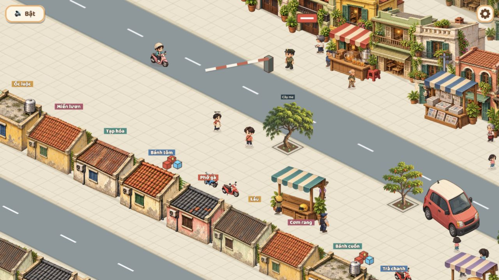

# Luồng 3 — đồng bộ toàn cảnh phố, đợt 15

Ngày 2026-10-29. T-102 Review, **chưa được người dùng duyệt**. Thay phạm vi hai quán mẫu ở đợt14 theo yêu cầu quay lại làm kỹ cả cảnh; không chờ duyệt mẫu rồi mới mở rộng nữa.

## Nguyên nhân và cách sửa

| Vấn đề | Đã sửa |
|---|---|
| Hai quán ảnh chen giữa dãy quán hình khối, khác vật liệu | Toàn bộ dãy phía nam dùng sáu biến thể ảnh cùng chuẩn; hình khối chỉ còn fallback khi ảnh không tải được |
| Các căn nhà thấp tách nhau rõ | Giảm khe giữa lô từ0,3 xuống0,12ô, giữ chung hàng chân nhà và bề sâu; bố trí chuỗi12 vị trí từ6 biến thể để không xen kẽ đúng hai mẫu |
| Nhà phía sau trông như chồng mái | Hai dãy sau lùi về y=-2,6/-7,2, chừa khoảng đường phục vụ, hạ cao độ nhà trang trí và giảm độ tương phản; giữ mặt tiền chính và khoảng ngõ |
| Màu trời lộ giữa chân các dãy nhà | Đưa nền trời ra sau lớp cuối, dùng nền đất/gạch thống nhất dưới các khối, có lối lát gạch giữa các lớp |
| Đại lộ nền quá rộng, khu phố tách thành các dải | Đổi thành một đường phố3ô rộng, thêm dãy nhà cùng bộ art ở phía đối diện; chung nguồn tọa độ đường/bó vỉa/hàng nhà |
| Sprite rời khỏi mặt đất | Thêm bóng tiếp đất mỏng dưới các khối nhà và hàng quán, bake một lần cùng ground |

Phía nam dùng mái ngói, mái tôn, mái bằng/bồn nước, tường vàng/kem/hồng, cửa chớp khác nhau. Hai dãy phía nam dùng cùng sáu mẫu, đổi thứ tự giữa hai dãy. Phía bắc giữ chín mẫu nhà hiện tại, cùng mặt tiền y=4,9; không thay model nhân vật hoặc quầy tương tác.

Đây là cảnh phố nhiều lớp trên đúng mặt phẳng isometric, không ghép một tranh background có đường phối cảnh khác, không lật gương nhà và không tạo một nền hồ. “Phố tiếp diễn” là vùng trang trí ngoài khu chơi, không có nghĩa mở thêm navigation/map vô hạn.

## File và giới hạn thay đổi

- Master mới: `art-src/slice/chapter1/south-shops-v2.png`, atlas2×2,1536×1024, alpha.
- Runtime mới: `public/assets/slice/chapter1/south-shops-v2.webp`, khoảng268KiB theo dung lượng đĩa. Dùng lại hai master/runtime mái ngói/tôn đợt14.
- Renderer: `incidentArt.ts`, `streetLayout.ts`, `chapter1Scenery.ts`, registry `sliceAssets.ts`.
- Không sửa terrain/nav/collider, tuyến xe/NPC, cứu hộ, UI hoặc góc nhìn camera trong lượt này. Các khối được thay ngoài lối đi hiện hành. Giữ mờ dãy gần khi che hero; dãy sau con đường nền nằm ngoài vùng đi lại.
- Không xóa atlas cũ vì vẫn còn được gọi, giữ nguồn và lịch sử đợt14.

## Kiểm tra trong game

Đã mở bản local5190 với camera chơi thật `?map=incident&close=1` ở PC1280×720, dọc390×844 và ngang844×390. Mở riêng `?map=incident&fit=1` để rà tổng bố cục/miệng ngõ/hai đầu phố; **ảnh fit không đại diện camera người chơi**. Không error console ở các lần đọc, trả viewport mặc định sau kiểm tra.

[Mobile dọc](../../screenshots/flow3-city-mobile.png) · [Mobile ngang](../../screenshots/flow3-city-landscape.png) · [Tổng bố cục](../../screenshots/flow3-city-overview.png)

Trên màn ngang, nhà tiền cảnh có thể bị khung hình cắt ở đáy vì nằm ngoài khu đi lại; ảnh không chứng minh mọi vị trí che khuất đều đúng. Đã rà nhìn bố cục toàn phố, chưa đi từng góc bằng hero hoặc kiểm mọi tư thế cứu hộ dưới mái. Nhà trong các dãy có cùng bộ art, nhưng các landmark như Ô Quan Chưởng vẫn dùng renderer hiện hành; không tuyên bố đã thay toàn bộ đồ họa của game.

## Cần người dùng duyệt lại

1. Toàn hai phía phố và các lớp nền đã đủ liền mạch, bớt cảm giác từng asset đặt rời chưa.
2. Biến thể nhà, khoảng cách, vật liệu và bóng chân nhà có hợp nhân vật/UI đang dùng.
3. Đi qua đầu/giữa/cuối phố, ngõ và hai barie: có mái che người hoặc điểm chân hình bị lệch không. Nếu có, gửi vị trí/ảnh để sửa đúng chỗ.
4. Độ đọc PC/mobile và độ mượt trên điện thoại thật sau thêm một atlas/hàng nền.

Chưa chạy unit/e2e/typecheck/build, chưa đo FPS/RAM thiết bị thật, chưa push/commit. Không đóng T-102 chỉ vì đã thay đủ dãy nhà.

## Công cụ và prompt nguồn

Dùng **imagegen tích hợp**, lấy hai master mái ngói/tôn đợt14 làm tham chiếu góc nhìn/phong cách. Bản tạo đầu chưa có gutter an toàn; đã sửa layout bằng công cụ imagegen, chọn bản đã đóng gói lại làm master của dự án. Xuất WebP bằng script có sẵn `zsh scripts/export-slice-webp.sh south-shops-v2`.

Prompt tạo bốn biến thể:

> Use case: stylized-concept. Asset type: 2 by 2 sprite atlas containing FOUR distinct single-storey Hanoi shop BACKS for an existing 2.5D isometric game. Reference images define the EXACT camera, footprint, ground orientation and painterly miniature material style. Keep the same rear-wall view, upper-left soft daylight, 2:1 orthographic ground axes (right/down +0.5, left/down -0.5), low wall height and approximate 2.3 by 1.6 rectangular footprint. Each of the FOUR equally sized cells contains ONE complete isolated building centered with at least 12 percent TRANSPARENT margin; no overlap across cells. Top-left: cream plaster, mossy terracotta tiled roof, dark green rear shutter, tiny wall AC. Top-right: muted mustard plaster, low flat parapet roof with a small cylindrical silver water tank at its far edge, blue wooden rear shutter. Bottom-left: faded rose plaster and brown timber rear wall, charcoal tiled shallow roof, restrained cream awning only at FAR side. Bottom-right: pale warm-gray plaster, weathered reddish corrugated roof, small blue rear shutter and discreet wall AC. Some far-side potted plants, no trailing plants beyond footprint. Match reference art detail and warm old-Hanoi palette, legible at phone size. Shopfront faces AWAY from viewer; we mainly see back wall, roof and right gable. No front-facing open counter. No text, labels, letters, logo, watermark, people, ground, pavement, platform, street, scene/background, cast-shadow plane or frame borders. Entire atlas genuinely transparent alpha. All buildings use same camera and similar scale, do not rotate/mirror any cell. Four different believable neighbors, not four recolors of one house.

Prompt chỉnh layout trước khi sử dụng:

> Precise atlas layout correction only. Preserve these exact four Hanoi buildings, camera, colors, details, transparency and their 2x2 cell order. Each building must be uniformly SHRUNK to 70 percent of its current size and centered in its own quarter of the canvas. Output same 3:2 canvas aspect ratio. Each equal cell must have very large genuinely transparent padding on all four sides, at least 15 percent of the cell height ABOVE and BELOW the complete object; adjacent rows must be separated by a wide empty transparent horizontal gutter. Top-row buildings may not touch or cross horizontal midline; bottom row buildings may not touch it either. No added ground, shadows, backgrounds, labels or cell borders. Preserve every wall base, roof corner, plant and water tank intact. This is sprite-sheet packing, not a change of artistic style or building geometry.

