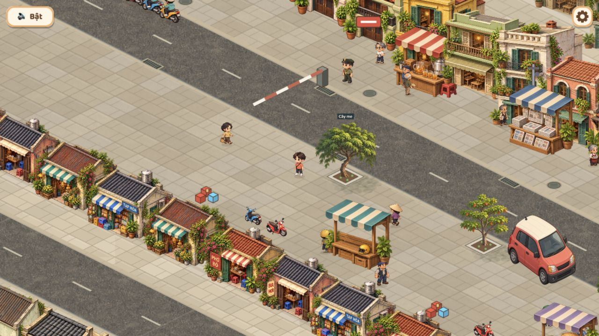

# Luồng 3 — bám ảnh tham chiếu người dùng, đợt 16

Cập nhật 2026-10-29: người dùng đã duyệt luồng3, T-102 Done. Bằng chứng/giới hạn bên dưới giữ nguyên theo lượt triển khai. Thay đánh giá mỹ thuật của đợt15 bằng ảnh mẫu mới của người dùng; không coi ảnh mẫu là bằng chứng bản game đã đạt chất lượng đó.

## Đối chiếu và thay đổi

- Ảnh mẫu có mặt tiền cửa hàng hướng ra phố, mái và vật liệu đa dạng; dãy gần trước đây chủ yếu là tường sau. Thay dãy gần bằng bốn mặt tiền PHỞ BÒ, TẠP HÓA, BIA HƠI và cửa xanh/mái che teal, bố trí chuỗi12 căn. Biển nằm trong ảnh vật thể, không thêm nhãn nổi trên mái. Giữ sáu mẫu tường sau ở phố nền.
- Đường cũ phẳng, vỉa hè quá sạch. Thêm một vật liệu nhựa đường vẽ từ trên xuống, chiếu đúng mặt phẳng2:1; dùng chung đường chính, vòng hai đầu và phố nền. Đổi đá lát sang màu ấm, biến thiên màu/mạch/sạn và lớp bụi nhẹ. Bổ sung nắp cống, rãnh thoát nước và vạch sơn ngả kem.
- Thêm bóng tán cây tĩnh để nối cây với mặt đất. Không thêm hiệu ứng chuyển động.
- Giữ UI kem/nâu, nhân vật, camera, navigation/collider, hoạt động NPC và cứu hộ của các luồng trước. Đây là thay mỹ thuật, chưa chỉnh lại kích thước đường/vỉa hè hoặc mở thêm vùng chơi.

Không ghép cả tranh mẫu vào map. Texture mặt đường được cắt theo các dải nhỏ tại khởi tạo và tái sử dụng, không dùng mask mỗi frame. Bản thử mask đã phủ sai lên vỉa hè và đã thay bằng clip canvas trước khi chụp các ảnh bên dưới. Không tạo texture khổng lồ bằng cả bản đồ.

## Asset và nguồn

- [Ảnh tham chiếu người dùng](reference-street-16.png).
- Master: `art-src/slice/chapter1/shopfronts-v1.png` (1536×1024, atlas2×2 alpha), `asphalt-v1.png` (1254×1254 opaque).
- Runtime: `public/assets/slice/chapter1/shopfronts-v1.webp` và `asphalt-v1.webp` (1024×1024). Xuất bằng script `scripts/export-slice-webp.sh`.
- Renderer: `streetMaterial.ts`, `streetPaving.ts`, `incidentArt.ts`, `chapter1Scenery.ts`; registry `sliceAssets.ts`.
- Công cụ tạo: imagegen tích hợp. Prompt lưu nguyên văn bên dưới; cụm “approved target” trong prompt chỉ mô tả ảnh đích gửi công cụ, **không phải người dùng đã duyệt bản triển khai**.

## Ảnh trong game

Local5191, camera chơi `?close=1`. Đã xem bằng trình duyệt ở PC1280×720, dọc390×844 và ngang844×390; đây là viewport giả lập, không phải điện thoại thật.

[Mobile dọc](../../screenshots/flow3-reference-mobile.png) · [Mobile ngang](../../screenshots/flow3-reference-landscape.png).

Chưa chạy suite/typecheck/build theo yêu cầu tự test của người dùng. Chưa đo FPS/RAM trên thiết bị thật, chưa kiểm từng góc che khuất hoặc cứu hộ sau thay art. Chưa commit/push.

## Phần còn phải duyệt

Đường và mặt tiền đã gần hướng tham chiếu hơn, nhưng chưa sao chép toàn cảnh: khoảng vỉa hè vẫn rộng theo map chơi hiện tại, chi tiết lề đường còn thưa; dãy nhà/quán còn lặp sau4/6/9 biến thể. Các landmark và vật thể hình khối cũ chưa được thay hết. Màn dọc vẫn cần người dùng kiểm độ nhận diện hero trên điện thoại thật. Không đóng luồng3 hoặc chuyển sang nghiệm thu Vertical Slice chỉ vì đã ghép asset.

## Prompt cửa hàng

> Use case: stylized-concept. Asset type: production sprite atlas for COG-CoffeeGame, 2 columns by 2 rows, FOUR distinct COMPLETE low single-storey Hanoi street SHOPFRONTS. Input image is the user's approved target LOOK, not an edit target; match its warm richly textured hand-painted street-game illustration, aged yellow plaster, muted terracotta/charcoal roofs, wooden shutters, striped cloth awnings, potted plants and believable Hanoi retail details. We need isolated buildings only, not a screenshot/scene. Each building is viewed from above in exact orthographic 2:1 isometric: long visible storefront wall extends right/down with slope +0.5; right side wall extends right/up with slope -0.5; no perspective convergence. Same low rectangular footprint as neighborhood shops (2.3 units along long facade, 1.6 deep), similar scale and upper-left sunlight for ALL cells. Ground-contact front corner at approximately 60 percent of each object's width. FOUR DIFFERENT SHOPS: top-left a mustard-yellow pho shop with a modest red vertical sign reading exactly 'PHỞ BÒ', green folding doors, small striped cream awning and plants; top-right a pale-cream grocery with a blue/cream canopy, shelves inside, crates close to its wall, sign 'TẠP HÓA'; bottom-left faded rose/ochre bia-hoi shop, charcoal tiled roof, open timber doors, cream awning, small sign 'BIA HƠI'; bottom-right warm-gray/yellow old house-shop with reddish corrugated roof, green shutters, cream/teal awning, flowers climbing close to wall, no text. Each roof complete, with slightly different height/profile, some small rooftop water-tank detail. Restained legible detail for mobile, real lived-in street feeling, not plastic 3D render, not thick cartoon outlines. Storefronts face the viewer as the foreground shops in the reference, no blank rear walls. CRITICAL PACKING: equal 2x2 cells with very generous transparent gutters; each object at most 65 percent of its cell height and 75 percent of its cell width, CENTERED; every roof/base/awning/plant fully inside its own cell with 15 percent empty margin above and below. Genuinely transparent alpha, no colored background. No pavement/base/platform, road, sky, people, parked vehicles, UI, labels outside the physical shop signs, watermarks or borders; keep merchandise and plants tight against walls so there is no large ground apron.

## Prompt nhựa đường

> A seamless tileable TOP-DOWN asphalt material texture for a hand-painted detailed Hanoi street game. Full-frame square swatch of warm neutral dark-gray aged asphalt, average midtone around #73716a, fine visible mineral aggregate and irregular mottled tar, subtle dusty brown road wear, a few extremely fine hairline cracks and repaired tar seams, gentle natural grain at several scales. Painterly realistic street-game illustration, matte, detailed enough to read on mobile, absolutely flat orthographic overhead view. Uniform diffuse daylight, no directional lighting gradient or vignette, no perspective, no isometric diamond. All four edges should tile seamlessly. No lane markings, stones/pavers/bricks, borders, gutters, manholes, leaves, objects, buildings, people, typography, labels, logos or watermark. Opaque material covers every pixel. Avoid large repeated rectangular patches, checkerboards, very high-contrast cracks, shiny wet roads or cartoon outlines.

