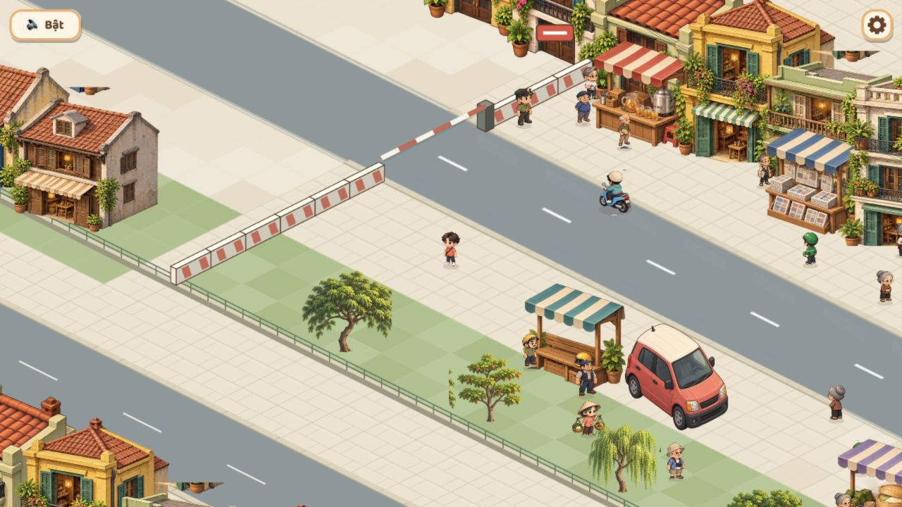

# Đoạn phố mẫu13 — 2026-10-29

Trạng thái Review. Phạm vi được người dùng chốt: giữ UI, nhân vật và nhà hiện tại; sửa một đoạn đường/vỉa hè và cách nối background. Không khôi phục đợt art12 đã hoàn tác.

## Đã sửa

- Bỏ background wallpaper lật cả X/Y, gỡ PNG district-background-v1.png cùng registry vì không còn sử dụng. Không tạo thêm tranh thành phố khác để dán bên dưới.
- Nền ngoài map dùng gạch cùng phép chiếu128×64 và màu vỉa hè của map. Chỉ pattern mặt đất đơn giản được lặp; nhà không bị lật.
- Phía dưới ranh vườn là vỉa hè, một tuyến phố song song và vỉa hè đối diện trước dãy nhà, tất cả cùng mặt đất. Dãy nhà dùng nguyên chín mẫu và scale hiện có, bố trí theo tuyến phố, không thay atlas nhân vật/nhà/cây/quầy.
- Cột0–14 ở đầu phố là đoạn thử gạch lát chữ nhật so le và bóvỉa có mặt đứng mỏng. Mặt nhựa đường chính vẽ liên tục để bỏ cảm giác ô cờ; đoạn0–14 có thêm mảng mòn nhẹ. Các đường xe/nav grid/collider/hội thoại và bỏkéo map giữ nguyên.
- Đường/gạch/bóvỉa được vẽ bằng code theo lưới rồi bake thành texture một lần khi dựng cảnh. Không phải một bộ PNG nền mới từ imagegen. Pattern nền512×256 dùng chung, TileSprite chỉ bằng viewport, listener được dọn khi scene shutdown.

## Đối chiếu thực tế

Đã mở localhost5180 và xem tổng cảnh ở viewportPC1280×720 vàmobile390×844 bằng trình duyệt in-app. Đã trả kích thước mặc định sau khi xem. Đây là kiểm tra thị giác bằng trình duyệt, không phải điện thoại thật hoặc bài kiểm tra tự động.

[Ảnh mobile390×844](../../screenshots/street-sample-mobile-390.jpg).

Không còn ảnh mái nhà lộn ngược ở mép map. Mặt đất và tuyến đường đối diện nối theo cùng phép chiếu. UI/người/cây/nhà vẫn dùng art trước đợt này. Hero còn nhỏ ở camera mobile hiện có; một số frame nhà cũ vẫn có mảnh chi tiết/điểm gắn chưa sạch. Chúng không được coi là đã sửa hoặc nghiệmthu trong đợt mẫu này.

Chưa chạy unit/e2e/typecheck/build, chưa push. Không có số đo FPS/bộnhớ sau thay đổi; không khẳng định Vertical Slice đã hoàn tất. Bản sao trước sửa của ba file render và PNG nền nằm trong /tmp/cog-street-sample-e6lY38 để thuận tiện hoàn tác trong phiên hiện tại; /tmp không phải bản lưu lâu dài.
