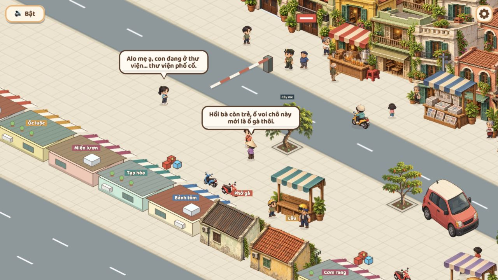

# Luồng 3 — mẫu quán phía nam, đợt 14

> Lịch sử: người dùng chưa duyệt đợt này; đã yêu cầu làm toàn cảnh ở [đợt15](STREET_COHESION_15.md). Phạm vi hai quán và bước chờ duyệt mẫu dưới đây đã được thay thế.

Ngày 2026-10-29. Theo dõi ở T-102 trong [task list](../../task-list/TASK_LIST.md). Đây là **mẫu chờ duyệt**, chưa đồng bộ toàn màn và chưa đóng luồng 3.

## Phạm vi đã làm

Hai quán phía nam, gần cột 8 và 10,6, thay hình khối đơn giản bằng ảnh nhìn từ phía sau. Một quán mái tôn, một quán mái ngói; cùng màu vật liệu và ánh sáng với `houses-v2.png` đang dùng ở phía bắc. Không dùng lại mặt tiền hướng camera cho mặt sau quán.

Giữ footprint trang trí 2,3 × 1,6 ô, hàng y=17,05; không thay map, collision, lối đi, NPC, quầy tương tác, UI hoặc luật chơi. Các quán khác vẫn vẽ như trước để đối chiếu. Khi thiếu texture, dùng quán cũ làm fallback.

Ghép theo cùng phép chiếu 2:1. Ảnh co đồng tỷ lệ theo chiều rộng footprint, không kéo dãn riêng chiều cao; điểm neo góc tiếp đất `(0.59, 0.99)`, depth theo footprint như hàng cũ. Vùng kiểm mờ khi che hero lấy bounds thật của sprite mới. Nhãn quán dùng UI hiện có và đặt phía trên ảnh, không in chữ vào asset. Chưa xác nhận bằng thao tác hero đi sau mọi cạnh ảnh mới.

Vỉa hè trong/ngoài map hiện đã dùng chung `streetPaver`, bó vỉa/vạch đường theo lưới; nền phía nam vẫn là đường tiếp diễn, không thêm wallpaper ảnh hoặc hồ. Giữ góc nhìn camera hiện tại, không thêm nút zoom hoặc kéo map. Chưa thay cả bộ mặt đường/nền và không coi việc xem ảnh là đủ nghiệm thu mép map/ngõ/hai đầu phố.

## File

| Vai trò | File |
|---|---|
| Master mái ngói | `art-src/slice/chapter1/south-shop-tile-v1.png` |
| Master mái tôn | `art-src/slice/chapter1/south-shop-tin-v1.png` |
| Runtime | `public/assets/slice/chapter1/south-shop-{tile,tin}-v1.webp` |
| Registry và ghép | `src/components/render/sliceAssets.ts`, `incidentArt.ts` |

Master giữ alpha trong workspace. Hai WebP 768×512 xuất bằng script có sẵn `scripts/export-slice-webp.sh south-shop-tile-v1 south-shop-tin-v1`, khoảng 104 KiB/file theo dung lượng đĩa; chưa phải số đo GPU/RAM. Chỉ nạp một lần theo registry.

## Xem trong game

Mở bản local cổng 5190 với `?map=incident&close=1`, không dùng toàn-map làm bằng chứng camera chơi. Xem PC 1280×720, dọc 390×844, ngang 844×390. Console không error tại các lần đọc; đã trả viewport mặc định. Không chạy unit/e2e/typecheck/build hoặc kiểm điện thoại thật.

[Mobile dọc](../../screenshots/flow3-sample-mobile.png) · [Mobile ngang](../../screenshots/flow3-sample-landscape.png)

Màn ngang cắt một phần quán tiền cảnh; đây là điểm còn cần cân khung khi hoàn thiện camera, không đánh dấu đã qua. Mẫu chỉ cho thấy hai vật liệu mới gần bộ nhà phía bắc hơn. Chưa kiểm mọi mức che khuất, rescue dưới mái, đường ngoài rìa hoặc hiệu năng sau nạp hai ảnh mới.

## Sau khi duyệt mẫu

1. Chốt vật liệu, tỷ lệ so với hero và hướng nhìn mặt sau. Nếu cần chỉnh, chỉnh hai mẫu trước.
2. Làm thêm biến thể theo cùng chuẩn và mở rộng dãy phía nam, tránh lặp một ảnh cả phố.
3. Rà nền tiếp diễn và các góc/miệng ngõ/hai đầu phố ở camera thật; xử lý khoảng trống hoặc mối nối còn lộ.
4. Duyệt camera PC/dọc/ngang cùng che khuất và lối đi. Giữ yêu cầu nhìn xa; không tự đưa thêm điều khiển zoom/kéo map.
5. Chỉ đóng T-102 khi toàn cảnh được duyệt. Chưa triển khai art cho chương 2.

## Nguồn tạo và prompt

Dùng công cụ **imagegen tích hợp**, không CLI/API ngoài. Tham chiếu phong cách là master `houses-v2.png` đã xem; tạo mẫu đầu, sau đó tạo biến thể từ ảnh mẫu đầu. Giữ cả hai master trong workspace, không sửa đè asset cũ.

Prompt mái ngói:

> Use case: stylized-concept. Asset type: one transparent 2.5D isometric Hanoi low shop building sprite for COG-CoffeeGame. Reference image is STYLE reference only: match its warm hand-painted miniature materials, muted yellow aged plaster, terracotta roof, soft upper-left daylight and green wood shutters, without changing the reference. Create ONE single-storey rectangular small Hanoi neighborhood shop, viewed from ABOVE ITS BACK and right-hand gable, with a broad weathered tiled roof and low rear plaster wall, a small rear shutter and discreet wall AC. The storefront and a narrow muted cream/teal fabric awning are on the FAR side, facing away from the viewer; do not show an open front counter facing the viewer. Orthographic 2:1 isometric ground axes: right/down slope +0.5, left/down slope -0.5; no perspective vanishing point. Building footprint about 2.3 units along right/down axis, 1.6 along left/down axis; wall height low, roof dominates silhouette. Object complete with 10 percent transparent margin, centered, isolated on genuinely transparent alpha. No street, pavement/base/platform, other buildings, people, sky, lettering, sign text, logo or watermark. Restrained readable detail to match the existing reference houses at phone size, no thick cartoon outlines. This is the south-side BACK of a shop that must not block the player's view across the street. Keep ground-contact corners clearly visible, no cast shadow extending outside the footprint.

Prompt mái tôn:

> Use case: precise-object-edit. Create a sibling variant of this isolated Hanoi shop sprite for an adjacent building in the same 2.5D game. Preserve exactly its orthographic 2:1 ground axes, overall footprint silhouette, camera, low single-storey scale, soft upper-left daylight, painterly miniature style, alpha transparency and full-object framing. Change the yellow rear plaster to muted sage/cream weathered plaster, the terracotta pitched roof to a modest shallow pitched charcoal/earth-brown corrugated metal roof, rear window to a simple dark wooden shutter, and far-side awning to muted cream/ochre stripes. Retain the back-facing building view, discreet small AC and a few plants on the far-side edge. No text, signs, people, base, ground, street, shadow plane, background or extra building. Genuinely transparent background. This is a variation of the same small Hanoi shop, not a taller building or a new scene.
