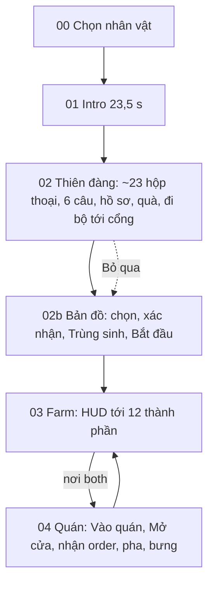
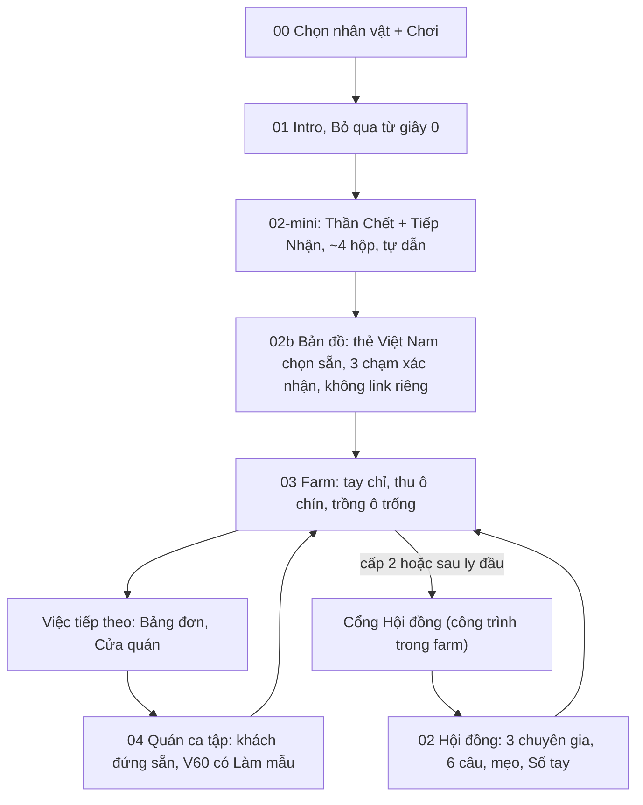

# Review toàn bộ luồng chơi theo GDD — hướng mobile-first kiểu Hay Day (05/11/2026)

| | |
|---|---|
| Loại | Báo cáo review (skill `/review-all-gdds`: pha Holism + Kịch bản xuyên hệ; cộng thiết kế lại luồng màn) |
| Người chạy | Quang, qua Claude Code (agent game-designer + ux-designer) |
| Đầu vào | [Ý tưởng mobile-first](../ideas/2026-11-05-mobile-first-don-gian-hoa.md) (có bảng Hay Day đã đối chiếu), GDD v2.2, `game-flow.md`, `onboarding-flow.md`, `progression.md`, `crew-autoplay.md`, tài liệu màn 00–04, `content.js`, `game.js` |
| Kết luận | **CONCERNS** — hướng đi đúng; 3 điểm BLOCKING phải giải trước khi chuyển ý tưởng sang `Đã chốt` |
| Giới hạn | Chỉ đọc tài liệu và code. **Chưa chạy sim, test, game hay playtest.** Mọi mốc thời gian, số thao tác là ước tính. Pha "Consistency" (2a–2f) của skill chưa chạy đầy đủ; chỉ ghi các lệch thấy được trong lúc đọc |

Báo cáo này **không phải luật**. Không triển khai vào code khi ý tưởng chưa `Đã chốt` và chưa có F-xx trong GDD (AGENTS.md).

---

## 1. Tóm tắt cho sếp

1. **Đổi luồng mở đầu** (phương án B): trước farm chỉ còn *thiên đàng mini* (Thần Chết + Thần Tiếp Nhận, khoảng 4 hộp thoại, tự dẫn). Ba chuyên gia + 6 câu hỏi chuyển thành **Cổng Hội đồng** — một công trình trong farm, mở ở cấp 2 hoặc sau ly đầu. Bản đồ thế giới vẫn chọn một lần trước farm, có thẻ "Bắt đầu ở Việt Nam" chọn sẵn.
2. **Farm kiểu Hay Day:** chức năng thành **công trình chạm được** (Cửa quán, Bảng đơn, Sạp ven đường, Nhà thợ, Xưởng nâng cấp, Cổng Hội đồng). HUD chỉ còn avatar/cấp, Việc tiếp theo, xu, Kho, nút ngữ cảnh, ≡.
3. **Một trục tiến trình chính: Cấp.** Cấp là cổng duy nhất mở tính năng và nội dung; xu chỉ mua thứ đã mở; uy tín chỉ còn là sức khoẻ quán; Awakening là nhánh song song theo sự kiện.
4. **Quán: học qua khách đầu tiên.** Ca 1 quán tự mở, khách đứng sẵn, V60 ly đầu có "Làm mẫu" miễn phí.
5. **Ba việc BLOCKING:** (a) chốt trục Cấp và tính lại XP khi thu cả ruộng; (b) không hỏi lại câu thiên đàng trong lúc tutorial; (c) không đặt "tự chế biến" làm mặc định từ đầu (để làm phần thưởng ở cấp 7).

---

## 2. Luồng màn: hiện tại → đề xuất

### 2.1 Hiện tại



Ước tính tới farm khoảng 3 phút (intro 23,5 s + thiên đàng ≤ 150 s + bản đồ < 30 s; GDD §4.2). Mục tiêu "chạm đầu ≤ 60 s" **không đạt** nếu thiên đàng đầy đủ còn đứng trước farm.

### 2.2 Đề xuất (phương án B)



Ước tính tới chạm đầu: khoảng 55–65 s (chưa đo). Để chắc ≤ 60 s cần rút intro hoặc làm nút Bỏ qua nổi bật hơn.

| Phương án thiên đàng | Mô tả | Đánh giá |
|---|---|---|
| A. Giữ thứ tự, rút ngắn | 1 chuyên gia + 2 câu, bản đồ chọn sẵn | Ít đụng luật; ước tính vẫn > 85 s |
| **B. Mini + Cổng Hội đồng (khuyến nghị)** | Như sơ đồ trên | Giữ thiên đàng, bản đồ, mẹo; giữ luật "chọn vùng xong không đổi". Phải xử lý chỗ chọn quà (`startingGift`) |
| C. Farm-first hoàn toàn | Bản đồ dời sau | Phá `region`, nhiệm vụ vùng. Không khuyến nghị |

Quà ở phương án B (cần chọn): (i) mặc định Túi hạt giống, Hội đồng tặng thêm quà sau; hoặc (ii) giữ chọn quà 3 thẻ trong 02-mini.

### 2.3 Từng màn

| Màn | Hiện tại → đề xuất | Đụng luật |
|---|---|---|
| 00 Chọn nhân vật | Giữ; nút Chơi lớn 48 px | Không |
| 01 Intro | Giữ; Bỏ qua từ giây 0 (đã có); cân nhắc bản ≤ 15 s sau khi đo tỉ lệ Bỏ qua | Không |
| 02 Thiên đàng | Tách: 02-mini trước farm; 3 chuyên gia + 6 câu thành Cổng Hội đồng trong farm, vào từ farm và ra về farm | ⚠ `onboarding-flow.md:3` "thiên đàng là bài học"; `game-flow.md` "đường một chiều" |
| 02b Bản đồ | Thẻ Việt Nam chọn sẵn, **vẫn cho chọn vùng khác, vẫn ẩn loại nơi tới khi chốt** | ⚠ nhẹ, `02b-world-map/README.md:17,34` |
| 03 Farm | Vào thẳng, tay chỉ; HUD 12 → 3–5 nút + công trình | ⚠ nếu Gieo cả ruộng |
| 04 Quán | Cửa quán là công trình; ca 1 tự mở, khách đứng sẵn; nút Mở/Đóng từ ca 2 | ⚠ thẻ 4 bước quán ở `onboarding-flow.md:164-171` |

---

## 3. Bản đồ farm kiểu Hay Day

| Công trình | Thay cho | Chạm thì | Mở khi (đề xuất) |
|---|---|---|---|
| Cửa quán | Nút ☕ Vào quán | Nhân vật đi tới cửa, vào quán | Sau lần thu/trồng đầu |
| Bảng đơn (chấm số) | Nút 📦 Đơn hàng | Modal giữa màn danh sách đơn | Cấp 4 |
| Sạp ven đường | Nút 🏪 Cửa hàng, chip xu mở shop | Modal Cửa hàng; chip xu thôi mở shop | Cấp 2 |
| Nhà thợ | Nút Nhân viên + Chỉ thị | Modal Nhân viên | Cấp 4 |
| Xưởng nâng cấp | Nút 🔧 Nâng cấp | Modal Nâng cấp | Cấp 2 |
| Cổng Hội đồng | Phần dời của thiên đàng | Hội thoại đáy màn, 3 chuyên gia, Sổ tay mẹo | Cấp 2 / sau ly đầu |
| Sân phơi, lò rang, máy xay, biển ruộng | Đã là công trình | Giữ nguyên (mua ruộng qua biển theo luật AGENTS) | Như hiện tại |
| Kho | Nút 🎒 | **Giữ nút HUD**, không dựng công trình trùng | Luôn có |

Mọi modal vẫn là **modal giữa màn, có nút đóng, khoá di chuyển**, Auto vẫn chạy phía sau. Dải giống vẫn ở dưới màn, không làm tối map.

```
 -20 (trái)                                              +11 (phải)
 ┌───────────────────────────────────────────────────────────────┐ z -19
 │ [Cổng Hội đồng]        (Ao + hàng rào)                         │
 │  ┌─Ruộng 3──┐ ┌─Ruộng 4──┐                       [Lò rang]     │
 │  └──────────┘ └──────────┘                                     │
 │        ═════ hành lang (z ≈ -8) ═════                          │
 │ (Giếng)                 [Nhà thợ]     [Xưởng nâng cấp]        │
 │  ┌─Ruộng 1──┐ ┌─Ruộng 2──┐   [Sân phơi]       [Máy xay]       │
 │  └──────────┘ └──────────┘            ╔═[Bảng đơn]═[CỬA QUÁN]═╗│
 │                                       ╚═══════════════════════╝│
 │                                                [Sạp ven đường] │
 └──────────────────────┬─────────────────────────────────────────┘ z +4
                        ⌂ CỔNG TRƯỚC (nhân vật xuất phát)
```

Sơ đồ chỉ là phác thảo, không theo tỉ lệ. Toạ độ trong `03-farm/gameplay.md` có nhiều đoạn sửa chồng nhau; phải đối chiếu `content.js`/`environment.js` và kiểm tra vừa màn 375×812 trước khi chốt. Nguyên tắc: cụm "thương mại" (sạp, bảng đơn, cửa quán) gần cổng trước để thấy ngay; cụm "việc nặng" (lò rang, giếng, ao) phía sau.

---

## 4. Trục tiến trình: Cấp

- **Cấp** là trục chính, hiện ở góc trên trái, là cổng duy nhất mở tính năng và nội dung (như Hay Day).
- **Xu** chỉ mua thứ đã mở; không mua được XP (`progression.md:11`).
- **Uy tín** chỉ là sức khoẻ quán, ảnh hưởng nhịp khách; ⚠ thôi mở món (đụng `04-cafe/gameplay.md:34-41`).
- **★ món** giữ là độ thành thạo từng món.
- **Awakening** song song, mở theo sự kiện, không gate theo cấp (đúng PDF và `decode-awaken.md:105`).

Bảng mở khoá đề xuất (mỗi cấp tối đa khoảng 2 thứ mới; ngưỡng XP và mốc phút **cần sim**):

| Cấp | Mở | Ghi chú |
|---|---|---|
| 1 | Ruộng 1, cây vối, Thu cả ruộng; quán: V60 (P0), Phin đen, Sữa đá; Kho; Việc tiếp theo; Memory/Quick Taste (P0) | Ép 4 bước tutorial |
| 2 | Phơi/rang tay, Sạp + Chợ, cây chè + quà giống, Xưởng nâng cấp, Cổng Hội đồng | |
| 3 | Mua ruộng 2, Chăm cả ruộng, Pha nhanh, Auto | ⚠ ruộng cần đủ cấp (`GDD:322`) |
| 4 | Thợ farm slot 1 + robot, Bảng đơn 3D, chế độ ruộng bón/tỉa | Chỉ mở chế độ ruộng khi D-27 đã chốt |
| 5 | Ruộng 3, cây mít, nhân viên quán slot 1, chọn sữa/nước | ⚠ mít từ cấp 3 sang 5 |
| 6 | Mốc ca Đồng/Bạc/Vàng, Bạc xỉu, Phin mít, Đầu ra ruộng | ⚠ món mở theo cấp |
| 7 | Ruộng 4, **Tự chế biến/tự nhận** (phần thưởng), Mương tưới | ⚠ `rules.md:94,98` |
| 8 | Trang trí, máy espresso (Espresso, Americano), hỏi lại mẹo qua Sổ tay | |
| 9 | Slot 2 farm và quán, vòi sữa (Cappuccino, Latte), sự cố nhân viên | ⚠ `rules.md:49` |
| 10 | Matcha, Matcha Latte; Đặt giá (chỉ khi D-28 đã chốt) | |
| 11–12 | Máy đánh trứng (Cà phê trứng, Cà phê muối), Dirty, slot 3 | |
| 13+ | Tự động quán (kiosk, robot espresso), Victory (F-36) | Giống mới chỉ khi F-22 được chốt |
| Theo sự kiện | Sổ tay Decode khi câu đầu "Sẵn sàng giải mã"; Key of Curiosity | Không gate theo cấp |

---

## 5. Phát hiện

| # | Mức | Phát hiện | Bằng chứng | Hướng xử lý |
|---|---|---|---|---|
| 1 | **BLOCKING** | Không có trục mở khoá chính; cấp hết nội dung sau khoảng giờ đầu | `progression.md:15-19`; giống mở cấp 1/2/3 (`content.js:5-7`); món mở theo uy tín 40–65 và uy tín chạm 100 trong khoảng 1 giờ (`GDD:609`) | Trục Cấp, bảng mục 4 |
| 2 | **BLOCKING** | Thu cả ruộng làm cấp nhảy vọt: 12 cây × 6 XP = 72 XP, gần tới cấp 3 (ngưỡng 30/90, `content.js:9`) | `GDD:487`, `progression.md:29` | XP tính theo lượt ruộng; không cho XP khi máy tự nhận; sim lại |
| 3 | **BLOCKING** | Hỏi lại câu thiên đàng bật ngay sau lần hái tay đầu, khoá di chuyển, trùng bước ép tutorial | `game.js:940` gọi `offerLesson(['ripe'])` | Không hỏi lại trước bước "Thả" của tutorial |
| 4 | CONCERN (nặng) | Giá p 0,8 thắng mọi cấu hình; chỉ "ẩn tới sau 1 giờ" thì lỗi vẫn còn | `GDD:618`, D-28 | Chốt D-28 trước khi mở Đặt giá |
| 5 | CONCERN | Kế hoạch ruộng có lựa chọn giả: chế độ Năng suất (bón) luôn nhỉnh hơn (D-27); Đầu ra Quán không có lý do kinh tế vì chợ chiếm 76–85% thu nhập | `GDD:555,596,616` | Bảng đơn kiểu xe tải có yêu cầu (giống, chất lượng, hạn) làm nguồn xu chính; sim |
| 6 | CONCERN | Tự chế biến mặc định bỏ móc "quay lại nhận mẻ" và che chuỗi phơi → rang; Hay Day cũng bắt nhận tay (kiến thức chung, chưa đối chiếu nguồn) | `rules.md:94,98`, `GDD:354` | Phơi/rang tay đầu game; tự chế biến là phần thưởng cấp 7 |
| 7 | CONCERN | Ngân sách chú ý vượt 4 hệ chủ động: phút 3 khoảng 6–7, phút 15 ≥ 12 (đề xuất cũ giảm còn 4 và 6–7) | Bảng 5.1 | Rải mốc theo cấp, tối đa 2 thứ mới mỗi cấp |
| 8 | CONCERN | Trụ cột 3 "Hai màn phụ thuộc" yếu thêm nếu tự gửi hạt chạy ngầm | `GDD:211` | Xe giao hạt 3D có hình + tiếng |
| 9 | CONCERN | Ly do Auto pha nhận ★ nếu bạn chưa tự pha món đó → trượt cổng thưởng ca ★★ | `crew-autoplay.md:75`, `GDD:416` | Mở Auto sau tutorial và sau khi tự pha ≥ 2 món đạt ≥ 70 điểm |
| 10 | CONCERN | Auto chưa biết Kế hoạch ruộng / Đầu ra | `crew-autoplay.md:71,73` | Viết lại `crew-autoplay` §5 |
| 11 | CONCERN | Robot tưới/làm cỏ thành thừa khi có Chăm + Mương tưới | `crew-autoplay.md:9` | Robot: Chăm / Chế biến / Giao; Mương và robot phải có đánh đổi |
| 12 | CONCERN | Tự gửi hạt đụng luật "đơn chỉ sinh khi có thợ" và "nhiệm vụ chỉ tính thao tác người chơi" | `GDD:379,493`; `content.js:81,93` | Luật rõ: chuyến theo kế hoạch người chơi tính `delivered`; nút "Gọi hạt" không cần thợ |
| 13 | CONCERN | Làm mẫu miễn phí ở ly đầu: ly `demo` không tính thành thạo, nhưng First Sixth Key cần "V60 ★★ lần đầu". Quick Taste "1 chạm" khác spec 6 thuộc tính ~30 s | `04-cafe/gameplay.md:118`, `decode-awaken.md:92`, `coffee-memory.md:48` | Làm mẫu ly đầu = tự pha có gợi ý (trần 80%), không cờ `demo`; "1 chạm" chỉ là lối vào |
| 14 | CONCERN | Thao tác hàng loạt làm tiền vào nhanh hơn → sink cuối game cạn sớm | EC-5, `GDD:775` | Sim; chốt đề xuất sink song song |
| 15 | ADVISORY | GDD tự mâu thuẫn: bù vắng mặt 4 giờ (§2, `:210`) vs 8 giờ (§6.2, `:343`); "ly đầu trước phút 2" vs "≤ 5 phút tổng"; `:340`, `:488`, §1.5 còn ghi "chưa code" dù 0.3 ghi Đã code; `:237` "tên tự đặt" trái F-01 | GDD | Sửa khi review GDD (cần người quyết số đúng) |
| 16 | ADVISORY | Mẫu "tự pha ly đầu rồi Pha nhanh" lời nhất — chấp nhận được | `GDD:580-585` | Giữ; Key of Curiosity cần ≥ 3 ly V60 tự pha |
| 17 | ADVISORY | Thuê 1 barista làm quán lỗ hơn 0 barista | `GDD:595,603` | Tách cấp mở barista; báo trước đánh đổi |
| 18 | ADVISORY | Fantasy "chủ đế chế" vs "quản lý vườn" | `GDD:163`, `progression.md:44` | Bậc thang: Người trùng sinh → chủ vườn + quán → đế chế |

### 5.1 Ngân sách chú ý (hệ đang ra quyết định cùng lúc)

| Thời điểm | Hiện tại | Đề xuất | Ghi chú |
|---|---|---|---|
| Phút 3 | 6–7 | 4 (khi đã hoãn hỏi lại, #3) | Đề xuất đạt ngưỡng |
| Phút 15 | ≥ 12 | 6–7 | Cả hai vượt 4 |
| Giờ thứ 2 | ≥ 10 | Gần như bằng | Hay Day nhiều công trình nhưng chung một động tác (xếp mẻ, nhận); Godbean nhiều kiểu động tác |

Mục tiêu: tối đa 4 việc ra quyết định cùng lúc — ruộng, ca quán, bảng đơn, sổ khám phá; phần còn lại dần tự động.

---

## 6. Kịch bản xuyên hệ

1. **Người mới, phút 0–5.** Tới farm mất khoảng 3 phút → còn chưa tới 2 phút cho thu và ly V60 9 bước. Gãy ở #3 (hỏi lại `ripe`), #13 (cờ `demo`), #2 (nhảy cấp lần thu đầu).
2. **Quay lại sau 4 giờ.** Cây chín nhưng thiếu nước, cỏ mọc; thợ không làm khi vắng (`GDD:450`). Thu/Chăm cả ruộng hợp đúng lúc này. Gãy: bán dồn làm giá chợ chạm sàn 30% ngay (`GDD:552`); chưa có luật tự chế biến khi vắng. Hướng sửa: bảng đơn nhiều đơn, làm mới theo thời gian, hấp thụ hàng dồn.
3. **Mua ruộng 2 và thuê thợ.** Mở cùng lúc Nhân viên, dải công cụ, gói thử robot, bảng đơn, cảm xúc thợ. Ô "Thợ phụ trách" của Kế hoạch ruộng trùng luật chia vùng (`crew-autoplay.md:39`) → cần luật ưu tiên.
4. **Auto chạy khi mở modal.** Giữ luật chạy phía sau. Gãy: #9, #10, và Auto làm hộ nhiệm vụ tutorial.
5. **Ca quán thiếu hạt.** Kho đầu 600 g vối + 300 g chè (`model.js:186`), V60 cần hạt chè mà cây chè mở cấp 2; gọi hạt cần thợ; nhập ngoài 75 xu. Hướng sửa: cảnh báo khi kho quán còn khoảng N ly (N cần sim), nút "Gọi hạt" không cần thợ, Đầu ra ghi rõ giống.

---

## 7. Danh sách sửa tài liệu khi duyệt (⚠ = đụng luật đã chốt)

| File / mục GDD | Sửa | |
|---|---|---|
| `docs/game-flow.md` | Sơ đồ + bảng điều kiện: 02-mini, Cổng Hội đồng trong farm, Cửa quán là công trình; bỏ câu "sau cổng không còn đường quay lại" | ⚠ |
| `docs/shared/onboarding-flow.md` | Dòng 3/13, mục 2, 3.1, 3.3 (`HUD_UNLOCKS` → theo cấp), 3.5 (thêm "Trồng ô quà"), mục 8, checklist mục 9; ép 4 bước; hoãn hỏi lại | ⚠ |
| `docs/screens/00-selection/README.md` | Nút Chơi lớn | |
| `docs/screens/01-intro/README.md` | Thời lượng nếu rút | |
| `docs/screens/02-heaven/README.md`, `gameplay.md` | Tách mini / Hội đồng; quà | ⚠ |
| `docs/screens/02b-world-map/README.md` | Thẻ chọn nhanh Việt Nam | ⚠ nhẹ |
| `docs/screens/03-farm/README.md`, `gameplay.md`, `rules.md` | Bảng công trình, thao tác theo ruộng, mở khoá theo cấp, chế biến tay → tự ở cấp 7 | ⚠ |
| `docs/screens/04-cafe/README.md`, `gameplay.md` | Vào từ Cửa quán; ca tập khách đứng sẵn; Làm mẫu ly đầu không cờ `demo`; món mở theo cấp | ⚠ |
| `docs/shared/crew-autoplay.md` | §5 Auto gọi thao tác ruộng, tôn trọng Đầu ra; mốc mở Auto; vai robot | ⚠ |
| `docs/shared/progression.md` | Trục Cấp chính; uy tín chỉ là sức khoẻ quán | ⚠ |
| `docs/shared/design-system.md` | §5 "tối đa 4 nút", §6 thanh dưới; thêm chip bám công trình | |
| `docs/shared/contracts.md` | `fieldPlans` (tuỳ chọn); `startingGift` nếu dời quà | ⚠ |
| GDD §0.3 | Thêm F-44 "Quản lý theo ruộng"; ghi chú F-06/07/10/16/19/41/42 | |
| GDD §2, §3.2 | Sửa lệch 4h/8h, mốc ly đầu, tên nhân vật (#15) | |
| GDD §4.1–4.3 | Sơ đồ luồng, bảng màn, zoom/joystick | ⚠ |
| GDD §5–6 | Chăm cả ruộng, ruộng cần cấp, chế biến, bảng đơn | ⚠ |
| GDD §7.4, 7.6, A.4 | Làm mẫu ly đầu; món mở theo cấp | ⚠ |
| GDD §8 | Kế hoạch ruộng thay chỉ thị; vai robot; lịch sự cố theo cấp | ⚠ |
| GDD §9 | XP theo lượt ruộng; bảng mở khoá; nhiệm vụ 8–9; ép bước | ⚠ |
| GDD §10.5 | Hồ sơ sim "quản lý ruộng"; chốt D-27, D-28 trước | |
| GDD §11.1 | Thanh 5 nút; xu không mở shop | |
| GDD §15 | Thêm câu hỏi mở và rủi ro | |
| `AGENTS.md` | Chỉ khi chọn Gieo cả ruộng | ⚠ |

---

## 7b. Bài học Hay Day từ bài viết người dùng gửi (05/11) — đối chiếu với Godbean

Nguồn: bài viết tiếng Việt người dùng dán vào phiên làm việc (không có link). Đây là **nguồn thứ cấp**: các con số kỹ thuật trong bài (chạy với 1 GB RAM, UI vector, animation không 60 fps) **chưa xác minh**, chỉ dùng làm định hướng, không dùng làm số đích.

| Bài học | Godbean hiện tại (đã đọc code) | Việc nên làm |
|---|---|---|
| **"Kill early, kill often"**: ra MVP sớm, thử với người chơi, bỏ nhanh ý tưởng không giữ chân | GDD 0.3 có 43 tính năng, 35 đã code; chỉ luồng người mới được playtest (03–04/11) | Coi lát 1–2 (mục 8) là MVP mobile; mỗi lát có playtest ngắn trên điện thoại thật, đo chạm đầu / ly đầu / tỉ lệ bỏ. Tính năng không có người dùng (sau khi có F-38 analytics) đưa vào danh sách **ẩn hoặc bỏ** — đúng tinh thần bảng cắt giảm ở ý tưởng mobile-first |
| **Thao tác trực giác, không cần hướng dẫn dài**: vuốt để gieo, kéo thức ăn tới chuồng, chạm để thu | Đã có kéo từ dải giống/công cụ qua nhiều ô (`src/features/farm/ui.js:82-105`, giới hạn `dragLimit` ở `game.js:636`); kéo thẻ nhân viên (`ui.js:566`). Thu vẫn cần chạm từng cây hoặc mở công cụ; chăm sóc qua nút/công cụ | (1) Chạm cây chín = thu ngay, không mở menu. (2) Kéo hạt từ dải giống quét qua ô (đã có) — làm thành **bài học đầu tiên** bằng bàn tay chỉ thay vì chữ. (3) Kéo bao hạt từ kho tới Cửa quán/Bảng đơn = gửi hàng. (4) Kéo bình tưới quét cả luống. Mục tiêu: mỗi bước tutorial dạy **một cử chỉ**, ít chữ |
| **Load theo khu vực, giải phóng sau khi dùng** | Quán được tạo lần đầu rồi **giữ trong bộ nhớ** để vào lại nhanh (`cafeKept`, `src/features/farm/game.js:882-895`); chỉ `dispose` khi mở quán lỗi. Thiên đàng/bản đồ có `dispose` riêng | Đo bộ nhớ trên máy yếu trước khi quyết: giữ quán (vào nhanh) hay giải phóng khi ở farm lâu (ít RAM). Đề xuất: giữ như cũ, thêm ngưỡng — ở farm quá N phút hoặc máy ít RAM thì giải phóng quán. Cần `/perf-profile` |
| **Đồ hoạ nhẹ** | Renderer bật bóng PCF (`src/app/game.js:219`), tắt khử răng cưa trên màn cảm ứng mật độ cao (`:217-218`); có bậc chất lượng chỉnh pixel ratio và bóng (`src/shared/vfx/index.js:23-26`) | Mặc định bậc thấp trên điện thoại; kiểm tra số draw call, nhân vật/cây dùng chung geometry; animation cây/khách giảm tần suất khi xa camera. Cần đo FPS trên máy thật (GDD 0.1: "chưa đo hiệu năng") |
| **Offline-first** | Save cục bộ một khoá `godbean-progress`; cây lớn khi vắng tối đa 8 giờ (`OFFLINE_MS`, `src/features/farm/rules.js:7`) | Đã đúng hướng. Nhân tiện: code là 8 giờ → GDD §2 ghi "bù tối đa 4 giờ" là **lệch code** (phát hiện #15) |
| **"Thiết kế tốt là vô hình"** (Don Norman) | Nhiều lớp gợi ý chồng nhau: gợi ý điều khiển 15 s, thẻ nhấp nháy, toast, chấm Mới, hỏi lại mẹo, `cafe-intro`, `bench-intro` | Giảm chữ: một kênh chỉ dẫn duy nhất (bàn tay + viền sáng), một dòng "Việc tiếp theo". Thước đo: người chơi mới làm được bước tiếp theo mà không đọc chữ |

## 8. Thứ tự đề xuất

1. **Sếp quyết** các câu hỏi ở mục 9.
2. **Chạy sim** (`scripts/balance-sim.mjs`) với hồ sơ "quản lý ruộng" + chốt D-27, D-28 → có ngưỡng XP theo cấp.
3. **Lát 1 (không đụng kinh tế/save):** thanh HUD gọn + tutorial ép 4 bước + "Việc tiếp theo" + hoãn hỏi lại (#3).
4. **Lát 2:** luồng mở đầu B (02-mini, Cổng Hội đồng) + thẻ Việt Nam.
5. **Lát 3:** công trình thay nút (Cửa quán, Sạp, Bảng đơn, Nhà thợ, Xưởng).
6. **Lát 4:** trục Cấp + Thu/Chăm cả ruộng + XP mới (sau sim).
7. **Lát 5:** Kế hoạch ruộng, tự chế biến cấp 7, Auto theo ruộng.

## 9. Câu hỏi cho sếp

> **05/11:** Quang uỷ quyền Claude trả lời cả 10 câu (tham khảo game + phản biện + soát chéo). Kết quả và luật chi tiết: [shared/mobile-first-proposal.md](../../shared/mobile-first-proposal.md). Vẫn là đề xuất, chờ sếp duyệt.

1. Luồng mở đầu: **B (mini + Cổng Hội đồng)**, A (rút ngắn tại chỗ), hay giữ nguyên?
2. Quà khởi đầu: mặc định Túi hạt giống + quà Hội đồng sau, hay giữ chọn 3 thẻ trong 02-mini?
3. Chọn sẵn Việt Nam trên bản đồ (vẫn cho đổi trước khi xác nhận)? — **Kết luận Q3 (05/11):** CÓ, lần chọn vùng đầu chọn sẵn VN, thẻ thu gọn không nhãn, vẫn ẩn loại, vẫn xác nhận 3 chạm; chạm cờ khác để đổi. Đã code F-44 L3, chưa test.
4. **Cấp là trục mở khoá duy nhất** (món thôi mở theo uy tín, ruộng cần đủ cấp)?
5. Gieo cả ruộng (sửa AGENTS.md) hay chỉ Thu/Chăm cả ruộng?
6. Tự chế biến: phần thưởng cấp 7 (khuyến nghị) hay mặc định?
7. Quán ca 1 tự mở, bỏ bước "Mở cửa"?
8. Làm mẫu miễn phí ly V60 đầu được tính là ly tự pha (trần 80%)?
9. Ẩn sự cố nhân viên tới cấp 9?
10. Chức năng thành công trình: đồng ý danh sách mục 3 (Kho vẫn là nút HUD)?
