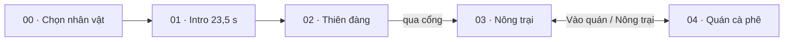

# Game Design Document — COG · Cà phê

## Thông tin tài liệu

| | |
|---|---|
| Dự án | COG — Cà phê |
| Loại tài liệu | Game Design Document (GDD) tổng hợp |
| Phiên bản | 1.3 |
| Cập nhật | 04/11/2026 |
| Trạng thái tài liệu | **Bản nháp tổng hợp** — chưa có người duyệt; xem [mục 0](#0-bảng-trạng-thái) |
| Người duyệt | _(chưa có)_ |
| Đối chiếu code lần cuối | 04/11/2026, commit `be1782a` (chưa tính thay đổi chưa commit) |
| Nguồn ưu tiên khi mâu thuẫn | [rules.md](../screens/03-farm/rules.md) (farm + quán) · [04-cafe/gameplay.md](../screens/04-cafe/gameplay.md) · [02-heaven/gameplay.md](../screens/02-heaven/gameplay.md) · [onboarding-flow.md](../shared/onboarding-flow.md) · [contracts.md](../shared/contracts.md) |
| Số liệu | Theo tài liệu hiện hành và `src/features/farm/content.js`, `rules.js`, `src/features/cafe/recipes.js` tại ngày cập nhật |

**Quy ước cập nhật:** đổi luật hoặc số liệu thì sửa tài liệu gốc của màn trước, sau đó cập nhật GDD và ghi vào [Lịch sử phiên bản](#lịch-sử-phiên-bản).

## Mục lục

0. [Bảng trạng thái](#0-bảng-trạng-thái)
1. [Tổng quan](#1-tổng-quan)
2. [Trụ cột thiết kế](#2-trụ-cột-thiết-kế)
3. [Cốt truyện và nhân vật](#3-cốt-truyện-và-nhân-vật)
4. [Cấu trúc game](#4-cấu-trúc-game)
5. [Gameplay cốt lõi](#5-gameplay-cốt-lõi)
6. [Hệ thống nông trại](#6-hệ-thống-nông-trại)
7. [Hệ thống quán cà phê](#7-hệ-thống-quán-cà-phê)
8. [Nhân sự](#8-nhân-sự)
9. [Tiến trình và người chơi mới](#9-tiến-trình-và-người-chơi-mới)
10. [Kinh tế và cân bằng](#10-kinh-tế-và-cân-bằng)
11. [Giao diện và trải nghiệm](#11-giao-diện-và-trải-nghiệm)
12. [Hình ảnh và âm thanh](#12-hình-ảnh-và-âm-thanh)
13. [Kỹ thuật và dữ liệu](#13-kỹ-thuật-và-dữ-liệu)
14. [Lộ trình và trạng thái](#14-lộ-trình-và-trạng-thái)
15. [Câu hỏi mở và rủi ro](#15-câu-hỏi-mở-và-rủi-ro)
- [Phụ lục A — Bảng nội dung](#phụ-lục-a--bảng-nội-dung)
- [Phụ lục B — Lệch số giữa tài liệu và code](#phụ-lục-b--lệch-số-giữa-tài-liệu-và-code)
- [Phụ lục C — Thuật ngữ](#phụ-lục-c--thuật-ngữ)
- [Phụ lục D — Tài liệu liên quan](#phụ-lục-d--tài-liệu-liên-quan)
- [Lịch sử phiên bản](#lịch-sử-phiên-bản)

---

## 0. Bảng trạng thái

Mục này trả lời ba câu hỏi: **GDD đang ở trạng thái nào**, **code đã làm tới đâu so với GDD**, **GDD còn cần sửa gì**. Cách cập nhật: [design/README.md](README.md).

### 0.1 Tóm tắt cho quản lý

| Câu hỏi | Trả lời (04/11/2026) |
|---|---|
| GDD đang ở trạng thái nào? | Bản nháp tổng hợp v1.2, gom từ tài liệu theo màn; **chưa có người duyệt**. Luật cốt lõi của 5 màn đã chốt; còn 4 đề xuất chờ duyệt và 5 câu hỏi mở |
| Code đã tới đâu? | 21/27 tính năng **Đã code**, 3 **Một phần**, 3 **Chưa làm** (bảng 0.3). Toàn bộ vòng chơi 00 → 04 chơi được |
| Đã kiểm chứng tới đâu? | Chỉ luồng người chơi mới được playtest (3 lượt, 03/11/2026) và kinh tế đo bằng mô phỏng. Phần lớn tính năng **chưa có xác nhận chơi thật** |
| GDD còn cần sửa gì? | 9 việc ở bảng 0.4; gấp nhất: chốt 4 chỗ code robot/sự cố làm khác spec (D-10). D-01, D-02 đã sửa ngày 04/11/2026 |

### 0.2 Chú giải

| Cột | Giá trị | Nghĩa |
|---|---|---|
| Thiết kế | Đề xuất | Ý tưởng có tài liệu, chưa được người dùng duyệt |
| | Đã chốt | Người dùng đã duyệt, là luật hiện hành |
| | Đang chỉnh | Đã chốt nhưng số liệu còn thay đổi theo đo đạc |
| | Bỏ | Đã quyết định không làm |
| Code | Chưa làm | Không có trong code |
| | Đang làm | Có thay đổi chưa commit hoặc mới làm một phần đang dở |
| | Một phần | Đã commit một phần phạm vi |
| | Đã code | Đã commit đủ phạm vi đã chốt |
| Kiểm chứng | Chưa | Chưa có ai chạy/chơi để xác nhận |
| | Test | Có test tự động trong `tests/` (không có nghĩa đã chạy gần đây) |
| | Sim | Đo bằng `scripts/balance-sim.mjs` |
| | Playtest dd/mm | Có người chơi thử ngày đó, kết quả ghi ở tài liệu nguồn |

"Đã code" **không** có nghĩa đã kiểm chứng. Theo quy tắc dự án, người dùng tự test; trạng thái kiểm chứng chỉ ghi khi có bằng chứng.

### 0.3 Tiến độ triển khai theo tính năng

| ID | Tính năng | Mục GDD | Thiết kế | Code | Kiểm chứng | Ghi chú / việc tiếp |
|---|---|---|---|---|---|---|
| F-01 | Chọn nhân vật | 4 | Đã chốt | Đã code | Chưa | |
| F-02 | Intro 3D 23,5 s | 3, 4 | Đã chốt | Đã code | Chưa | Y tế, Thần Chết còn khối tạm; chưa lồng tiếng |
| F-03 | Thiên đàng: hỏi đáp, dấu, hành trang | 5.3 | Đã chốt | Đã code | Test, Playtest 03/11 | `tests/heaven-gameplay.test.js` |
| F-04 | Mẹo thiên đàng, hỏi lại câu sai | 5.3, A.1 | Đã chốt | Đã code | Playtest 03/11 | Lỗi mở: reload mất chế độ tự dẫn tới chuyên gia kế |
| F-05 | Ruộng, mua đất liền kề | 6.1 | Đã chốt | Đã code | Chưa | Playtest 03/11 chưa đi tới Mua ruộng |
| F-06 | Cây trồng, chăm sóc | 6.2, A.3 | Đã chốt | Đã code | Test | Tài liệu đã sửa theo code 04/11 |
| F-07 | Chế biến phơi, rang | 6.3 | Đã chốt | Đã code | Test | 3 câu hỏi mở về mẻ (15.1) |
| F-08 | Kho, chợ giảm giá theo ngày | 6.4, 10.3 | Đang chỉnh | Đã code | Sim | |
| F-09 | Nâng cấp tới cấp 20, 3 bậc diện mạo | 6.5 | Đã chốt | Đã code | Sim | Bậc 2+ là bản sao khối tạm |
| F-10 | Đơn hàng farm → quán | 6.6 | Đã chốt | Đã code | Playtest 03/11 (một phần) | |
| F-11 | Trang trí hoa, đèn, biển tên | 6.7 | Đã chốt | Đã code | Chưa | |
| F-12 | Công trình sản xuất phụ, trạm song song | 14.3 | Đề xuất | Chưa làm | — | Chờ duyệt `build-proposal.md` |
| F-13 | Vòng ca quán, mục tiêu ca, uy tín | 7.1–7.3 | Đang chỉnh | Đã code | Playtest 03/11 | |
| F-14 | 11 công thức, bàn pha theo số đo | 7.4, A.4 | Đã chốt | Đã code | Chưa | |
| F-15 | Nâng cấp quán, tự động hóa | 7.6, A.6 | Đã chốt | Đã code | Chưa | Bố cục kiểm bằng `?debug=grid` |
| F-16 | Thợ farm 2 chỗ, chỉ thị | 8.1 | Đã chốt | Đã code | Test | `tests/worker-avoidance.test.js`, `farm-gameplay.test.js` |
| F-17 | Nhân viên quán, bảng việc | 8.2 | Đã chốt | Đã code | Chưa | |
| F-18 | Robot, sự cố, gói thử robot | 8.3 | Đã chốt | Đã code | Chưa | 4 chỗ code khác spec chờ chốt (D-10); cần đo playtester theo robot-staff mục 12 |
| F-19 | Nhiệm vụ, HUD mở dần, hướng dẫn lần đầu | 9 | Đã chốt | Đã code | Playtest 03/11 | Chưa kiểm đoạn Gửi hạt → Mua ruộng → Tưới/Làm cỏ |
| F-20 | Cân bằng kinh tế | 10 | Đang chỉnh | Đã code | Sim | Chưa playtest phiên dài |
| F-21 | Chỉnh độ vui quán (fun-review) | 14.3 | Đề xuất | Một phần | Chưa | P1–P3 đã vào `04-cafe/gameplay.md`; phần còn lại chờ duyệt (D-06) |
| F-22 | Dòng giống thật, vòng đời nhiều năm | 14.3 | Đề xuất | Chưa làm | — | |
| F-23 | Thợ tự vận hành (staff-ai) | 14.3 | Đề xuất | Một phần | — | Bước 1 (chỉ thị) đã làm |
| F-24 | Đa ngôn ngữ Anh/Việt | 1.2 | Đã chốt | Đã code | Chưa | Commit `4bd9f2e` 04/11: dịch toàn bộ 5 màn, 1.910 khóa; chưa chạy test/chơi thử. Chi tiết: [i18n.md › Nhật ký triển khai](../shared/i18n.md#nhật-ký-triển-khai) |
| F-25 | Âm thanh, VFX phản hồi | 12.2 | Đã chốt | Đã code | Chưa | Chưa có nhạc nền/âm môi trường file thật |
| F-26 | Thay khối tạm bằng asset 3D | 12.3 | Đã chốt | Một phần | Chưa | Theo `assets/registry/` |
| F-27 | Nhóm "Để sau" (cold brew, khách quen, latte art…) | 14.4 | Đề xuất | Chưa làm | — | |

### 0.4 Việc cần sửa trong GDD và tài liệu

| ID | Việc | Tài liệu | Mức |
|---|---|---|---|
| D-10 | Chốt 4 chỗ code làm khác spec robot/sự cố (C-1…C-4, Phụ lục B): sửa code theo spec hay sửa spec theo code | `shared/robot-staff.md` mục 0 | Cao |
| D-11 | Xem 3 chỗ nghi lỗi code robot/sự cố (B-1…B-3) | `shared/robot-staff.md` mục 0 | Trung bình |
| D-03 | Vòng chơi mục 1 còn nhắc "tách vỏ" và "xay hạt thành bột" ở farm, đã bỏ | `03-farm/rules.md` mục 1 | Trung bình |
| D-04 | `gameplay.md` farm là nhật ký nhiều đợt, chứa bố cục cũ (4 xưởng, máy xay, tách vỏ); cần dọn còn mô tả hiện hành | `03-farm/gameplay.md` | Trung bình |
| D-05 | Ba file đề xuất 02/11 chưa đối chiếu lại với code | `03-farm/*-proposal.md` | Trung bình |
| D-06 | Ghi rõ phần nào của fun-review đã áp dụng, phần nào chờ duyệt | `04-cafe/fun-review.md` | Trung bình |
| D-07 | GDD chưa có: phạm vi bản phát hành (MVP), chỉ số đo thành công (giữ chân, thời gian phiên), mô hình kiếm tiền | GDD mục 1, 14 | Trung bình |
| D-08 | GDD chưa có người duyệt; cần chốt người duyệt và ngày duyệt | GDD thông tin tài liệu | Thấp |
| D-09 | Nhật ký `rules.md` có dòng "bồi dưỡng vẫn còn" mâu thuẫn quyết định bỏ cùng ngày; đánh dấu đã thay | `03-farm/rules.md` | Thấp |

Câu hỏi thiết kế chưa chốt nằm ở [mục 15.1](#151-câu-hỏi-mở); không lặp ở đây.

---

## 1. Tổng quan

### 1.1 Ý tưởng chính

Người chơi bị Thần Chết "kéo nhầm" lên thiên đàng, học nghề cà phê từ Hội đồng trùng sinh, rồi tỉnh lại ở trần gian để tự trồng, chế biến cà phê và mở quán pha bằng công thức thật.

### 1.2 Thông số chung

| | |
|---|---|
| Thể loại | Mô phỏng nông trại + quản lý quán cà phê, 3D, có cốt truyện mở đầu |
| Nền tảng | Trình duyệt (WebGL / Three.js), ưu tiên mobile, chơi được trên PC |
| Góc nhìn | 3D, camera chéo từ trên cao; farm dùng phép chiếu song song |
| Điều khiển | Bấm/chạm đối tượng để nhân vật tự đi tới làm; WASD/mũi tên trên PC, joystick trên mobile |
| Ngôn ngữ | Anh (mặc định) và Việt, đổi trong ⚙️ Cài đặt; xem [i18n.md](../shared/i18n.md) |
| Lưu | Một save `cog-coffee-progress` trong localStorage |
| Phiên chơi | Đơn vị nhịp: ngày công / vụ 6 phút, ca quán 4 phút |

### 1.3 Đối tượng người chơi

- Người chơi casual thích game nông trại, quản lý quán, chơi ngắn trên điện thoại.
- Người thích cà phê, muốn biết pha phin, espresso, V60 thật sự ra sao.

### 1.4 Điểm khác biệt

- **Kiến thức thật:** giống cà phê, tỉ lệ, độ xay, nhiệt độ, thời gian chiết là luật chơi, không phải chữ trang trí.
- **Hai màn phụ thuộc nhau:** hạt từ farm nuôi quán; quán trả giá cao hơn chợ.
- **Bản sắc Việt:** vườn cao nguyên, phin, cà phê sữa đá, bạc xỉu, cà phê trứng; chất liệu gỗ, mây tre, sơn mài.

## 2. Trụ cột thiết kế

| # | Trụ cột | Nghĩa là | Ví dụ trong game |
|---|---|---|---|
| 1 | **Cuốn ngay** | Mọi thao tác có hình + tiếng ngay khi trạng thái đổi | Tiền, hàng bay về HUD; ly đầu bán được trước phút thứ 2 |
| 2 | **Có lý do quay lại** | Luôn có việc đang chờ khi trở lại | Cây lớn khi vắng mặt (bù tối đa 4 giờ), đơn hàng, nâng cấp, luyện món lên 3★ |
| 3 | **Hai màn phụ thuộc nhau** | Farm làm ra hạt, quán biến hạt thành doanh thu lớn hơn | Chợ giảm giá khi bán nhiều; hạt dư mang sang quán lời hơn |
| 4 | **Học thật** | Chấm theo số đo thật, sai thì giải thích lý do thật | Câu hỏi thiên đàng, quầy pha rót tới vạch g/ml/°C |

**Nguyên tắc thiết kế chung** (từ `AGENTS.md`):

- Đây là game, không phải website/dashboard. Ưu tiên thế giới 3D, thao tác trên đối tượng, HUD nhỏ gọn.
- Shop, kho, nâng cấp mở bằng modal game giữa màn hình, có nút đóng, khóa di chuyển khi mở.
- Bản đồ, nhân vật, công trình có tỷ lệ cân đối, đường đi rõ, vật cản hợp lý.
- Khối tạm vẫn phải thể hiện chức năng, trạng thái và điểm tương tác để thay asset mà không viết lại luật.

## 3. Cốt truyện và nhân vật

### 3.1 Cốt truyện

| Chặng | Diễn biến |
|---|---|
| Intro | Nhân vật đi bộ, né xe đạp, va biển, ngã. Y tế đưa lên cáng, Thần Chết tách hồn dẫn lên đường mây tới cổng trời |
| Thiên đàng | Thần Chết giao hồ sơ; gặp ba chuyên gia; Thần Tiếp Nhận tiết lộ người chơi **chỉ ngất**, Thần Chết kéo nhầm (dấu đỏ "CHƯA CHẾT · CHỈ NGẤT") |
| Trần gian | Tỉnh lại, làm chủ một mảnh vườn cà phê và một quán nhỏ |

### 3.2 Nhân vật

| Nhân vật | Vai trò | Trạng thái asset |
|---|---|---|
| Người chơi | Nam hoặc nữ, tên tự đặt ≤ 20 ký tự (mặc định nữ, "An Nhiên") | GLB có rig, cao chuẩn 2 đơn vị |
| Thần Chết | Dẫn hồn, giao nhiệm vụ ở thiên đàng | Khối dựng bằng code |
| Chuyên gia trồng cà phê | 2 câu hỏi về trồng | Khối tạm |
| Chuyên gia pha chế | 2 câu hỏi về pha | Khối tạm |
| Chuyên gia kinh doanh | 2 câu hỏi về kinh doanh | Khối tạm |
| Thần Tiếp Nhận | Kiểm tra hồ sơ, tiết lộ sự thật, trao hành trang | Khối tạm |
| Thợ nông trại | NPC làm vườn, chế biến, giao hàng | Xem [8. Nhân sự](#8-nhân-sự) |
| Nhân viên quán | 14 ứng viên có tên, tiểu sử, 4 chỉ số | Xem [8. Nhân sự](#8-nhân-sự) |
| Khách quán | Xếp hàng, gọi món, ngồi hoặc mang đi | 3D, có thanh kiên nhẫn |

Chưa có lồng tiếng.

## 4. Cấu trúc game

### 4.1 Sơ đồ màn



- 00 → 01 → 02 → 03 là đường một chiều. Qua cổng thiên đàng thì tải lại trang vào thẳng farm.
- Chỉ farm ↔ quán đi hai chiều. Quán dùng chung model `farm`; farm vẫn chạy khi người chơi ở quán.
- Chi tiết điều kiện chuyển và dữ liệu đi theo: [game-flow.md](../game-flow.md).

### 4.2 Bảng màn

| Màn | Thời lượng mục tiêu | Vai trò | Tài liệu |
|---|---|---|---|
| 00 Chọn nhân vật | < 30 s | Chọn nam/nữ, đặt tên | [00-selection](../screens/00-selection/README.md) |
| 01 Intro | 23,5 s, bỏ qua được | Mở truyện | [01-intro](../screens/01-intro/README.md) |
| 02 Thiên đàng | ≤ 150 s | Bài học, nhận mẹo và hành trang | [02-heaven](../screens/02-heaven/README.md) |
| 03 Nông trại | Vòng chơi chính | Trồng, chế biến, bán, thuê thợ, xây | [03-farm](../screens/03-farm/README.md) |
| 04 Quán | Ca 4 phút | Nhận order, pha tay, bưng ly | [04-cafe](../screens/04-cafe/README.md) |

### 4.3 Điều khiển

| | PC | Mobile |
|---|---|---|
| Di chuyển | Bấm mặt đất, WASD / mũi tên | Bấm mặt đất, joystick analog góc trái |
| Tương tác | Bấm đối tượng; E / Enter / Space ở thiên đàng | Chạm đối tượng |
| Camera farm | Kéo chuột để xem, con lăn / +/− zoom 0,8–1,65, 🎯 về nhân vật | Kéo một ngón, nút +/−, 🎯 |
| Hội thoại | Enter hoặc bấm để tiếp; phím 1–3 chọn đáp án | Chạm để tiếp |

## 5. Gameplay cốt lõi

### 5.1 Vòng lặp chính

```text
Trồng → chăm (tưới / làm cỏ / bón) → hái quả
     → sân phơi (quả → nhân sạch) → lò rang (nhân → hạt rang)
     → bán ở Chợ  hoặc  chuyển về quán pha bán
     → xu → mua ruộng, nâng cấp, thuê thợ, xây trang trí → mở rộng
```

### 5.2 Vòng lặp theo nhịp thời gian

| Nhịp | Người chơi làm gì |
|---|---|
| Vài giây | Chạm cây, hái, nhận mẻ, rót tới vạch |
| 30 s – 2 phút | Chạy mẻ phơi/rang, pha và bưng một ly |
| Ca quán 4 phút | Đạt mốc Đồng/Bạc/Vàng, nhận thưởng ca |
| Ngày công 6 phút | Lứa cây mới, giá chợ hồi, trả lương thợ |
| Nhiều phiên | Mua ruộng, nâng cấp, mở món, luyện 3★, mở rộng đội |

### 5.3 Thiên đàng — vòng học việc (một lần)

Nói chuyện Thần Chết → chọn được dẫn đường hoặc tự khám phá → gặp 3 chuyên gia theo thứ tự tùy chọn (mỗi người 2 câu, 3 đáp án, trả lời một lần) → đủ 3 dấu thì Thần Tiếp Nhận tiết lộ sự thật → chọn hành trang → đi qua cổng.

- Câu đúng cho **mẹo** có tác dụng thật ở farm/quán (Phụ lục A.1).
- Câu sai được giải thích ngay rồi **hỏi lại đúng lúc** ở farm/quán (sau lần hái tay, ra giếng, báo cáo cuối ca, ly dưới 70 điểm, khách bỏ về), tối đa 1 câu mỗi ngày công; hoặc ôn ở Sổ tay thiên đàng trong Hướng dẫn.
- Chơi lại chương không xóa mẹo, không trả thưởng lần hai.
- Hành trang chọn 1, áp một lần khi vào farm (Phụ lục A.2).

## 6. Hệ thống nông trại

### 6.1 Bản đồ và đất

- 4 ruộng × 12 ô (lưới 4×3) = 48 ô. Ruộng 1 có sẵn; ruộng 2–4 giá **120 / 180 / 300 xu**, chỉ mua ruộng liền kề.
- Bấm ô hoặc biển ruộng khóa: nhân vật đi tới biển trước. Đủ tiền và liền kề mới hiện xác nhận; thiếu tiền báo số xu thiếu. Chỉ trừ tiền khi bấm xác nhận.
- Mỗi ruộng có rào riêng và cổng gỗ; ruộng chưa mua đóng cổng.
- Công trình: giếng nước, ao dự trữ, sân phơi, lò rang. Ranh map `FARM_BOUNDS`: x −20 → 11, z −19 → 4.

### 6.2 Cây trồng và chăm sóc

Cây là cây lâu năm: hái không xóa cây, cây sang lứa tiếp theo. Bảng giống: Phụ lục A.3.

| Việc | Khi nào | Ghi chú |
|---|---|---|
| Gieo | Ô trống | Chọn giống ở dải icon nhỏ phía dưới; chỉ trừ hạt khi trồng xong |
| Tưới | Nước < 35 | Mỗi lần tốn 1 lượt nước, đặt nước về 70 (~412 s sau mới cần tưới lại); nước ≤ 15 thì cây ngừng lớn |
| Làm cỏ | Cỏ ≥ 30 | ~857 s từ lúc sạch; cỏ ≥ 75 thì cây ngừng lớn |
| Tỉa cành | Tiến độ ≤ 17%, 1 lần mỗi lứa | Không tỉa: sản lượng ×0,95; tỉa: +5 chất lượng |
| Bón phân | Tiến độ 30–65% (cây trưởng thành thêm 0–17%), nước ≥ 30, 1 lần mỗi lứa | Không bắt buộc, không tăng tốc. Bón: sản lượng ×1,1 và +5 chất lượng; không bón ×0,9 |
| Hái | Quả chín | Quả chín giữ nguyên chờ hái, không tự hỏng |

- Chạm cây = công cụ **Tự chọn**: nhân vật tự làm việc cây cần nhất.
- Dải công cụ (kéo chọn nhiều ô để gieo/tưới hàng loạt) chỉ mở khi có ruộng thứ 2.
- Vắng mặt được tính bù tối đa 8 giờ, cây không chết. Quả chín giữ sản lượng chờ hái nhưng vẫn mất nước, mọc cỏ.
- Sức khỏe cây (sàn 20) ảnh hưởng tốc độ lớn, sản lượng và chất lượng; mưa cộng nước. Chi tiết: [03-farm/gameplay.md](../screens/03-farm/gameplay.md) mục "Nhịp chăm sóc".

### 6.3 Chế biến

| Trạm | Vào → ra (mỗi phần) | Thời gian cơ sở / mẻ | Sức chứa cấp 1 |
|---|---|---|---|
| Sân phơi | 600 g quả → 100 g nhân sạch | 30 s | 18 kg |
| Lò rang | 100 g nhân sạch → 84 g hạt rang | 18 s | 1 kg |

- Mỗi trạm chạy 1 mẻ một lúc; yêu cầu lớn chia thành mẻ nối tiếp, hàng chờ tối đa 48 mẻ.
- Nguyên liệu trừ khi bắt đầu. Xong thì thành phẩm nằm ở giỏ trên trạm, **phải bấm tới nhận**. Kho đầy thì hàng chờ tại trạm, không mất.
- Mẻ chưa chạy hủy được, trả nguyên liệu. Máy xay ở farm đã bỏ.

### 6.4 Kho, mua, bán

- Kho tính theo tổng gram của các **lô**; mỗi lô có chất lượng, nguồn, thời gian. Ba vị trí: kho farm, đang chuyển, kho quán.
- Cửa hàng có ba tab: Cây giống / Vật tư / Chợ. Mọi mua/bán có modal xác nhận.
- Ô số lượng giới hạn 1–99; bán tự do tính theo gram, mặc định bán hết.
- Giá chợ và cơ chế giảm giá: [10. Kinh tế](#10-kinh-tế-và-cân-bằng).

### 6.5 Nâng cấp công trình

- Cấp tối đa 20 cho mọi hạng mục (Thiết bị quán tối đa 10). Lên cấp N cần nông trại cấp N.
- Tốc độ `1 + 0,07 × (cấp − 1)`; công suất `1 + 0,18 × (cấp − 1)`.
- Mẻ đã xếp giữ thông số lúc xếp; nâng cấp chỉ áp cho yêu cầu mới.
- Diện mạo theo bậc: Cơ bản (cấp 1), Cải tiến (10), Chuyên nghiệp (20), mỗi bậc một slot asset riêng.

### 6.6 Đơn hàng farm → quán

| Tab | Điều kiện | Hành động |
|---|---|---|
| Cần làm | Đơn mở, kho chưa đủ hạt rang | Chọn/đổi thợ phụ trách |
| Chờ chuyển | Đơn mở, kho đã đủ | «Chuyển về quán · 2 xu», từng đơn hoặc Chuyển hết |
| Đang chuyển | Hàng đã xuất kho | Xem % và giây còn lại |

- Chỉ phát sinh khi farm có ít nhất 1 thợ; tối đa 2 đơn mở/đang chuyển.
- Chuyển nội bộ không sinh tiền; quán kiếm tiền khi bán ly.

### 6.7 Xây dựng trang trí

- Hiện có: bồn hoa 25 xu, đèn vườn 40 xu, biển tên 30 xu (nhập ≤ 24 ký tự).
- Chọn món → bóng đặt xanh/đỏ → xoay (R) → bấm đất chốt → xác nhận mới trừ xu. Nhân vật tới thi công 5–6 s; phá dỡ 3,5 s, không hoàn xu.
- Không đặt trên ruộng, đường, sát công trình. Tối đa 100 món. Chỉ trang trí, không cộng năng suất.

## 7. Hệ thống quán cà phê

### 7.1 Vòng chơi một ca (4 phút)

1. **Mở cửa:** khách 3D vào, xếp hàng theo dây chắn (tối đa 6 người; dài hơn thì khách quay đi, uy tín −1).
2. **Nhận order:** đứng ở quầy thu ngân là tự nhận order khách đầu hàng. Khách tự tìm ghế; hết ghế thì chờ mang đi.
3. **Pha chế:** modal Quầy pha giữa màn hình, mỗi bước một thao tác (chọn hạt, độ xay, kỹ thuật, hoặc **giữ để rót** tới vạch chuẩn g / ml / °C). Rót quá không rút lại. Sai thì hiện lý do thật.
4. **Bưng ra:** cầm ly, bấm đúng bàn (khách mang đi: bấm quầy thu ngân).
5. **Thanh toán:** giá theo chất lượng; tip theo ★, độ nhanh, combo ≥ 2★ liên tiếp, pha theo trí nhớ.

Rời quán về farm thì quán tạm dừng hoàn toàn, vào lại chơi tiếp đúng chỗ.

### 7.2 Khách và uy tín

- Kiên nhẫn: xếp hàng 55 s, ngồi 80 s, mang đi 50 s. Hết kiên nhẫn thì bỏ về, uy tín −2, mất combo.
- Uy tín quyết định hạng sao quán, tốc độ khách tới và mở món.
- Khoảng cách giữa hai khách: `clamp(9 + 9 nếu chưa có ai pha tự động − (uy tín − 50) × 0,06 − số bàn × 0,6 − số kiosk, 3, 24)` giây × ngẫu nhiên 0,75–1,25.

### 7.3 Mục tiêu ca

| Mốc | Số ly | Thưởng (cần TB ≥ 2★) |
|---|---|---|
| Đồng | 4 + hạng sao + 6 × số tay pha | 3 xu/ly, uy tín +1 |
| Bạc | ⌈1,4 × Đồng⌉ | 4 xu/ly, uy tín +2 |
| Vàng | ⌈1,8 × Đồng⌉ | 5 xu/ly, uy tín +3 |

- Thưởng ca tối đa 300 xu. Chưa đạt Đồng chỉ −1 uy tín khi dưới nửa mốc Đồng.
- **Món của ca** được gọi gấp 3 lần, bán +30%. Ly chủ quán tự pha bán ×2 giá.

### 7.4 Pha chế và thành thạo

- Công thức: Phụ lục A.4.
- 3★ (≥ 90 điểm) mở **pha theo trí nhớ**: ẩn thẻ và vạch chuẩn, +20% tip.
- Barista NPC chỉ tự pha món người chơi đã luyện đủ điểm (ngưỡng `90 − Trí nhớ × 0,4`).

### 7.5 Nguyên liệu

- **Hạt rang** dùng chung kho quán. Nguồn: đơn từ farm (252 g/đơn) hoặc **Nhập hạt ngoài** 500 g / 75 xu (đắt hơn hạt farm).
- Save mới có sẵn **600 g hạt vối rang** (lô `starter`, ~30 ly) để ca đầu chơi ngay.
- Vật tư nhập theo gói thật: Phụ lục A.5. Thiếu nguyên liệu khi pha thì hiện thứ thiếu kèm nút mở kho.

### 7.6 Nâng cấp quán

| Nhóm | Hạng mục |
|---|---|
| Bàn ghế | 3 → 10 bàn theo cấp quán 1–10; mỗi bàn nâng riêng 2 → 4 ghế, ghế đệm, sofa |
| Thiết bị | Phin, máy xay (cộng chất lượng); máy espresso, vòi đánh sữa, máy đánh trứng/kem, bộ V60 (mở món) |
| Tự động | Trạm pha thêm (tối đa 3), quầy thu ngân 2, robot thu ngân (kiosk), quầy nhận đồ + màn hình gọi số, robot pha espresso |
| Mở rộng | Sân vườn (+2 bàn ngoài trời) |

Giá chi tiết: Phụ lục A.6.

## 8. Nhân sự

### 8.1 Thợ nông trại

- Tối đa **2 chỗ thợ**; thuê là vào làm ngay. Phí tuyển trả một lần.
- Lương `30 + 10 × (cấp − 1)` xu mỗi ngày công 6 phút, tự gia hạn nếu đủ xu. Hết xu thì thợ dừng an toàn.
- Không có năng lượng, nghỉ giữa ca hay bồi dưỡng. Vắng mặt > 60 s không tiêu ngày công đã trả.
- Thợ làm theo **Chỉ thị** (tab trong Nhân viên): Tự chăm vườn, Trồng lấp ô trống, Dùng phân bón, Tự chế biến. Có 2 thợ thì chia vùng chăm.
- Đào tạo tối đa cấp 10, +2 mỗi chỉ số mỗi cấp.
- Việc thợ làm không tính vào nhiệm vụ của người chơi.

### 8.2 Nhân viên quán

- Tối đa 10 người; giới hạn vai: 2 thu ngân, 3 barista, 3 phục vụ, 1 tạp vụ, 1 quản lý ca.
- Lương theo **ca 4 phút**, chỉ trôi khi quán mở.
- Bảng việc chung: ai rảnh tự nhận việc đúng vai, ưu tiên khách sắp hết kiên nhẫn; mỗi việc được giữ chỗ để không làm trùng.

| Vai | Việc |
|---|---|
| Thu ngân | Đứng sau quầy, nhận order khách đầu hàng |
| Barista | Pha món đã đủ điểm luyện ở trạm pha trống |
| Phục vụ | Lấy ly ở kệ giao, bưng tới khách gấp nhất; rảnh thì dọn bàn |
| Tạp vụ | Ưu tiên dọn bàn |
| Quản lý ca | Cả đội nhanh hơn ~10–20%, tự nhập nguyên liệu sắp hết |

### 8.3 Robot và sự cố

Spec: [robot-staff.md](../shared/robot-staff.md).

| | Farm | Quán |
|---|---|---|
| Robot | Robot vườn, dùng chung 2 chỗ thợ, tối đa 1; 15 xu/ngày công; gói 1/5/10 ngày = 15/68/113 xu; chỉ tưới, làm cỏ, chế biến, giao hàng | Robot bưng, Robot dọn; 3 xu/ca, không gói; bưng 1 ly/chuyến |
| Sự cố người | Mải chơi ~12%, Nghỉ ốm ~4% (tối đa 1/ngày công) | Mải chơi ~12%, Nghỉ ốm ~4%, Chửi khách ~5% (tối đa 1/ca) |
| Miễn sự cố | 2 ngày công đầu, khi người chơi ở quán, uy tín < 30 | 2 ca đầu, ca gói thử robot, uy tín < 30 |

Gói thử robot pha (một lần): 1 ca robot pha sai thông số thật kèm báo cáo so sánh ly người chơi với ly robot.

## 9. Tiến trình và người chơi mới

### 9.1 Cấp và XP

- Save mới 200 xu.
- Ngưỡng XP cấp nông trại: `0, 30, 90, 190, 350, 600, 950, 1400, 2000, 2800…`.
- Nguồn XP: nhiệm vụ, bán (⌊xu nhận / 2⌋).
- Cấp mở giống (chè cấp 2, mít cấp 3) và giới hạn cấp nâng cấp công trình.

### 9.2 Chuỗi nhiệm vụ cố định

Thưởng một lần, chỉ tính thao tác của người chơi.

| # | Nhiệm vụ | Thưởng |
|---|---|---|
| 1 | Hái lứa quả đầu tiên | 10 xu, 4 XP |
| 2 | Bán ly cà phê đầu tiên | 15 xu, 6 XP |
| 3 | Phơi mẻ cà phê đầu tiên | 10 xu, 4 XP |
| 4 | Rang một mẻ hạt | 10 xu, 4 XP |
| 5 | Bán thành quả của mình | 15 xu, 6 XP |
| 6 | Gửi hạt rang về quán | 10 xu, 5 XP |
| 7 | Mua ruộng thứ hai | 10 xu, 5 XP |
| 8–9 | Tưới, Làm cỏ | Theo `content.js` |

Bấm thẻ mục tiêu ở HUD trái thì nhân vật tự đi tới đúng chỗ. Lần đầu thẻ nhấp nháy, có mũi chỉ 3D.

### 9.3 Mở khóa dần

- **HUD lúc mới vào:** avatar/XP, thẻ mục tiêu, xu, Kho, Cài đặt, Hướng dẫn.
- **Mở theo mốc:** Vào quán (sau Hái), Cửa hàng, Đơn hàng, Nâng cấp, Nhân viên, Xây dựng, dải công cụ (từ ruộng 2).
- **Món quán:** theo uy tín và thiết bị (Phụ lục A.4).
- Save cũ đã qua mốc thấy đủ ngay.

### 9.4 Hướng dẫn lần đầu

| Lúc | Hướng dẫn |
|---|---|
| Vào thiên đàng | Gợi ý điều khiển theo thiết bị, tắt sau khi di chuyển hoặc 10 s |
| Vào farm | Gợi ý điều khiển theo thiết bị, tắt sau khi đi + làm một việc, 15 s hoặc × |
| Vào quán | Thẻ 4 bước: Mở cửa → đứng quầy thu ngân → pha → bưng ly |
| Mở quầy pha | Một dòng hướng dẫn rót tới vạch, gợi ý giới hạn 80% điểm bước đó |

Chi tiết: [onboarding-flow.md](../shared/onboarding-flow.md).

## 10. Kinh tế và cân bằng

### 10.1 Nguồn thu và khoản chi

| Nguồn xu | Khoản chi |
|---|---|
| Bán ở Chợ | Hạt giống, phân bón (1 xu/túi) |
| Bán ly ở quán (giá + tip) | Mua ruộng (120/180/300) |
| Thưởng ca (≤ 300 xu) | Nâng cấp công trình và quán |
| Thưởng nhiệm vụ | Lương thợ, nhân viên quán |
| Mẹo thiên đàng (+30 xu), hành trang (+150 xu) | Vật tư quán, hạt nhập ngoài (75 xu/500 g) |
| | Phí chuyển hàng 2 xu/chuyến, trang trí |

### 10.2 Giá sản phẩm

| Sản phẩm | Giá gốc / gram |
|---|---|
| Quả chín | 0,004 xu |
| Nhân sạch | 0,04 xu |
| Hạt rang | 0,07 xu |
| Cà phê bột | 0,072 xu |

Giá nhân theo hệ số giống (Phụ lục A.3) và chất lượng lô.

### 10.3 Chợ giảm giá theo lượng bán

- Mỗi ngày công 6 phút, giá giảm tuyến tính từ 100% xuống sàn 30% khi đã bán 840 xu giá gốc (`MARKET_DAILY = 1200`). Ngày công mới thì hồi giá.
- Tính theo tích phân: bán một lần hay chia nhỏ nhận như nhau. Lượng đã bán lưu trong save.
- Mục đích: 2 ruộng bán gần đủ giá, 4 ruộng bão hòa, buộc dùng quán (trụ cột 3).

### 10.4 Công thức giá nâng cấp

- Cấp < 10: `base × 1,42^(cấp−1)`
- Cấp ≥ 10: `base × 1,42^9 × (1 + 0,15 × (cấp − 10))²`

### 10.5 Kết quả mô phỏng

`scripts/balance-sim.mjs` chạy chính `model.js` với người chơi mẫu (6 phút farm / ca quán 4 phút, tự mua ruộng và nâng cấp). Kết quả 120 phút (03/11/2026):

| Chỉ số | Kết quả |
|---|---|
| Cấp đạt được | 17–18 |
| Thu từ chợ | ~9–10 nghìn xu |
| Quán + thưởng ca | ~1,5 nghìn xu |
| Số mốc mở khóa | 54 |
| Quãng trống dài nhất | 6 phút |

Bón phân có đánh đổi: chậm mua ruộng lúc đầu, lời về sau. Cân bằng cần playtest thật thêm (mục 15).

## 11. Giao diện và trải nghiệm

### 11.1 Bố cục HUD farm

| Vùng | Thành phần |
|---|---|
| Trái | Avatar / tên / cấp / XP → thẻ mục tiêu → Cần xử lý → Hoạt động (gập sẵn) |
| Phải | Ô xu (mở Cửa hàng), Cài đặt · Vào quán · Hướng dẫn |
| Dưới | Menu tối đa 6 nút: Kho, Cửa hàng, Nâng cấp, Nhân viên, Đơn hàng, Xây dựng; dải chọn giống / công cụ |
| Giữa trên | Thông báo ngắn, tự mất sau 3 s |

### 11.2 Quy tắc UI

- Modal khóa di chuyển, kích thước ổn định giữa tab, nội dung dài cuộn bên trong.
- Mua/bán và mua ruộng luôn có xác nhận; chỉ trừ tiền khi xác nhận.
- Esc trong hộp xác nhận chỉ đóng hộp đó.
- Chọn giống dùng dải icon nhỏ phía dưới, không làm tối map; ô được chọn sáng viền.
- Khung gỗ, bảng kem, biển tiêu đề xanh, nút đóng tròn; font Baloo 2 / Fredoka.

Chi tiết: [design-system.md](../shared/design-system.md), [ui-audio-vfx.md](../shared/ui-audio-vfx.md).

## 12. Hình ảnh và âm thanh

### 12.1 Định hướng hình ảnh

Hướng **"Phố Nắng Cà Phê"**: stylized ấm, chất liệu Việt.

| Trụ cột hình ảnh | Nghĩa là |
|---|---|
| Nắng cao nguyên ấm | Ánh sáng là nhân vật chính, bóng mát ánh xanh |
| Chất liệu thủ công | Gỗ, mây tre, gốm, vải bố, giấy dó, sơn mài; bề mặt nhám |
| Đọc được trong 1 giây | UI ≤ 20% màn hình; chỉ 1 màu nhấn cho thứ tương tác được |

Chi tiết bảng màu, ánh sáng theo cảnh: [art-direction.md](../shared/art-direction.md).

### 12.2 Âm thanh và hiệu ứng

- Thao tác nào cũng có hình và tiếng; tiền/hàng bay về HUD.
- Quầy pha: tiếng rót/hơi/đánh bọt đổi theo số đo, có tiếng báo vào vạch chuẩn. Pha theo trí nhớ thì tắt gợi ý bằng tiếng.
- Cài đặt âm thanh và chất lượng hình được lưu qua các lần mở game.

### 12.3 Asset 3D

- Quy trình Meshy → Blender → game: [asset-pipeline.md](../assets/asset-pipeline.md).
- Nhiều đối tượng còn là khối tạm; mỗi đối tượng có slot asset riêng để thay mà không đổi luật.

## 13. Kỹ thuật và dữ liệu

| Hạng mục | Mô tả |
|---|---|
| Engine | Three.js, JS module |
| Cấu trúc code | Theo màn ở `src/features/<màn>/`; xem [project-structure.md](../shared/project-structure.md) |
| Save | Một key `cog-coffee-progress` (`version: 1`): `player`, `introCompleted`, `heaven`, `startingGift`, `farm` (`version: 3`), `settings`. Mọi hàm ghi đọc bản cũ rồi gộp |
| Ghi farm | `commit()` sau mỗi thao tác thành công và mỗi ≥ 5 s; quán ghi qua `farm.act(...)` |
| Tìm đường | A* lưới 0,35, chia lô theo ngân sách khung hình; dùng chung cho người chơi, thợ, khách |
| Hiệu năng | Đồ họa mặc định theo thiết bị, tự hạ một bậc khi dưới ~25 fps kéo dài; không post-processing |
| Phân lớp luật | `model.js` sửa số liệu; `rules.js` công thức; `content.js` / `recipes.js` dữ liệu nội dung |
| Hợp đồng dữ liệu | [contracts.md](../shared/contracts.md) |

## 14. Lộ trình và trạng thái

### 14.1 Đã có trong code

| Màn | Tính năng |
|---|---|
| 00–01 | Chọn nhân vật, intro 3D có phụ đề |
| 02 | Thiên đàng với mẹo, hỏi lại câu sai, hành trang |
| 03 | 4 ruộng, 3 giống, chăm sóc, sân phơi, lò rang, chợ giảm giá, nâng cấp tới cấp 20, 2 thợ với chỉ thị, đơn hàng, trang trí |
| 04 | 11 món, bàn pha theo số đo, ca 4 phút, nhân viên quán, tự động hóa |
| Chung | Luồng người chơi mới, HUD mở dần, lưu cài đặt, robot và sự cố nhân viên, đa ngôn ngữ Anh/Việt |

### 14.2 Đang làm

- Không có. Đa ngôn ngữ Anh/Việt (F-24) đã commit 04/11/2026, chờ kiểm chứng.

Tiến độ chi tiết theo tính năng: [mục 0.3](#03-tiến-độ-triển-khai-theo-tính-năng).

### 14.3 Đề xuất chờ duyệt

| Đề xuất | File |
|---|---|
| Công trình sản xuất phụ, xây thêm trạm để chạy song song | [build-proposal.md](../screens/03-farm/build-proposal.md) |
| Dòng giống thật (TR4, TR9, Catimor, Bourbon…), vòng đời cây nhiều năm | [crop-processing-proposal.md](../screens/03-farm/crop-processing-proposal.md) |
| Thợ tự vận hành nông trại sâu hơn | [staff-ai-proposal.md](../screens/03-farm/staff-ai-proposal.md) |
| Chỉnh độ vui vòng chơi quán (giá, mốc ca, khách sành) | [fun-review.md](../screens/04-cafe/fun-review.md) |

### 14.4 Để sau

Cold brew theo mẻ, khách quen có món yêu thích, latte art, sữa/trứng sản xuất từ farm, bản đồ thế giới, nhạc nền và âm môi trường bằng file thật, lồng tiếng, thay khối tạm bằng asset 3D.

## 15. Câu hỏi mở và rủi ro

### 15.1 Câu hỏi mở

Theo [rules.md](../screens/03-farm/rules.md) mục 10:

1. Có gộp lệnh chế biến mới vào mẻ chờ cùng loại không.
2. Nâng cấp có mở nhiều mẻ song song không, cấp nào.
3. Giới hạn hàng chờ giữ 48 hay giảm; có tính mẻ xong chưa nhận không.
4. Xử lý dữ liệu cũ của nhân viên.
5. Cân bằng kinh tế cần playtest thật, không dựa vào vốn thử lớn.

### 15.2 Rủi ro

| Rủi ro | Ảnh hưởng | Hướng xử lý |
|---|---|---|
| Nhiều thay đổi 02–03/11/2026 chưa được kiểm chứng trong game | Luồng có thể lỗi dù tài liệu ghi đã triển khai | Playtest theo từng màn |
| Code làm khác spec ở robot/sự cố (Phụ lục B) | Người làm và người chơi hiểu luật khác nhau | Chốt C-1…C-4 (D-10) |
| Người mới thấy khó hiểu ("chả hiểu gì") | Bỏ game sớm | HUD mở dần, thẻ mục tiêu dẫn đường, ly đầu trước phút 2 |
| Khối tạm thay asset chậm | Hình ảnh kém hấp dẫn | Ưu tiên thay khối tạm dễ thấy (art-direction mục 5) |

---

## Phụ lục A — Bảng nội dung

### A.1 Mẹo thiên đàng

| Câu | Mẹo |
|---|---|
| `ripe` | Hái tay +5 chất lượng |
| `water` | Bình tưới +2 lượt |
| `recipe` | Phin đen nóng và Cà phê sữa đá bắt đầu ★ (điểm luyện 40) |
| `adjust` | Màn kết quả ly đánh dấu "Sửa bước này trước" |
| `costs` | +30 xu một lần |
| `customer` | Uy tín quán +3 một lần |

### A.2 Hành trang

| Hành trang | Tác dụng |
|---|---|
| Túi hạt giống | +6 hạt cà phê vối, +6 túi phân |
| Gói mở rộng quán (id `tools`) | Quán lên cấp 2: mở sẵn 4 bàn thay vì 3 |
| Túi vốn nhỏ | +150 xu |

### A.3 Giống cà phê

| Giống | Giá hạt | Mở ở cấp | Lứa đầu | Tái vụ | Sản lượng / lứa | Hệ số giá |
|---|---|---|---|---|---|---|
| Cà phê vối (Robusta) | 10 xu | 1 | 450 s (90 s cây con + 360 s) | 6 phút | 3.000 g quả | ×1 |
| Cà phê chè (Arabica) | 20 xu | 2 | 480 s (120 + 360) | 6 phút | 2.600 g | ×1,3 |
| Cà phê mít (Liberica) | 30 xu | 3 | 546 s (150 + 396) | 6,6 phút | 3.400 g | ×1,5 |

Sản lượng gốc nhân với: bón ×1,1 / không bón ×0,9; không tỉa ×0,95; sức khỏe ×(0,7 + 0,3 × sức khỏe/100).

### A.4 Công thức quán

| Món | Mở khi | Điểm học chính |
|---|---|---|
| Phin đen | Có sẵn | 20 g bột xay vừa thô, ủ 20 ml nước 92–96 °C, nhỏ giọt 4–5 phút |
| Cà phê sữa đá | Có sẵn | Sữa đặc vào ly trước, khuấy tan khi còn nóng |
| Bạc xỉu | Uy tín 55 | Sữa nhiều hơn cà phê, rót cà phê sau cùng |
| Phin cà phê mít | Uy tín 55 | Hạt mít pha phin 20 g, ít đắng, hương trái cây |
| Espresso | Máy espresso | 18 g bột mịn, nén phẳng, chiết 1:2 (~36 g) trong 25–30 s |
| Americano | Máy espresso | Espresso + 100–140 ml nước nóng |
| Cappuccino | + vòi đánh sữa | Sữa 60–65 °C, bọt dày 1–1,5 cm |
| Latte | + vòi đánh sữa | ~200 ml sữa, bọt mỏng 0,5 cm |
| Cà phê trứng | Máy đánh trứng, uy tín 60 | Chỉ lòng đỏ, đánh bông 3–5 phút |
| Cà phê muối | Máy đánh trứng, uy tín 65 | Kem + ~0,5 g muối phủ trên cà phê đá |
| Pour-over V60 | Bộ V60 | 1:16, tráng giấy lọc, bloom gấp 2 lần bột, 2:30–3:00 |

### A.5 Vật tư quán

| Vật tư | Gói | Giá | Có sẵn khi mới chơi |
|---|---|---|---|
| Ly & ống hút | 50 cái | 5 xu | 30 |
| Sữa đặc | Lon 380 g (~300 ml) | 6 xu | 300 ml |
| Sữa tươi | Hộp 1 L | 5 xu | 1.000 ml |
| Đá viên | Túi 2 kg | 2 xu | 2.000 g |
| Trứng gà | Vỉ 10 quả | 4 xu | 0 |
| Kem whipping | Hộp 250 ml | 6 xu | 0 |
| Muối biển | Gói 100 g | 1 xu | 0 |
| Giấy lọc V60 | Hộp 40 tờ | 4 xu | 0 |

### A.6 Thiết bị và tự động hóa quán

| Hạng mục | Giá từng cấp (xu) | Tác dụng |
|---|---|---|
| Bộ phin | có sẵn → 40 → 90 | Giữ nhiệt đều, giọt ổn định |
| Máy xay | có sẵn → 80 → 160 | Xay đều, ít đắng chát |
| Máy espresso | 120 / 200 / 320 | Mở Espresso, Americano |
| Ca & vòi đánh sữa | 60 / 120 | Mở Cappuccino, Latte |
| Máy đánh trứng/kem | 70 | Mở Cà phê trứng, Cà phê muối |
| Bộ V60 + ấm cổ ngỗng | 90 | Mở Pour-over V60 |
| Trạm pha thêm | 150 / 260 | Thêm barista pha cùng lúc, tối đa 3 trạm |
| Quầy thu ngân 2 | 180 | Hai thu ngân nhận order cùng lúc |
| Robot thu ngân (kiosk) | 200 / 300 | Khách tự gọi món, mỗi cấp thêm 1 máy |
| Quầy nhận đồ + màn hình gọi số | 160 | Khách mang đi tự tới lấy ly |
| Sân vườn | 400 | +2 bàn ngoài trời |

## Phụ lục B — Lệch số giữa tài liệu và code

Đã đối chiếu và sửa ngày 04/11/2026 (D-01, D-02). Tài liệu nguồn nay mô tả theo code; các chỗ **code làm khác spec về hành vi** chưa chốt bên nào đúng:

| # | Spec ghi | Code đang làm | Chi tiết |
|---|---|---|---|
| C-1 | Ly robot bị chê: trần −2 uy tín mỗi ca | Trần −2 cho cả gói | [robot-staff.md](../shared/robot-staff.md) mục 0 |
| C-2 | Farm: chạm thợ mải chơi → «Nhắc» ngay | Chạm thợ mở bảng có «Nhắc» (2 bước) hoặc «Nhắc» trên toast | như trên |
| C-3 | Sự cố quán tới hạn lúc quán đóng → hủy | Dời tới lần mở quán sau | như trên |
| C-4 | (không nói) | Ly robot bị chê vẫn trừ uy tín trong ca tập | như trên |

Nghi lỗi code (B-1 giá hiển thị gói robot, B-2 trả công đè sự cố chưa tới hạn, B-3 điều kiện «Thuê robot thay» lệch): xem robot-staff mục 0.

Code còn vài chỗ tự lệch nhau ở cây trồng, chưa ảnh hưởng luật: mốc tỉa 17% so theo `SEASON_MS` ở `game.js`/`crew.js` nhưng theo `regrowMs` ở `model.js` (lệch với mít); tên giai đoạn `phaseOf` chia `SEASON_MS` thay vì `regrowMs`; số giây còn lại trên cây không tính hệ số sức khỏe trong khi thanh tiến độ có tính; hằng `CARE.feedFrom/feedUntil` khai báo nhưng không dùng.

## Phụ lục C — Thuật ngữ

| Thuật ngữ | Nghĩa |
|---|---|
| Ngày công / vụ | 6 phút thời gian thật (`SEASON_MS`, `WORK_DAY_MS`) |
| Ca quán | 4 phút một lần mở cửa (`CAFE_SHIFT_MS`) |
| Lô | Một phần hàng trong kho có chất lượng, nguồn, thời gian riêng |
| Nhân sạch | Hạt đã phơi và tách vỏ, chưa rang |
| Mẻ | Một lượt chế biến ở sân phơi hoặc lò rang |
| Mẹo | Thưởng có tác dụng thật nhận từ câu đúng ở thiên đàng |
| Hành trang | Quà chọn 1 khi rời thiên đàng |
| Uy tín | Chỉ số quán, quyết định hạng sao, lượng khách, món mở |
| Tay pha | Barista pha được món trên menu hoặc robot espresso |
| Chỉ thị | Thiết lập việc thợ farm tự làm |
| Thợ chính | Thợ đang làm ở farm, điều kiện để phát sinh đơn quán |
| Khối tạm | Hình khối dựng bằng code, chờ thay asset 3D |

## Phụ lục D — Tài liệu liên quan

| Nhóm | File |
|---|---|
| Mục lục | [docs/README.md](../README.md), [game-flow.md](../game-flow.md) |
| Theo màn | [00-selection](../screens/00-selection/README.md), [01-intro](../screens/01-intro/README.md), [02-heaven](../screens/02-heaven/README.md), [03-farm](../screens/03-farm/README.md), [04-cafe](../screens/04-cafe/README.md) |
| Luật | [03-farm/rules.md](../screens/03-farm/rules.md), [04-cafe/gameplay.md](../screens/04-cafe/gameplay.md), [02-heaven/gameplay.md](../screens/02-heaven/gameplay.md) |
| Dùng chung | [contracts.md](../shared/contracts.md), [onboarding-flow.md](../shared/onboarding-flow.md), [robot-staff.md](../shared/robot-staff.md), [ui-audio-vfx.md](../shared/ui-audio-vfx.md), [design-system.md](../shared/design-system.md), [art-direction.md](../shared/art-direction.md), [i18n.md](../shared/i18n.md) |
| Asset | [asset-pipeline.md](../assets/asset-pipeline.md), [scene-assets.md](../assets/scene-assets.md) |

## Lịch sử phiên bản

| Phiên bản | Ngày | Thay đổi |
|---|---|---|
| 1.3 | 04/11/2026 | F-24 → Đã code (commit `4bd9f2e`, dịch xong 5 màn, chờ kiểm chứng); mục 1.2 sửa ngôn ngữ mặc định thành tiếng Anh cho khớp code |
| 1.2 | 04/11/2026 | Xong D-01 (tài liệu robot/sự cố theo code), D-02 (số cây trồng theo code: lứa đầu 450/480/546 s, tưới về 70, bù vắng mặt 8 giờ, thêm tỉa cành); thêm D-10, D-11; Phụ lục B ghi 4 chỗ code khác spec |
| 1.1 | 04/11/2026 | Thêm mục 0 Bảng trạng thái (tóm tắt, tiến độ 27 tính năng, 9 việc sửa tài liệu); robot chuyển sang Đã code theo đối chiếu code |
| 1.0 | 04/11/2026 | Bản GDD tổng hợp đầu tiên, sắp theo mẫu GDD chuẩn |
