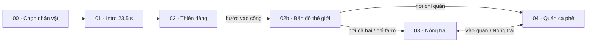

# Game Design Document — Godbean

## Thông tin tài liệu

| | |
|---|---|
| Dự án | **Godbean** — tagline: *Godbean: Build your own Coffee Empire!* (vi: *Xây đế chế cà phê của riêng bạn!*). Tên cũ: COG — Cà phê (đổi 04/11/2026). Repo và remote `cog` của sếp giữ tên cũ |
| Loại tài liệu | Game Design Document (GDD) tổng hợp |
| Phiên bản | 2.1 |
| Cập nhật | 04/11/2026 |
| Trạng thái tài liệu | **Bản nháp tổng hợp** — chưa có người duyệt; xem [mục 0](#0-bảng-trạng-thái) |
| Người duyệt | _(chưa có)_ |
| Đối chiếu code lần cuối | 04/11/2026, commit `4f361ba` (đối chiếu với tài liệu chuẩn, chỉ đọc code) |
| Tài liệu chuẩn của founder | [GODBEAN_MASTER_HANDOFF_2026-11-04.pdf](../references/GODBEAN_MASTER_HANDOFF_2026-11-04.pdf) v1.0 (24 trang). Ưu tiên cao nhất cho gameplay, economy, progression, nhiệm vụ. Trang 1–10 (mục 1–13) thắng Phụ lục A (tr. 10–24, lịch sử). Chỗ GDD/code khác tài liệu chuẩn **không tự sửa code**: ghi ở 0.4 và 15.1. Quyết định của Quang ngày 04/11/2026: [PDF-GDD-GAP-REPORT.md](../reports/PDF-GDD-GAP-REPORT.md) mục 9. Repo làm việc: `beolamtat/V2` (`origin`) → MR sang `tahulk79/COG-CoffeeGame` `main` (`cog`); tên repo `TheCoffeeSixSense` trong PDF §10 không áp dụng (Q-09, chốt 04/11) |
| Nguồn ưu tiên khi mâu thuẫn (luật chi tiết đã chốt) | [rules.md](../screens/03-farm/rules.md) (farm + quán) · [04-cafe/gameplay.md](../screens/04-cafe/gameplay.md) · [02-heaven/gameplay.md](../screens/02-heaven/gameplay.md) · [onboarding-flow.md](../shared/onboarding-flow.md) · [contracts.md](../shared/contracts.md) |
| Số liệu | Theo tài liệu hiện hành và `src/features/farm/content.js`, `rules.js`, `src/features/cafe/recipes.js` tại ngày cập nhật |

**Quy ước cập nhật:** đổi luật hoặc số liệu thì sửa tài liệu gốc của màn trước, sau đó cập nhật GDD và ghi vào [Lịch sử phiên bản](#lịch-sử-phiên-bản).

## Mục lục

0. [Bảng trạng thái](#0-bảng-trạng-thái)
1. [Tổng quan](#1-tổng-quan)
2. [Trụ cột thiết kế](#2-trụ-cột-thiết-kế)
3. [Cốt truyện và nhân vật](#3-cốt-truyện-và-nhân-vật)
4. [Cấu trúc game](#4-cấu-trúc-game)
5. [Gameplay cốt lõi](#5-gameplay-cốt-lõi)
6. [Hệ thống nông trại](#6-hệ-thống-nông-trại)
7. [Hệ thống quán cà phê](#7-hệ-thống-quán-cà-phê)
8. [Nhân sự](#8-nhân-sự)
9. [Tiến trình và người chơi mới](#9-tiến-trình-và-người-chơi-mới)
10. [Kinh tế và cân bằng](#10-kinh-tế-và-cân-bằng)
11. [Giao diện và trải nghiệm](#11-giao-diện-và-trải-nghiệm)
12. [Hình ảnh và âm thanh](#12-hình-ảnh-và-âm-thanh)
13. [Kỹ thuật và dữ liệu](#13-kỹ-thuật-và-dữ-liệu)
14. [Lộ trình và trạng thái](#14-lộ-trình-và-trạng-thái)
15. [Câu hỏi mở và rủi ro](#15-câu-hỏi-mở-và-rủi-ro)
- [Phụ lục A — Bảng nội dung](#phụ-lục-a--bảng-nội-dung)
- [Phụ lục B — Lệch số giữa tài liệu và code](#phụ-lục-b--lệch-số-giữa-tài-liệu-và-code)
- [Phụ lục C — Thuật ngữ](#phụ-lục-c--thuật-ngữ)
- [Phụ lục D — Tài liệu liên quan](#phụ-lục-d--tài-liệu-liên-quan)
- [Lịch sử phiên bản](#lịch-sử-phiên-bản)

---

## 0. Bảng trạng thái

Mục này trả lời ba câu hỏi: **GDD đang ở trạng thái nào**, **code đã làm tới đâu so với GDD**, **GDD còn cần sửa gì**. Cách cập nhật: [design/README.md](README.md).

### 0.1 Tóm tắt cho quản lý

| Câu hỏi | Trả lời (05/11/2026) |
|---|---|
| GDD đang ở trạng thái nào? | Bản nháp tổng hợp v2.1, gom từ tài liệu theo màn và đối chiếu với **tài liệu chuẩn của founder** (PDF 04/11/2026); Quang đã chốt mọi điểm mâu thuẫn và câu hỏi mở từ đối chiếu (04/11/2026), có spec cho Memory, Decode & Awaken, tiến trình, analytics; **chưa có người duyệt** toàn bộ GDD |
| Code đã tới đâu? | 43 tính năng ở bảng 0.3: 34 **Đã code**, 5 **Một phần**, 0 **Đang làm**, 4 **Chưa làm** (F-28…F-43 đã commit tới `4f4ad82`, 05/11). `npm test` 167/167, `npm run build` qua (05/11). QA trình duyệt 04/11: luồng mới NORMAL tới ly V60 đầu + sổ tay, profile MAX (Hướng dẫn, Mục tiêu, Menu/Giá) đạt, 6 lỗi đã sửa; chưa đo hiệu năng. Tiến độ: [IMPLEMENTATION-STATUS.md](../reports/IMPLEMENTATION-STATUS.md) |
| Đã kiểm chứng tới đâu? | Chỉ luồng người chơi mới được playtest (03–04/11/2026) và kinh tế đo bằng mô phỏng. Phần lớn tính năng **chưa có xác nhận chơi thật**; chưa có bằng chứng chạy iPad |
| Lệch tài liệu chuẩn? | Ba hệ thống PDF xếp P0 đã có code (05/11): Coffee Memory (F-33, lát 1), nếm 6 thuộc tính (F-34), Decode / First Sixth Key (F-35, thiếu dữ liệu 2 câu). Đã chốt **kết hợp**: giữ kinh tế đang có, bổ sung các hệ thống này (14.4). Pour-over V60 (F-40) và đánh đổi năng suất–chất lượng (F-41) đã code, số liệu còn chỉnh. Chi tiết: [PDF-GDD-GAP-REPORT.md](../reports/PDF-GDD-GAP-REPORT.md) |
| GDD còn cần sửa gì? | Bảng 0.4; gấp nhất: D-25 (chạy sim để chốt số F-36, F-41, F-42, F-43), D-26 (chọn nơi nhận analytics), D-10 (4 chỗ code robot/sự cố khác spec) |

### 0.2 Chú giải

| Cột | Giá trị | Nghĩa |
|---|---|---|
| Thiết kế | Đề xuất | Ý tưởng có tài liệu, chưa được người dùng duyệt |
| | Đã chốt | Người dùng đã duyệt, là luật hiện hành |
| | Đang chỉnh | Đã chốt nhưng số liệu còn thay đổi theo đo đạc |
| | Bỏ | Đã quyết định không làm |
| Code | Chưa làm | Không có trong code |
| | Đang làm | Có thay đổi chưa commit hoặc mới làm một phần đang dở |
| | Một phần | Đã commit một phần phạm vi |
| | Đã code | Đã commit đủ phạm vi đã chốt |
| Kiểm chứng | Chưa | Chưa có ai chạy/chơi để xác nhận |
| | Test | Có test tự động trong `tests/` (không có nghĩa đã chạy gần đây) |
| | Sim | Đo bằng `scripts/balance-sim.mjs` |
| | Playtest dd/mm | Có người chơi thử ngày đó, kết quả ghi ở tài liệu nguồn |

"Đã code" **không** có nghĩa đã kiểm chứng. Theo quy tắc dự án, người dùng tự test; trạng thái kiểm chứng chỉ ghi khi có bằng chứng.

### 0.3 Tiến độ triển khai theo tính năng

| ID | Tính năng | Mục GDD | Thiết kế | Code | Kiểm chứng | Ghi chú / việc tiếp |
|---|---|---|---|---|---|---|
| F-01 | Chọn nhân vật | 4 | Đã chốt | Đã code | Playtest 04/11 | 04/11: bỏ chọn giới tính/đặt tên, tên ngẫu nhiên theo ngôn ngữ, nút Chơi mobile-first |
| F-02 | Intro 3D 23,5 s | 3, 4 | Đã chốt | Đã code | Playtest 04/11 | Y tế, Thần Chết còn khối tạm; chưa lồng tiếng |
| F-03 | Thiên đàng: hỏi đáp, dấu, hành trang | 5.3 | Đã chốt | Đã code | Test, Playtest 03/11, Playtest 04/11 | `tests/heaven-gameplay.test.js`. 04/11: thêm nút Bỏ qua (`heaven.skipped`) — bỏ qua thì tự lấy hành trang đầu, đi thẳng vào cổng mở bản đồ. 04/11 audit: chơi trọn 6 câu + Bỏ qua trên Chrome; GP-B1 Thần Chết lặp hộp nhận hồ sơ. 05/11: Bỏ qua hiện ở mọi pha chưa xong; sau đó sửa: đặt nhân vật ở đường lên cổng rồi tự đi vào cổng mở bản đồ — thử trên preview desktop 05/11 (chưa commit); nhãn dấu/chuyên gia trung tính (không lộ cà phê) — thử trên preview desktop 05/11. [Audit](audits/2026-11-04-audit-toan-game.md). Đã commit tới `4f4ad82` (05/11) |
| F-04 | Mẹo thiên đàng, hỏi lại câu sai | 5.3, A.1 | Đã chốt | Đã code | Playtest 03/11 | Lỗi mở: reload mất chế độ tự dẫn tới chuyên gia kế |
| F-05 | Ruộng, mua đất liền kề | 6.1 | Đã chốt | Đã code | Playtest 04/11 | Playtest 03/11 chưa đi tới Mua ruộng. 04/11 audit: mua ruộng 2, 3 đúng luật (đi tới biển → xác nhận). [Audit](audits/2026-11-04-audit-toan-game.md). 04/11 dev: farm màn dọc mở camera thấy trọn ruộng (UX-A4), nhãn 3D ẩn sau thẻ nhiệm vụ (UX-A1) |
| F-06 | Cây trồng, chăm sóc | 6.2, A.3 | Đã chốt | Đã code | Test | Tài liệu đã sửa theo code 04/11 |
| F-07 | Chế biến phơi, rang | 6.3 | Đã chốt | Đã code | Test | 3 câu hỏi mở về mẻ (15.1) |
| F-08 | Kho, chợ giảm giá theo ngày | 6.4, 10.3 | Đang chỉnh | Đã code | Sim | |
| F-09 | Nâng cấp tới cấp 20, 3 bậc diện mạo | 6.5 | Đã chốt | Đã code | Sim, Playtest 04/11 | Bậc 2+ là bản sao khối tạm. 04/11 audit: nâng 10 công trình lên 20 trên trình duyệt (652.694 xu). [Audit](audits/2026-11-04-audit-toan-game.md) |
| F-10 | Đơn hàng farm → quán | 6.6 | Đã chốt | Đã code | Playtest 03/11 (một phần) | |
| F-11 | Trang trí hoa, đèn, biển tên | 6.7 | Đã chốt | Đã code | Chưa | |
| F-12 | Công trình sản xuất phụ, trạm song song | 14.3 | Đề xuất | Chưa làm | — | Chờ duyệt `build-proposal.md` |
| F-13 | Vòng ca quán, mục tiêu ca, uy tín | 7.1–7.3 | Đang chỉnh | Đã code | Playtest 03/11, Playtest 04/11 | 04/11 audit: EC-2 danh tiếng theo ly không chạy (`model.js:538`) — đã sửa, có test, chưa chạy, PT-1 thuê barista làm trượt ca. [Audit](audits/2026-11-04-audit-toan-game.md). 04/11 dev: HUD ca cảnh báo cổng ★ (PT-11); giá nhập 45 xu ở nơi chỉ quán (EC-3, chờ duyệt). Test 74/74 |
| F-14 | 11 công thức, bàn pha theo số đo | 7.4, A.4 | Đã chốt | Đã code | Playtest 04/11 | V60 đổi luật ở F-40 (đã code 05/11). 04/11 audit: tự pha Nâu đá ★★★; vạch cân phin ~0,21 s (PT-3). [Audit](audits/2026-11-04-audit-toan-game.md) |
| F-15 | Nâng cấp quán, tự động hóa | 7.6, A.6 | Đã chốt | Đã code | Playtest 04/11 | Bố cục kiểm bằng `?debug=grid`. 04/11 audit: mua toàn bộ thiết bị/tự động hóa/mở rộng. [Audit](audits/2026-11-04-audit-toan-game.md) |
| F-16 | Thợ farm 3 chỗ (F-29), chỉ thị | 8.1 | Đã chốt | Đã code | Test | `tests/worker-avoidance.test.js`, `farm-gameplay.test.js` |
| F-17 | Nhân viên quán, bảng việc | 8.2 | Đã chốt | Đã code | Chưa | |
| F-18 | Robot, sự cố, gói thử robot | 8.3 | Đã chốt | Đã code | Chưa | 4 chỗ code khác spec chờ chốt (D-10); cần đo playtester theo robot-staff mục 12 |
| F-19 | Nhiệm vụ, HUD mở dần, hướng dẫn lần đầu | 9 | Đã chốt | Đã code | Playtest 03/11 | Chưa kiểm đoạn Gửi hạt → Mua ruộng → Tưới/Làm cỏ |
| F-20 | Cân bằng kinh tế | 10 | Đang chỉnh | Đã code | Sim | Chưa playtest phiên dài |
| F-21 | Chỉnh độ vui quán (fun-review) | 14.3 | Đề xuất | Một phần | Chưa | P1–P3 đã vào `04-cafe/gameplay.md`; phần còn lại chờ duyệt (D-06) |
| F-22 | Dòng giống thật, vòng đời nhiều năm | 14.3 | Đề xuất | Chưa làm | — | |
| F-23 | Thợ tự vận hành (staff-ai) | 14.3 | Đề xuất | Một phần | — | Bước 1 (chỉ thị) đã làm |
| F-24 | Đa ngôn ngữ Anh/Việt | 1.2 | Đã chốt | Đã code | Chưa | Commit `4bd9f2e` 04/11: dịch toàn bộ 5 màn, 1.910 khóa; chưa chạy test/chơi thử. Chi tiết: [i18n.md › Nhật ký triển khai](../shared/i18n.md#nhật-ký-triển-khai) |
| F-25 | Âm thanh, VFX phản hồi | 12.2 | Đã chốt | Đã code | Chưa | Chưa có nhạc nền/âm môi trường file thật |
| F-26 | Thay khối tạm bằng asset 3D | 12.3 | Đã chốt | Một phần | Chưa | Theo `assets/registry/` |
| F-27 | Nhóm "Để sau" (cold brew, khách quen, latte art…) | 14.4 | Đề xuất | Chưa làm | — | |
| F-31 | Món mới (Matcha, Matcha Latte, Dirty), sữa Meiji/Dalat Milk, nước máy/Lavie, Auto pha, bàn pha mobile first | 7.4, 7.5 | Đã chốt | Đã code | Test 04/11 | 04/11: code đã commit; `tests/cafe-rules.test.js` qua; toàn bộ `node --test tests/*.test.js` **64/64** (04/11 sau triển khai audit). [ý tưởng](ideas/2026-11-04-menu-mon-moi.md), [04-cafe/gameplay](../screens/04-cafe/gameplay.md). Đã commit tới `4f4ad82` (05/11) |
| F-30 | Pha nhanh một chạm, rót dễ hơn, ly có hạn tươi | 7.4 | Đã chốt | Đã code | Test 04/11 | 04/11 (sau audit): sàn Pha nhanh 70 → 40, món mới ★, ★★ khi tự pha ≥ 70 — chưa chạy test, chưa chơi thử. 04/11: code đã commit; `tests/cafe-rules.test.js` qua (toàn bộ 64/64 ngày 04/11 sau triển khai audit); Auto pha bằng Pha nhanh. [04-cafe/gameplay](../screens/04-cafe/gameplay.md). Đã commit tới `4f4ad82` (05/11) |
| F-29 | 3 slot đội, sao robot/nhân viên/bạn, lười-mệt, chế độ Auto | 8 | Đã chốt | Đã code | Test 04/11, Playtest 04/11 | 04/11: code đã commit; `node --test tests/*.test.js` 64/64 qua (04/11 sau triển khai audit; đã chơi thử Auto trên Chrome); farm + quán 3 slot, robot 1 việc, đa nhiệm theo cấp, Auto 3 × 10 phút; 05/11: Auto chỉ dừng bằng ⏸; Auto không tự đổi cảnh farm ↔ quán — thử trên preview desktop 05/11: đang Auto vào quán, về farm rồi vào lại, quán đóng cửa đều chạy tiếp, khung tệ nhất 41 ms (chưa commit). [crew-autoplay](../shared/crew-autoplay.md). 04/11 audit: 3 slot chặn đúng trên trình duyệt; nút Auto đè modal (UX-1). [Audit](audits/2026-11-04-audit-toan-game.md). Đã commit tới `4f4ad82` (05/11) |
| F-28 | Bản đồ thế giới: chọn nơi trùng sinh, luật theo loại nơi | 4.1 | Đã chốt | Đã code | Playtest 04/11 | 04/11: 8 nơi (cả hai: Việt Nam, Brazil; chỉ trồng: Colombia, Kenya, Indonesia; chỉ quán: Ý, Nhật, Mỹ), loại nơi ẩn tới khi chốt, mỗi nơi 2 nhiệm vụ riêng (thưởng chưa sim); sa bàn 3D địa hình liền (bờ thoải, núi, nước trong, đổ bóng), đảo của nơi chọn bay lên khi chạm. Đã xem thử trong Brave 04/11 (chưa playtest). 04/11 chiều: thay đảo tròn bằng khối hình quốc gia trồi lên, nhãn chỉ còn tên, thẻ khi chạm chỉ ghi địa lý (địa hình, khí hậu, nhiệt độ, mưa, độ cao) — chưa xem lại. [02b-world-map](../screens/02b-world-map/README.md). 04/11 audit: Việt Nam, Ý chơi được; P0 GP-A1 nơi chỉ quán kẹt tiền, GP-A2 không có thẻ nhiệm vụ. [Audit](audits/2026-11-04-audit-toan-game.md). 04/11 dev: sửa vị trí Việt Nam/Nhật trên bản đồ (PT-9), xem lại trên Chrome. Đã commit tới `4f4ad82` (05/11) |
| F-32 | Chợ thế giới: sàn đơn hàng giữa các khu vực (NPC trước) | 6.6, 7 | Đề xuất | Chưa làm | — | [market-proposal](../screens/02b-world-map/market-proposal.md) |
| F-33 | Coffee Memory: ly trong game + ly ngoài đời, lưu dự định + thực tế, so sánh A/B, insight, xuất/xóa | 1.5 | Đã chốt (PDF tr. 5 §5.3; Q-10 04/11) | Một phần | Test 04/11 | Lát 1 code 04/11 (`src/state/memory.js`, `cafe/memory-ui.js`); test `memory.test.js`; QA trình duyệt 04/11 một phần (xem IMPLEMENTATION-STATUS). Spec [coffee-memory.md](../shared/coffee-memory.md). Khóa save riêng `godbean-memory`. Backlog B-01, B-06. Đã commit tới `4f4ad82` (05/11) |
| F-34 | Quick Taste: 6 thuộc tính cảm quan 1–5 + mức thích, chấm độc lập trước khi xem ly cũ, tách khỏi điểm mô hình | 1.5 | Đã chốt (PDF tr. 4 §5.1, tr. 5 §5.3) | Đã code | Test 04/11 | Code 04/11 trong sổ tay; test `memory.test.js`; QA trình duyệt 04/11 một phần (xem IMPLEMENTATION-STATUS). Spec [coffee-memory.md](../shared/coffee-memory.md) mục 5. Không ảnh hưởng giá bán. Backlog B-02. Đã commit tới `4f4ad82` (05/11) |
| F-35 | Decode & Awaken (lớp phủ, không phải màn mới): câu hỏi mở → thử nghiệm → giải mã → Fragment → Message → vận dụng → Sixth Key; First Sixth Key = Key of Curiosity | 1.5, 5.3 | Đã chốt (hướng Q-03 04/11; bảng Fragment ↔ Key v1 theo PROPOSED của PDF) | Một phần | Test 04/11 | Code 04/11 (`src/features/awakening/`): 16 câu hỏi, Fragment/Key, First Sixth Key, 6 Key mở công cụ; test `awakening*.test.js`, `unlocks.test.js`. Câu `region`, `roast-age` chưa có dữ liệu; QA trình duyệt 04/11 một phần (xem IMPLEMENTATION-STATUS). 05/11 đo hiệu năng: sửa hồi quy check không đổi vẫn lưu → giật ~3 s (test có; đo lại 05/11: 100 fps, p99 11 ms). Spec [decode-awaken.md](../shared/decode-awaken.md). Backlog B-07. Đã commit tới `4f4ad82` (05/11) |
| F-36 | Ba trục Wealth / Mastery / Awakening độc lập, hai mục tiêu thắng độc lập (Economic, Discovery) | 1.5, 9.1 | Đã chốt (Q-04, Q-06 04/11), số Đang chỉnh | Đã code | Test 04/11, Sim 04/11 | Code 04/11 (`farm/progression.js`); test `progression.test.js`; sim cấp 15 ở 120′, Economic ~44 giờ; QA trình duyệt 04/11 một phần (xem IMPLEMENTATION-STATUS). Spec [progression.md](../shared/progression.md): XP chợ trần 40/ngày công, Economic ≥ 300.000 xu tài sản, Discovery 6 Key. Chờ sim (D-25). Đã commit tới `4f4ad82` (05/11) |
| F-37 | Dữ liệu người chơi: xuất / nhập / xóa, báo save chỉ nằm trong trình duyệt | 13 | Đã chốt (PDF tr. 5 §5.3 APPROVED) | Đã code | Test 04/11 | Code 04/11 (Cài đặt ▸ Dữ liệu); test `data-export.test.js`; QA trình duyệt 04/11 một phần (xem IMPLEMENTATION-STATUS). Hiện chỉ có Reset (`src/ui/settings.js`). Backlog B-03. Đã commit tới `4f4ad82` (05/11) |
| F-38 | Analytics theo sự kiện từ MVP: event §8.2 + sự kiện game, envelope, hàng chờ, công tắc tắt | 13 | Đã chốt (PDF tr. 6 §8.2; Q-11 04/11) | Đã code | Test 04/11 | Code 04/11 (`src/shared/analytics/`), 23 sự kiện; nơi nhận chưa có (D-26); profile MAX không ghi; QA trình duyệt 04/11 một phần (xem IMPLEMENTATION-STATUS). Spec [analytics.md](../shared/analytics.md). Nơi nhận chưa chọn (D-26). Backlog B-11. Đã commit tới `4f4ad82` (05/11) |
| F-39 | Điểm ly ghi rõ "theo mô hình game" + `SCORE_MODEL_VERSION`; công thức và số đo giữ chữ "thật" | 2, 7.4 | Đã chốt (PDF tr. 4 §5, tr. 9 §11.1; D-21 04/11) | Đã code | Test 04/11 | Code 04/11 (`recipes.js` `SCORE_MODEL_VERSION`, dòng điểm + ⓘ); QA trình duyệt 04/11 một phần (xem IMPLEMENTATION-STATUS). [04-cafe/gameplay](../screens/04-cafe/gameplay.md) mục "Pour-over". Backlog B-04. Đã commit tới `4f4ad82` (05/11) |
| F-40 | Pour-over V60 là phương pháp đầu tiên: có sẵn, 3 giai đoạn rót + nhiệt + thời gian, ly hướng dẫn đầu | 7.4, A.4 | Đã chốt (PDF tr. 4 §5, tr. 7 §9 ph. 1; Quang 04/11) | Đã code | Test 04/11 | Code 04/11; test `v60.test.js`; thời gian ly đầu chưa đo; QA trình duyệt 04/11 một phần (xem IMPLEMENTATION-STATUS). Số liệu Đang chỉnh. [04-cafe/gameplay](../screens/04-cafe/gameplay.md) mục "Pour-over là phương pháp đầu tiên". Backlog B-05. Đã commit tới `4f4ad82` (05/11) |
| F-41 | Đánh đổi năng suất ↔ chất lượng: bón ×1,15 / −6, tỉa ×0,9 / +10, giá chợ theo chất lượng mạnh hơn, Đơn Chợ q ≥ 85 ×1,6 | 6.2, 10.2–10.3 | Đã chốt (PDF tr. 2 §3.2; Quang 04/11), số liệu Đang chỉnh | Đã code | Test 04/11, Sim 04/11 | Code 04/11 (`farm/rules.js`); test `crop-tradeoff.test.js`; sim: chênh 6,8%, bón nhỉnh nhất (D-27); QA trình duyệt 04/11 một phần (xem IMPLEMENTATION-STATUS). Tính tay, chưa sim. [rules.md](../screens/03-farm/rules.md) mục 6. Backlog B-09. Đã commit tới `4f4ad82` (05/11) |
| F-42 | Chủ quán tự đặt giá món: hệ số 0,8–1,3, chỉ đổi khi quán đóng, ảnh hưởng nhịp khách và tip | 7 | Đã chốt (Q-07 04/11), số Đang chỉnh | Đã code | Test 04/11, Sim 04/11 | Code 04/11; test `cafe-price.test.js`; sim: p 0,8 áp đảo (D-28); QA trình duyệt 04/11 một phần (xem IMPLEMENTATION-STATUS). [04-cafe/gameplay](../screens/04-cafe/gameplay.md) mục "Chủ quán tự đặt giá". Chờ sim (D-25). Đã commit tới `4f4ad82` (05/11) |
| F-43 | Vùng ảnh hưởng trồng trọt: hệ số sản lượng / chất lượng / thời gian lớn theo nơi × giống | 4.1, 6.2 | Đã chốt (Q-08 04/11), số Đang chỉnh | Đã code | Test 04/11, Sim 04/11 | Code 04/11 (`REGION_CROP`); test `crop-tradeoff.test.js`; sim co/ke −14%; QA trình duyệt 04/11 một phần (xem IMPLEMENTATION-STATUS). [02b-world-map](../screens/02b-world-map/README.md) mục "Vùng ảnh hưởng trồng trọt". Chờ sim (D-25). Đã commit tới `4f4ad82` (05/11) |

### 0.4 Việc cần sửa trong GDD và tài liệu

| ID | Việc | Tài liệu | Mức |
|---|---|---|---|
| D-25 | Chạy `scripts/balance-sim.mjs` sau khi code để chốt số F-36 (trần XP chợ, ngưỡng cấp), F-41 (bón/tỉa), F-42 (hệ số giá), F-43 (hệ số vùng); sim cần thêm nơi chỉ trồng/chỉ quán (D-13) | GDD 10.5; `progression.md`, `rules.md`, `04-cafe/gameplay.md`, `02b-world-map/README.md` | Cao |
| D-27 | F-41: bón vẫn là lựa chọn nhỉnh nhất (chênh 6,8%, sim 10.5). Đề xuất của economy (chưa duyệt): tăng lượng Đơn Chợ 200 g → ~1.000 g để thưởng chất lượng ≥ 85 có trọng lượng (~10% doanh thu chợ/ngày). Cần Quang quyết | `03-farm/rules.md` mục 6 | Trung bình |
| D-28 | F-42: p 0,8 thắng mọi cấu hình vì quán không quá tải và thưởng ca tính theo số ly. Phương án (chưa duyệt): (a) sàn p 0,9; (b) chi phí vật tư mỗi ly tính theo giá gốc để giảm giá ăn vào lãi; (c) khách tăng khi giảm giá có trần theo sức pha. Cần Quang quyết | `04-cafe/gameplay.md` "Chủ quán tự đặt giá" | Cao |
| D-26 | Chọn nơi nhận analytics (PDF gợi ý Supabase Free) và người cấp project/URL công khai | `shared/analytics.md` mục 5 | Trung bình |
| D-10 | Chốt 4 chỗ code làm khác spec robot/sự cố (C-1…C-4, Phụ lục B): sửa code theo spec hay sửa spec theo code | `shared/robot-staff.md` mục 0 | Cao |
| D-11 | Xem 3 chỗ nghi lỗi code robot/sự cố (B-1…B-3) | `shared/robot-staff.md` mục 0 | Trung bình |
| D-03 | Vòng chơi mục 1 còn nhắc "tách vỏ" và "xay hạt thành bột" ở farm, đã bỏ | `03-farm/rules.md` mục 1 | Trung bình |
| D-04 | `gameplay.md` farm là nhật ký nhiều đợt, chứa bố cục cũ (4 xưởng, máy xay, tách vỏ); cần dọn còn mô tả hiện hành | `03-farm/gameplay.md` | Trung bình |
| D-05 | Ba file đề xuất 02/11 chưa đối chiếu lại với code | `03-farm/*-proposal.md` | Trung bình |
| D-06 | Ghi rõ phần nào của fun-review đã áp dụng, phần nào chờ duyệt | `04-cafe/fun-review.md` | Trung bình |
| D-07 | GDD chưa có: phạm vi bản phát hành (MVP), chỉ số đo thành công (giữ chân, thời gian phiên), mô hình kiếm tiền | GDD mục 1, 14 | Trung bình |
| D-08 | GDD chưa có người duyệt; cần chốt người duyệt và ngày duyệt | GDD thông tin tài liệu | Thấp |
| D-09 | Nhật ký `rules.md` có dòng "bồi dưỡng vẫn còn" mâu thuẫn quyết định bỏ cùng ngày; đánh dấu đã thay | `03-farm/rules.md` | Thấp |
| D-12 | ~~Audit 04/11: 9.1 thiếu nguồn XP; 14.1/14.2/14.4 cũ; mã F-31 trùng~~ **Đã sửa 04/11/2026** (9.1 đủ nguồn XP, 14.x theo bảng 0.3, chợ thế giới đổi thành F-32) | GDD mục 0.3, 9.1, 14 | Xong |
| D-13 | ~~Sim và 10.5 lỗi thời~~ sim đã khớp công thức quán và chạy lại 04/11/2026 (10.5); còn: sim chưa có nhân viên/robot và nơi chỉ trồng/chỉ quán; Phụ lục A.5/A.6 thiếu giá Meiji/Lavie/Matcha/chasen/roastery/autoEspresso. Đã sửa 7.2 (khoảng cách khách) và 8.3 (3 chỗ robot) ngày 04/11 | GDD 10.5, Phụ lục A; sim | Cao |
| D-14 | Audit 04/11: `onboarding-flow.md` mục 3.3 còn menu 6 nút (code dùng HUD v2: thanh 4 nút + drawer Quản lý). Đã sửa 04/11: `game-flow.md` (màn 00), `02-heaven/gameplay.md` (cổng → bản đồ, hành trang đổi theo nơi), dòng "không có nút bỏ qua" ở `onboarding-flow.md` mục 11 | `shared/onboarding-flow.md` mục 3.3 | Trung bình |
| D-15 | **Phần lớn đã sửa 04/11** (crew-autoplay.md dòng 15/71, README 02b `beansSold`, số test). Audit toàn game 04/11: `crew-autoplay.md` tự mâu thuẫn (dòng 15 «chạm bất kỳ đâu» và dòng 71 «Auto không mua bán» trái code); README 02b ghi `sold` cho nhiệm vụ Colombia/Kenya, code dùng `beansSold`; số test trong 0.3 (39/39, 41/41) cũ, hiện 43/43. Chi tiết: [audit 04/11](audits/2026-11-04-audit-toan-game.md) | `shared/crew-autoplay.md`, `02b-world-map/README.md`, GDD 0.3 | Trung bình |

Câu hỏi thiết kế chưa chốt nằm ở [mục 15.1](#151-câu-hỏi-mở); không lặp ở đây.

---

## 1. Tổng quan

### 1.1 Ý tưởng chính

Người chơi bị Thần Chết "kéo nhầm" lên thiên đàng, học nghề cà phê từ Hội đồng trùng sinh, rồi tỉnh lại ở trần gian để tự trồng, chế biến cà phê và mở quán pha bằng công thức thật.

### 1.2 Thông số chung

| | |
|---|---|
| Tên game | **Godbean** · tagline *Godbean: Build your own Coffee Empire!* |
| Thể loại | Mô phỏng nông trại + quản lý quán cà phê, 3D, có cốt truyện mở đầu |
| Nền tảng | Trình duyệt (WebGL / Three.js), ưu tiên mobile, chơi được trên PC |
| Góc nhìn | 3D, camera chéo từ trên cao; farm dùng phép chiếu song song |
| Điều khiển | Bấm/chạm đối tượng để nhân vật tự đi tới làm; WASD/mũi tên trên PC, joystick trên mobile |
| Ngôn ngữ | Anh (mặc định) và Việt, đổi trong ⚙️ Cài đặt; xem [i18n.md](../shared/i18n.md) |
| Lưu | Một save `godbean-progress` trong localStorage |
| Phiên chơi | Đơn vị nhịp: ngày công / vụ 6 phút, ca quán 4 phút |

### 1.3 Đối tượng người chơi

- Người chơi casual thích game nông trại, quản lý quán, chơi ngắn trên điện thoại.
- Người thích cà phê, muốn biết pha phin, espresso, V60 thật sự ra sao.

### 1.4 Điểm khác biệt

- **Kiến thức thật:** giống cà phê, tỉ lệ, độ xay, nhiệt độ, thời gian chiết là luật chơi, không phải chữ trang trí.
- **Hai màn phụ thuộc nhau:** hạt từ farm nuôi quán; quán trả giá cao hơn chợ.
- **Bản sắc Việt:** vườn cao nguyên, phin, cà phê sữa đá, bạc xỉu, cà phê trứng; chất liệu gỗ, mây tre, sơn mài.

### 1.5 Tầm nhìn theo tài liệu chuẩn

Tóm tắt các mục **APPROVED** của [tài liệu chuẩn](../references/GODBEAN_MASTER_HANDOFF_2026-11-04.pdf) (trang/mục ghi trong ngoặc). Mục PROPOSED ghi rõ là đề xuất. Chỗ code chưa làm hoặc làm khác: bảng 0.3 (F-33…F-39), 0.4 (D-16…D-20), 15.1.

| Chủ đề | Luật | Trong game hiện tại |
|---|---|---|
| Định vị (tr. 1 §1) | Game xây đế chế cà phê, vừa giải trí vừa giúp hiểu trồng → sơ chế → rang → xay → pha → phục vụ → kinh doanh; **game-first**, hấp dẫn cả người không thích cà phê. *Hybrid Discovery*: cơ chế cà phê có cơ sở khoa học, truyện/thưởng được hư cấu. *Persistent Discovery*: khám phá được lưu và so sánh lâu dài | Có farm + quán; Persistent Discovery chưa có (F-33) |
| Thông điệp (tr. 1 §1) | *Build Your Own Coffee Empire* (kinh doanh) · *Decode the Divine* (thần thoại) · *Every Bean Holds a Universe* (triết lý) · *From Coffee to Consciousness / The Sixth Taste* (chiều sâu) | Chỉ có tagline đầu |
| Nền tảng (tr. 1 §1) | Web responsive PC / mobile / **iPad** trước, native sau; EN/VI đầu tiên; không cần tài khoản để chơi (Phụ lục tr. 15–16) | Có; chưa kiểm iPad |
| Lore (tr. 1–2 §2) | Godbean = "hạt của Thánh Thần" = hạt dữ liệu (Divine Data Seed / Databean); người chơi tự gieo, biến đổi, thưởng thức, thử nghiệm để giải mã. **Là lore hư cấu**, không tuyên bố cà phê thật chứa năng lượng/dữ liệu đo được | Truyện thiên đàng hiện tại là khung mở đầu; lớp Databean chưa có (3.1) |
| Sixth Taste = Sixth Key (tr. 2 §2.1) | Khoảnh khắc giải mã mở tầng khám phá mới, ba chiều: hiểu mình · hiểu người · hiểu vũ trụ. Vòng xoắn Tò mò → Đúng/Sai → Yêu/Ghét → Đáng yêu/Đáng thương → Tò mò cấp cao (không tất yếu); mỗi lĩnh vực một tầng riêng. **Không xếp hạng "giác ngộ"** | Chưa có (F-35) |
| Hai tầng chơi (tr. 2 §3) | **Learn & Earn**: Farm Play + Coffee Shop Play kiếm XP và vốn. **Build & Expand**: mua đất quê làm farm và/hoặc mặt bằng phố mở quán; Farm Owner / Café Owner; farm cấp hạt cho quán, bán thị trường hoặc mua đối tác, có đánh đổi sản lượng–chất lượng–chi phí–giá–nhu cầu–dòng tiền–uy tín | Khớp khung (5, 6, 7, F-28); đánh đổi sản lượng–chất lượng đã chốt luật (F-41, chưa code); chưa có giá do chủ quán, marketing, chuỗi quán (Q-07) |
| Ba tiến trình (tr. 3 §3.3) | **Wealth** (tiền, đất, thiết bị, quán) · **Mastery** (XP, công thức, kỹ năng, dữ liệu) · **Awakening** (Fragments, Messages, Sixth Keys) độc lập; hai kiểu thắng Economic / Discovery; giàu không đồng nghĩa thức tỉnh | Luật đã chốt, chưa code ([progression.md](../shared/progression.md), F-36) |
| Decode & Awaken (tr. 3 §4) | **Lớp xuyên suốt hai tầng, không phải tầng thứ ba bắt buộc.** Play → Collect Data → Observe → Hypothesize → Experiment → Decode → Understand → Apply → Sixth Key → Awaken → Expand → New Questions. Awaken mở lựa chọn/công cụ/câu chuyện, không chỉ +x% năng suất. *PROPOSED:* 6 loại Fragments, Awakening Tree 6 Key, nhiệm vụ mẫu Yield vs Quality, The Bitter Truth, First Sixth Key | Chưa có (F-35) |
| Khoa học cà phê (tr. 4 §5) | Quan hệ nhân quả hợp lý; **không tự nhận thuật toán đoán đúng vị thật**; không có một công thức tối ưu cho mọi người; **pour-over là phương pháp đầu tiên** | Công thức/số đo giữ chữ "thật", điểm ly ghi "theo mô hình game" (F-39); V60 thành món đầu (F-40) — đều chưa code |
| Coffee Lab & Memory (tr. 4–5 §5.1–5.3) | Giúp tự pha ly ngon ngoài đời và biết đánh giá. 6 thuộc tính cảm quan (aroma, acidity, sweetness, bitterness, body, aftertaste); chua/đắng cao không tự động tốt/xấu; tách đặc tính / chất lượng kỹ thuật / mức yêu thích / ký ức. Flow Brew → Taste độc lập → So lịch sử → Reflect → Save Insight → Plan; chấm trước khi xem điểm cũ; lưu riêng công thức dự định và phiên thực tế; Quick Taste (~30 s) / Journal / Scientist; Repeat Last Brew; xuất/xóa; dữ liệu sức khỏe/cảm xúc tùy chọn và riêng tư; báo rủi ro mất localStorage | Chưa có (F-33, F-34, F-37) |
| Kiếm tiền (tr. 6 §7) | Xem [10.6](#106-nguyên-tắc-kiếm-tiền-theo-tài-liệu-chuẩn) | Chưa có thanh toán |
| Đo lường (tr. 6–7 §8.2) | Đo acquisition → activation → engagement → retention → revenue → referral và giá trị học tập; event tối thiểu và envelope ở PDF tr. 6; không gửi nhật ký/sức khỏe vào analytics | Spec [analytics.md](../shared/analytics.md), chưa code (F-38) |
| Giải đấu, LiveOps, marketing (tr. 5–7 §6, §8.3–8.4) | Sau MVP; MVP chỉ một Brewing Challenge giám khảo cố định | Để sau (14.4) |

**Phụ lục A của PDF (tr. 10–24, GDD cũ "The Coffee Six Sense")** mô tả web 2D cozy với route `/play`, `/memory`…, FTUE "Start Brewing", không có kinh tế trong MVP. PDF ghi phần này chỉ mang tính lịch sử và thua mục 1–13. GDD **giữ** game 3D, luồng 00 → 04 và kinh tế hiện có (khớp §3, §9 Phase 4); chỉ lấy từ Phụ lục các yêu cầu không mâu thuẫn (thang cảm quan 1–5, trường Memory, Definition of Done ở 14.5).

## 2. Trụ cột thiết kế

| # | Trụ cột | Nghĩa là | Ví dụ trong game |
|---|---|---|---|
| 1 | **Cuốn ngay** | Mọi thao tác có hình + tiếng ngay khi trạng thái đổi | Tiền, hàng bay về HUD; ly đầu bán được trước phút thứ 2 |
| 2 | **Có lý do quay lại** | Luôn có việc đang chờ khi trở lại | Cây lớn khi vắng mặt (bù tối đa 4 giờ), đơn hàng, nâng cấp, luyện món lên 3★ |
| 3 | **Hai màn phụ thuộc nhau** | Farm làm ra hạt và là nguồn thu chính (chợ); quán lời hơn **trên mỗi gram** và cho thưởng ca, nhưng bị giới hạn bởi nhịp khách | Chợ giảm giá khi bán nhiều; một ly ~20 g bán ~5 xu (≈0,25 xu/g) so với hạt rang ở chợ 0,07 xu/g; chợ chiếm ~76–85% tổng thu theo sim 04/11/2026 (10.5) |
| 4 | **Học thật** | Công thức và số đo là số thật (g, ml, °C, tỉ lệ), sai thì giải thích lý do thật; **điểm ly ghi rõ là theo mô hình game**, không tự nhận đo đúng vị ly thật (D-21, chốt 04/11/2026; tài liệu chuẩn tr. 4 §5) | Câu hỏi thiên đàng, quầy pha rót tới vạch g/ml/°C |

**Nguyên tắc thiết kế chung** (từ `AGENTS.md`):

- Đây là game, không phải website/dashboard. Ưu tiên thế giới 3D, thao tác trên đối tượng, HUD nhỏ gọn.
- Shop, kho, nâng cấp mở bằng modal game giữa màn hình, có nút đóng, khóa di chuyển khi mở.
- Bản đồ, nhân vật, công trình có tỷ lệ cân đối, đường đi rõ, vật cản hợp lý.
- Khối tạm vẫn phải thể hiện chức năng, trạng thái và điểm tương tác để thay asset mà không viết lại luật.

## 3. Cốt truyện và nhân vật

### 3.1 Cốt truyện

| Chặng | Diễn biến |
|---|---|
| Intro | Nhân vật đi bộ, né xe đạp, va biển, ngã. Y tế đưa lên cáng, Thần Chết tách hồn dẫn lên đường mây tới cổng trời |
| Thiên đàng | Thần Chết giao hồ sơ; gặp ba chuyên gia; Thần Tiếp Nhận tiết lộ người chơi **chỉ ngất**, Thần Chết kéo nhầm (dấu đỏ "CHƯA CHẾT · CHỈ NGẤT") |
| Trần gian | Tỉnh lại, làm chủ một mảnh vườn cà phê và một quán nhỏ |

Tài liệu chuẩn (tr. 1–2 §2) chốt lớp lore **Godbean = Divine Data Seed / Databean**: hạt chứa thông điệp, người chơi tự giải mã qua trồng, pha, nếm, thử nghiệm. Truyện thiên đàng ở trên hiện chưa nói tới lớp này. Hướng nối đã chốt 04/11/2026: câu hỏi ở thiên đàng để lại **câu hỏi mở**, người chơi tự giải mã ở trần gian (mục 5.3, F-35); chi tiết ở [decode-awaken.md](../shared/decode-awaken.md); lời thoại lore 6 đoạn chưa viết.

### 3.2 Nhân vật

| Nhân vật | Vai trò | Trạng thái asset |
|---|---|---|
| Người chơi | Nam hoặc nữ, tên tự đặt ≤ 20 ký tự (mặc định nữ, "An Nhiên") | GLB có rig, cao chuẩn 2 đơn vị |
| Thần Chết | Dẫn hồn, giao nhiệm vụ ở thiên đàng | Khối dựng bằng code |
| Chuyên gia trồng cà phê | 2 câu hỏi về trồng | Khối tạm |
| Chuyên gia pha chế | 2 câu hỏi về pha | Khối tạm |
| Chuyên gia kinh doanh | 2 câu hỏi về kinh doanh | Khối tạm |
| Thần Tiếp Nhận | Kiểm tra hồ sơ, tiết lộ sự thật, trao hành trang | Khối tạm |
| Thợ nông trại | NPC làm vườn, chế biến, giao hàng | Xem [8. Nhân sự](#8-nhân-sự) |
| Nhân viên quán | 14 ứng viên có tên, tiểu sử, 4 chỉ số | Xem [8. Nhân sự](#8-nhân-sự) |
| Khách quán | Xếp hàng, gọi món, ngồi hoặc mang đi | 3D, có thanh kiên nhẫn |

Chưa có lồng tiếng.

## 4. Cấu trúc game

### 4.1 Sơ đồ màn



- 00 → 01 → 02 → 02b → 03/04 là đường một chiều. Qua cổng thiên đàng thì tải lại trang vào thẳng farm (nơi chỉ quán: vào thẳng quán).
- Chỉ farm ↔ quán đi hai chiều, và chỉ ở nơi "cả hai" (Việt Nam); xem [02b-world-map](../screens/02b-world-map/README.md). Quán dùng chung model `farm`; farm vẫn chạy khi người chơi ở quán.
- Chi tiết điều kiện chuyển và dữ liệu đi theo: [game-flow.md](../game-flow.md).

### 4.2 Bảng màn

| Màn | Thời lượng mục tiêu | Vai trò | Tài liệu |
|---|---|---|---|
| 00 Chọn nhân vật | < 30 s | Chọn nam/nữ, tên ngẫu nhiên theo ngôn ngữ | [00-selection](../screens/00-selection/README.md) |
| 01 Intro | 23,5 s, bỏ qua được | Mở truyện | [01-intro](../screens/01-intro/README.md) |
| 02 Thiên đàng | ≤ 150 s | Bài học, nhận mẹo và hành trang | [02-heaven](../screens/02-heaven/README.md) |
| 02b Bản đồ thế giới | < 30 s | Chọn nơi trùng sinh: chỉ farm / chỉ quán / cả hai | [02b-world-map](../screens/02b-world-map/README.md) |
| 03 Nông trại | Vòng chơi chính | Trồng, chế biến, bán, thuê thợ, xây | [03-farm](../screens/03-farm/README.md) |
| 04 Quán | Ca 4 phút | Nhận order, pha tay, bưng ly | [04-cafe](../screens/04-cafe/README.md) |

### 4.3 Điều khiển

| | PC | Mobile |
|---|---|---|
| Di chuyển | Bấm mặt đất, WASD / mũi tên | Bấm mặt đất, joystick analog góc trái |
| Tương tác | Bấm đối tượng; E / Enter / Space ở thiên đàng | Chạm đối tượng |
| Camera farm | Kéo chuột để xem, con lăn / +/− zoom 0,8–1,65, 🎯 về nhân vật | Kéo một ngón, nút +/−, 🎯 |
| Hội thoại | Enter hoặc bấm để tiếp; phím 1–3 chọn đáp án | Chạm để tiếp |

## 5. Gameplay cốt lõi

### 5.1 Vòng lặp chính

```text
Trồng → chăm (tưới / làm cỏ / bón) → hái quả
     → sân phơi (quả → nhân sạch) → lò rang (nhân → hạt rang)
     → bán ở Chợ  hoặc  chuyển về quán pha bán
     → xu → mua ruộng, nâng cấp, thuê thợ, xây trang trí → mở rộng
```

### 5.2 Vòng lặp theo nhịp thời gian

| Nhịp | Người chơi làm gì |
|---|---|
| Vài giây | Chạm cây, hái, nhận mẻ, rót tới vạch |
| 30 s – 2 phút | Chạy mẻ phơi/rang, pha và bưng một ly |
| Ca quán 4 phút | Đạt mốc Đồng/Bạc/Vàng, nhận thưởng ca |
| Ngày công 6 phút | Lứa cây mới, giá chợ hồi, trả lương thợ |
| Nhiều phiên | Mua ruộng, nâng cấp, mở món, luyện 3★, mở rộng đội |

### 5.3 Thiên đàng — vòng học việc (một lần)

Nói chuyện Thần Chết → chọn được dẫn đường hoặc tự khám phá → gặp 3 chuyên gia theo thứ tự tùy chọn (mỗi người 2 câu, 3 đáp án, trả lời một lần) → đủ 3 dấu thì Thần Tiếp Nhận tiết lộ sự thật → chọn hành trang → đi qua cổng.

- Câu đúng cho **mẹo** có tác dụng thật ở farm/quán (Phụ lục A.1).
- Câu sai được giải thích ngay rồi **hỏi lại đúng lúc** ở farm/quán (sau lần hái tay, ra giếng, báo cáo cuối ca, ly dưới 70 điểm, khách bỏ về), tối đa 1 câu mỗi ngày công; hoặc ôn ở Sổ tay thiên đàng trong Hướng dẫn.
- Chơi lại chương không xóa mẹo, không trả thưởng lần hai.
- Hành trang chọn 1, áp một lần khi vào farm (Phụ lục A.2).
- **Câu hỏi mở (chốt hướng 04/11/2026, chưa code):** mẹo giữ nguyên là bài học (Mastery); mỗi câu còn để lại một câu hỏi mở người chơi kiểm chứng ở farm/quán, kiểm chứng xong mới nhận Divine Data Fragment (F-35). Chi tiết: [02-heaven/gameplay.md](../screens/02-heaven/gameplay.md).

## 6. Hệ thống nông trại

### 6.1 Bản đồ và đất

- 4 ruộng × 12 ô (lưới 4×3) = 48 ô. Ruộng 1 có sẵn; ruộng 2–4 giá **120 / 180 / 300 xu**, chỉ mua ruộng liền kề.
- Bấm ô hoặc biển ruộng khóa: nhân vật đi tới biển trước. Đủ tiền và liền kề mới hiện xác nhận; thiếu tiền báo số xu thiếu. Chỉ trừ tiền khi bấm xác nhận.
- Mỗi ruộng có rào riêng và cổng gỗ; ruộng chưa mua đóng cổng.
- Công trình: giếng nước, ao dự trữ, sân phơi, lò rang. Ranh map `FARM_BOUNDS`: x −20 → 11, z −19 → 4.

### 6.2 Cây trồng và chăm sóc

Cây là cây lâu năm: hái không xóa cây, cây sang lứa tiếp theo. Bảng giống: Phụ lục A.3.

| Việc | Khi nào | Ghi chú |
|---|---|---|
| Gieo | Ô trống | Chọn giống ở dải icon nhỏ phía dưới; chỉ trừ hạt khi trồng xong |
| Tưới | Nước < 35 | Mỗi lần tốn 1 lượt nước, đặt nước về 70 (~412 s sau mới cần tưới lại); nước ≤ 15 thì cây ngừng lớn |
| Làm cỏ | Cỏ ≥ 30 | ~857 s từ lúc sạch; cỏ ≥ 75 thì cây ngừng lớn |
| Tỉa cành | Tiến độ ≤ 17%, 1 lần mỗi lứa | Không tỉa: sản lượng ×0,95; tỉa: +5 chất lượng |
| Bón phân | Tiến độ 30–65% (cây trưởng thành thêm 0–17%), nước ≥ 30, 1 lần mỗi lứa | Không bắt buộc, không tăng tốc. Bón: sản lượng ×1,1 và +5 chất lượng; không bón ×0,9 |
| Hái | Quả chín | Quả chín giữ nguyên chờ hái, không tự hỏng |

- **Luật mới chốt 04/11/2026, chưa code (F-41):** bón ×1,15 sản lượng / −6 chất lượng; tỉa ×0,9 / +10; không bón, không tỉa ×1,0. Sớm thì sản lượng thắng, muộn (chợ bão hòa) thì chất lượng thắng qua Đơn Chợ và ly quán. Số và tính tay: [rules.md](../screens/03-farm/rules.md) mục 6.
- Chạm cây = công cụ **Tự chọn**: nhân vật tự làm việc cây cần nhất.
- Dải công cụ (kéo chọn nhiều ô để gieo/tưới hàng loạt) chỉ mở khi có ruộng thứ 2.
- Vắng mặt được tính bù tối đa 8 giờ, cây không chết. Quả chín giữ sản lượng chờ hái nhưng vẫn mất nước, mọc cỏ.
- Sức khỏe cây (sàn 20) ảnh hưởng tốc độ lớn, sản lượng và chất lượng; mưa cộng nước. Chi tiết: [03-farm/gameplay.md](../screens/03-farm/gameplay.md) mục "Nhịp chăm sóc".

### 6.3 Chế biến

| Trạm | Vào → ra (mỗi phần) | Thời gian cơ sở / mẻ | Sức chứa cấp 1 |
|---|---|---|---|
| Sân phơi | 600 g quả → 100 g nhân sạch | 30 s | 18 kg |
| Lò rang | 100 g nhân sạch → 84 g hạt rang | 18 s | 1 kg |

- Mỗi trạm chạy 1 mẻ một lúc; yêu cầu lớn chia thành mẻ nối tiếp, hàng chờ tối đa 48 mẻ.
- Nguyên liệu trừ khi bắt đầu. Xong thì thành phẩm nằm ở giỏ trên trạm, **phải bấm tới nhận**. Kho đầy thì hàng chờ tại trạm, không mất.
- Mẻ chưa chạy hủy được, trả nguyên liệu. Máy xay ở farm đã bỏ.

### 6.4 Kho, mua, bán

- Kho tính theo tổng gram của các **lô**; mỗi lô có chất lượng, nguồn, thời gian. Ba vị trí: kho farm, đang chuyển, kho quán.
- Cửa hàng có ba tab: Cây giống / Vật tư / Chợ. Mọi mua/bán có modal xác nhận.
- Ô số lượng giới hạn 1–99; bán tự do tính theo gram, mặc định bán hết.
- Giá chợ và cơ chế giảm giá: [10. Kinh tế](#10-kinh-tế-và-cân-bằng).

### 6.5 Nâng cấp công trình

- Cấp tối đa 20 cho mọi hạng mục (Thiết bị quán tối đa 10). Lên cấp N cần nông trại cấp N.
- Tốc độ `1 + 0,07 × (cấp − 1)`; công suất `1 + 0,18 × (cấp − 1)`.
- Mẻ đã xếp giữ thông số lúc xếp; nâng cấp chỉ áp cho yêu cầu mới.
- Diện mạo theo bậc: Cơ bản (cấp 1), Cải tiến (10), Chuyên nghiệp (20), mỗi bậc một slot asset riêng.

### 6.6 Đơn hàng farm → quán

| Tab | Điều kiện | Hành động |
|---|---|---|
| Cần làm | Đơn mở, kho chưa đủ hạt rang | Chọn/đổi thợ phụ trách |
| Chờ chuyển | Đơn mở, kho đã đủ | «Chuyển về quán · 2 xu», từng đơn hoặc Chuyển hết |
| Đang chuyển | Hàng đã xuất kho | Xem % và giây còn lại |

- Chỉ phát sinh khi farm có ít nhất 1 thợ; tối đa 2 đơn mở/đang chuyển.
- Chuyển nội bộ không sinh tiền; quán kiếm tiền khi bán ly.

### 6.7 Xây dựng trang trí

- Hiện có: bồn hoa 25 xu, đèn vườn 40 xu, biển tên 30 xu (nhập ≤ 24 ký tự).
- Chọn món → bóng đặt xanh/đỏ → xoay (R) → bấm đất chốt → xác nhận mới trừ xu. Nhân vật tới thi công 5–6 s; phá dỡ 3,5 s, không hoàn xu.
- Không đặt trên ruộng, đường, sát công trình. Tối đa 100 món. Chỉ trang trí, không cộng năng suất.

## 7. Hệ thống quán cà phê

### 7.1 Vòng chơi một ca (4 phút)

1. **Mở cửa:** khách 3D vào, xếp hàng theo dây chắn (tối đa 6 người; dài hơn thì khách quay đi, uy tín −1).
2. **Nhận order:** đứng ở quầy thu ngân là tự nhận order khách đầu hàng. Khách tự tìm ghế; hết ghế thì chờ mang đi.
3. **Pha chế:** modal Quầy pha giữa màn hình, mỗi bước một thao tác (chọn hạt, độ xay, kỹ thuật, hoặc **giữ để rót** tới vạch chuẩn g / ml / °C). Rót quá không rút lại. Sai thì hiện lý do thật.
4. **Bưng ra:** cầm ly, bấm đúng bàn (khách mang đi: bấm quầy thu ngân).
5. **Thanh toán:** giá theo chất lượng; tip theo ★, độ nhanh, combo ≥ 2★ liên tiếp, pha theo trí nhớ.

Rời quán về farm thì quán tạm dừng hoàn toàn, vào lại chơi tiếp đúng chỗ.

### 7.2 Khách và uy tín

- Kiên nhẫn: xếp hàng 55 s, ngồi 80 s, mang đi 50 s. Hết kiên nhẫn thì bỏ về, uy tín −2, mất combo.
- Uy tín quyết định hạng sao quán, tốc độ khách tới và mở món. Uy tín là **thước sức khỏe quán**, trần 100 có chủ ý (món mở muộn nhất ở 65); mỗi ly ★★ +0,6, ★★★ +1,2, ly ★0 −0,6. Xem lại hệ số 0,6 → 0,3 chỉ khi sim cho người chơi một mình đạt 90 trong dưới 11 ca **và** playtest báo hết mục tiêu (NEW-3, 04/11/2026).
- Khoảng cách giữa hai khách (chốt 04/11/2026, NEW-2): `gap = clamp(9 + max(0, 13 − 6,5·H) − (uy tín − 50)·0,06 − số bàn·0,6 − số kiosk, sàn, 24)` × ngẫu nhiên 0,75–1,25, với **sàn = max(3, 20·(1 − C), 20/(1 + 1,5·H))**. H = tay pha hiệu dụng = tổng phần menu mỗi barista pha được (chỉ lấy số barista bằng số trạm pha) + phần menu máy espresso tự động; C = tỉ lệ món trên menu có ít nhất một tay pha ngoài bạn. Hàm `arrivalGap`, `brewForce` trong `cafe/service.js`. Lý do: công thức cũ đếm đầu người và sàn 3 s cố định, quán nâng tối đa có ~80 khách/ca trong khi chỉ pha ~25 ly → khách bỏ về hàng loạt, uy tín về 10.

### 7.3 Mục tiêu ca

| Mốc | Số ly | Thưởng (cần TB ly **bạn tự pha** ≥ 2★) |
|---|---|---|
| Đồng | 4 + hạng sao + round(3 × H) (H: tay pha hiệu dụng, mục 7.2; chốt 04/11/2026, trước là 6 × số người) | 3 xu/ly, uy tín +1 |
| Bạc | ⌈1,4 × Đồng⌉ | 4 xu/ly, uy tín +2 |
| Vàng | ⌈1,8 × Đồng⌉ | 5 xu/ly, uy tín +3 |

- Thưởng ca tối đa 300 xu. Chưa đạt Đồng chỉ −1 uy tín khi dưới nửa mốc Đồng.
- Sao TB chỉ tính ly người chơi tự pha (không tính ly nhân viên/robot); bạn không pha ly nào thì chỉ xét số ly. Lý do (audit 04/11, PT-1): ly nhân viên ★1 kéo TB < 2★ nên thuê người làm trượt ca.
- Cổng TB ≥ 2★ chặn cả Đồng/Bạc/Vàng (trượt cổng: không thưởng, uy tín 0, hoặc −1 nếu dưới nửa mốc Đồng). HUD ca hiện «⚠ n ly · cần TB ★★ (hiện x★)» khi đã đủ ly mốc Đồng mà TB ly bạn pha < 2★ (PT-11, 04/11/2026), thay cho «Gold ✓» gây hiểu nhầm.
- Đóng quán bằng tay hay hết giờ: khách đang chờ **về êm** (👋), không trừ uy tín, báo cáo ca ghi số khách "về lúc đóng cửa".
- **Món của ca** được gọi gấp 3 lần, bán +30%. Ly chủ quán tự pha bán ×2 giá.

### 7.4 Pha chế và thành thạo

- Công thức: Phụ lục A.4.
- 3★ (≥ 90 điểm) mở **pha theo trí nhớ**: ẩn thẻ và vạch chuẩn, +20% tip.
- Điểm ly hiển thị "Điểm theo mô hình game" kèm ⓘ (F-39, chưa code); cảm nhận của người chơi ghi riêng ở Coffee Memory (F-33, F-34).
- Barista NPC chỉ tự pha món người chơi đã luyện đủ điểm (ngưỡng `90 − Trí nhớ × 0,4`).

### 7.5 Nguyên liệu

- **Hạt rang** dùng chung kho quán. Nguồn: đơn từ farm (252 g/đơn) hoặc **Nhập hạt ngoài** 500 g: **75 xu** ở nơi có farm, **45 xu** ở nơi chỉ quán (`supplierPrice(region)`, EC-3 04/11/2026 — giá tạm, chờ Quang duyệt sau khi có sim nơi chỉ quán; lý do: ở 75 xu ly nhân viên Phin đen/Nâu đá lỗ). Nơi chỉ quán hết hạt và tiền dưới giá nhập → **hạt cứu trợ** 300 g miễn phí, mỗi ngày công một lần.
- Save mới có sẵn **600 g hạt vối rang** (lô `starter`, ~30 ly) để ca đầu chơi ngay. Luật mới F-40 (chưa code): thêm 300 g hạt chè rang và 40 giấy lọc cho ly V60 đầu tiên.
- Vật tư nhập theo gói thật: Phụ lục A.5. Thiếu nguyên liệu khi pha thì hiện thứ thiếu kèm nút mở kho.

### 7.6 Nâng cấp quán

| Nhóm | Hạng mục |
|---|---|
| Bàn ghế | 3 → 10 bàn theo cấp quán 1–10; mỗi bàn nâng riêng 2 → 4 ghế, ghế đệm, sofa |
| Thiết bị | Phin, máy xay (cộng chất lượng); máy espresso, vòi đánh sữa, máy đánh trứng/kem, bộ V60 (mở món) |
| Tự động | Trạm pha thêm (tối đa 3), quầy thu ngân 2, robot thu ngân (kiosk), quầy nhận đồ + màn hình gọi số, robot pha espresso |
| Mở rộng | Sân vườn (+2 bàn ngoài trời) |

Giá chi tiết: Phụ lục A.6.

## 8. Nhân sự

### 8.1 Thợ nông trại

- Tối đa **3 chỗ thợ**, trộn robot/người (F-29); robot đúng 1 việc, người 1 mảng việc, cấp 4 → 2 mảng, cấp 7 → đa nhiệm. Thuê là vào làm ngay. Phí tuyển trả một lần.
- Lương `30 + 10 × (cấp − 1)` xu mỗi ngày công 6 phút, tự gia hạn nếu đủ xu. Hết xu thì thợ dừng an toàn.
- Không có năng lượng, nghỉ giữa ca hay bồi dưỡng. Vắng mặt > 60 s không tiêu ngày công đã trả.
- Thợ làm theo **Chỉ thị** (tab trong Nhân viên): Tự chăm vườn, Trồng lấp ô trống, Dùng phân bón, Tự chế biến. Có từ 2 thợ thì chia vùng chăm (tối đa 3 chỗ, F-29).
- Đào tạo tối đa cấp 10, +2 mỗi chỉ số mỗi cấp.
- Việc thợ làm không tính vào nhiệm vụ của người chơi.

### 8.2 Nhân viên quán

- Tối đa **3 người** (F-29); giới hạn vai trong 3 slot: 2 thu ngân, 3 barista, 3 phục vụ, 1 tạp vụ, 1 quản lý ca. Sao ly: robot ★, nhân viên tối đa ★★, bạn ★★★. Người cấp 3 trở lên phụ bưng/dọn khi rảnh.
- Lương theo **ca 4 phút**, chỉ trôi khi quán mở.
- Bảng việc chung: ai rảnh tự nhận việc đúng vai, ưu tiên khách sắp hết kiên nhẫn; mỗi việc được giữ chỗ để không làm trùng.

| Vai | Việc |
|---|---|
| Thu ngân | Đứng sau quầy, nhận order khách đầu hàng |
| Barista | Pha món đã đủ điểm luyện ở trạm pha trống |
| Phục vụ | Lấy ly ở kệ giao, bưng tới khách gấp nhất; rảnh thì dọn bàn |
| Tạp vụ | Ưu tiên dọn bàn |
| Quản lý ca | Cả đội nhanh hơn ~10–20%, tự nhập nguyên liệu sắp hết |

### 8.3 Robot và sự cố

Spec: [robot-staff.md](../shared/robot-staff.md).

| | Farm | Quán |
|---|---|---|
| Robot | Robot vườn, dùng chung 3 chỗ thợ (thuê tới 3 robot, F-29), mỗi robot làm đúng 1 việc; 15 xu/ngày công; gói 1/5/10 ngày = 15/68/113 xu; chỉ tưới, làm cỏ, chế biến, giao hàng | Robot bưng, Robot dọn; 3 xu/ca, không gói; bưng 1 ly/chuyến |
| Sự cố người | Mải chơi ~12%, Nghỉ ốm ~4% (tối đa 1/ngày công) | Mải chơi ~12%, Nghỉ ốm ~4%, Chửi khách ~5% (tối đa 1/ca) |
| Miễn sự cố | 2 ngày công đầu, khi người chơi ở quán, uy tín < 30 | 2 ca đầu, ca gói thử robot, uy tín < 30 |

Gói thử robot pha (một lần): 1 ca robot pha sai thông số thật kèm báo cáo so sánh ly người chơi với ly robot.

## 9. Tiến trình và người chơi mới

### 9.1 Cấp và XP

- Save mới 200 xu.
- Ngưỡng XP cấp nông trại: `0, 30, 90, 190, 350, 600, 950, 1400, 2000, 2800…`.
- Nguồn XP (theo `farm/model.js`, đối chiếu 04/11/2026): nhiệm vụ (`xp` của nhiệm vụ), đơn cửa hàng (`xp` của đơn), bán ở chợ (⌊xu nhận / 2⌋), hái một cây +6, nhận mẻ chế biến +4 mỗi mẻ, mua ruộng +10, mỗi ly bạn hoặc nhân viên pha 1 + số sao (ly robot không có XP).
- **Luật mới chốt 04/11/2026, chưa code (F-36):** XP bán chợ tối đa 40 mỗi ngày công; bỏ XP mua ruộng; thêm XP luyện món ★★/★★★ (+15/+30), Memory (trần 30/ngày công), giải mã câu hỏi mở (+20). Xu không đổi được sang XP, Fragment, Key. Chi tiết: [progression.md](../shared/progression.md).
- Cấp mở giống (chè cấp 2, mít cấp 3) và giới hạn cấp nâng cấp công trình.

### 9.2 Chuỗi nhiệm vụ cố định

Thưởng một lần, chỉ tính thao tác của người chơi.

| # | Nhiệm vụ | Thưởng |
|---|---|---|
| 1 | Hái lứa quả đầu tiên | 10 xu, 4 XP |
| 2 | Bán ly cà phê đầu tiên | 15 xu, 6 XP |
| 3 | Phơi mẻ cà phê đầu tiên | 10 xu, 4 XP |
| 4 | Rang một mẻ hạt | 10 xu, 4 XP |
| 5 | Bán thành quả của mình | 15 xu, 6 XP |
| 6 | Gửi hạt rang về quán | 10 xu, 5 XP |
| 7 | Mua ruộng thứ hai | 10 xu, 5 XP |
| 8–9 | Tưới, Làm cỏ | Theo `content.js` |

Bấm thẻ mục tiêu ở HUD trái thì nhân vật tự đi tới đúng chỗ. Lần đầu thẻ nhấp nháy, có mũi chỉ 3D.

### 9.3 Mở khóa dần

- **HUD lúc mới vào:** avatar/XP, thẻ mục tiêu, xu, Kho, Cài đặt, Hướng dẫn.
- **Mở theo mốc:** Vào quán (sau Hái), Cửa hàng, Đơn hàng, Nâng cấp, Nhân viên, Xây dựng, dải công cụ (từ ruộng 2).
- **Món quán:** theo uy tín và thiết bị (Phụ lục A.4).
- Save cũ đã qua mốc thấy đủ ngay.

### 9.4 Hướng dẫn lần đầu

| Lúc | Hướng dẫn |
|---|---|
| Vào thiên đàng | Gợi ý điều khiển theo thiết bị, tắt sau khi di chuyển hoặc 10 s |
| Vào farm | Gợi ý điều khiển theo thiết bị, tắt sau khi đi + làm một việc, 15 s hoặc × |
| Vào quán | Thẻ 4 bước: Mở cửa → đứng quầy thu ngân → pha → bưng ly |
| Mở quầy pha | Một dòng hướng dẫn rót tới vạch, gợi ý giới hạn 80% điểm bước đó |

Chi tiết: [onboarding-flow.md](../shared/onboarding-flow.md).

## 10. Kinh tế và cân bằng

### 10.1 Nguồn thu và khoản chi

| Nguồn xu | Khoản chi |
|---|---|
| Bán ở Chợ | Hạt giống, phân bón (1 xu/túi) |
| Bán ly ở quán (giá + tip) | Mua ruộng (120/180/300) |
| Thưởng ca (≤ 300 xu) | Nâng cấp công trình và quán |
| Thưởng nhiệm vụ | Lương thợ, nhân viên quán |
| Mẹo thiên đàng (+30 xu), hành trang (+150 xu) | Vật tư quán, hạt nhập ngoài (75 xu/500 g) |
| | Phí chuyển hàng 2 xu/chuyến, trang trí |

### 10.2 Giá sản phẩm

| Sản phẩm | Giá gốc / gram |
|---|---|
| Quả chín | 0,004 xu |
| Nhân sạch | 0,04 xu |
| Hạt rang | 0,07 xu |
| Cà phê bột | 0,072 xu |

Giá nhân theo hệ số giống (Phụ lục A.3) và chất lượng lô: hiện `× (0,7 + 0,3 × q/100)`; luật mới F-41 (chưa code) `× (0,3 + 0,8 × q/100)`.

### 10.3 Chợ giảm giá theo lượng bán

- Mỗi ngày công 6 phút, giá giảm tuyến tính từ 100% xuống sàn 30% khi đã bán 840 xu giá gốc (`MARKET_DAILY = 1200`). Ngày công mới thì hồi giá.
- Tính theo tích phân: bán một lần hay chia nhỏ nhận như nhau. Lượng đã bán lưu trong save.
- **Đơn Chợ** (200 g hạt rang, trả 1,2 × giá gốc, không qua giảm giá): tối đa **2 đơn mỗi ngày công** (`ORDERS_PER_DAY`, chốt 04/11/2026 sau audit EC-1; trước đó lặp vô hạn). Luật mới F-41 (chưa code): lô trung bình q ≥ 85 trả **1,6 ×** giá gốc.
- Mục đích: 2 ruộng bán gần đủ giá, 4 ruộng bão hòa, để hạt dư mang sang quán lời hơn trên mỗi gram. **Chốt 04/11/2026:** chợ vẫn là nguồn thu chính (~76–85% tổng thu theo sim 10.5, có hoặc không có barista); quán không "buộc" phải dùng vì bị giới hạn bởi nhịp khách, không phải thiếu hạt. Giảm chợ chỉ làm chậm tiến trình mà không đổi tỉ lệ, nên giữ nguyên `MARKET_DAILY = 1200`, sàn 30%.

### 10.4 Công thức giá nâng cấp

- Cấp < 10: `base × 1,42^(cấp−1)`
- Cấp ≥ 10: `base × 1,42^9 × (1 + 0,15 × (cấp − 10))²`

### 10.5 Kết quả mô phỏng

`scripts/balance-sim.mjs` chạy chính `model.js` với người chơi mẫu (6 phút farm / ca quán 4 phút, tự mua ruộng và nâng cấp). Kết quả 120 phút (03/11/2026):

| Chỉ số | Kết quả |
|---|---|
| Cấp đạt được | 17–18 |
| Thu từ chợ | ~9–10 nghìn xu |
| Quán + thưởng ca | ~1,5 nghìn xu |
| Số mốc mở khóa | 54 |
| Quãng trống dài nhất | 6 phút |

Bón phân có đánh đổi: chậm mua ruộng lúc đầu, lời về sau. Cân bằng cần playtest thật thêm (mục 15).

**Chạy lại 04/11/2026 sau khi sửa sim cho khớp code** (nơi Việt Nam, hành trang Túi vốn, không thuê người). Sim giờ dùng đúng công thức quán của `cafe/service.js`: khoảng cách khách `9 + 13 − uy tín − bàn − kiosk` (≈ 20 s), mục tiêu ca `4 + hạng`, Pha nhanh theo `quickScore`, sữa/nước theo loại đang dùng. Tự pha giả định 30 s/ly, 82 điểm (★★); Pha nhanh 6 s + 4 s bưng. Chọn cách pha bằng `BREW=mix|hand|quick`. Mỗi cách chạy 3 lượt, 60 phút:

| Cách pha | Tiền ly | Thưởng ca | Ly bán / khách tới | Sao | Uy tín cuối |
|---|---|---|---|---|---|
| mix: tự pha ly đầu mỗi món, sau đó Pha nhanh | 534–550 | 305–352 | 71–75 / 74–77 | ★★ | 63–66 |
| hand: luôn tự pha | 369–378 | 144 | 48 / 73–76 | ★★ | 55–56 |
| quick: chỉ Pha nhanh, không tự pha | 442–453 | **0** | 70–73 / 72–75 | ★ | 50 |

- Chợ chiếm phần lớn thu nhập: 3.951 xu/60 phút (khoảng 82–90% tổng thu), không đổi theo cách pha. Chạy 120 phút (mix): chợ 10.644, tiền ly 1.261, thưởng ca 682, cấp 18.
- Luật Pha nhanh mới có tác dụng: chỉ Pha nhanh thì ly ★, trượt cổng "TB ≥ 2★" nên mất toàn bộ thưởng ca; tự pha mỗi món một lần rồi Pha nhanh là cách lời nhất. Luôn tự pha thì chậm hơn nhịp khách (30 s so với ~20 s), khoảng 1/3 khách còn đứng chờ khi hết ca.
- **Có barista** (`BARISTAS=0..3`: Vy, Khoa, Phát cấp 1; model tự trả lương ca mới khi còn tiền), cách pha mix, 2 lượt mỗi mức, 60 phút:

| Barista | Tiền ly | Thưởng ca | Lương | Quán ròng | Ly bán (nhân viên) | Chợ / tổng thu |
|---|---|---|---|---|---|---|
| 0 | 530–556 | 267–288 | 0 | 797–844 | 69–72 (0) | 82–83% |
| 1 | 373–405 | 306–328 | 60 | 641–651 | 98–99 (83–85) | 85% |
| 2 | 573–576 | 644 | 120 | ~1.100 | 161 (146–148) | 76% |
| 3 | 546–553 | 491 | 180 | ~860 | 160 (149) | 79% |

  - Một barista làm quán **lỗ hơn** tự làm: nhân viên nhận gần hết order, ly nhân viên giá ×1 (ly của bạn ×2), nên tiền ly giảm dù bán nhiều ly hơn. Hai barista mới lời nhờ khách đến nhanh và mục tiêu ca +6/người (thưởng ca gấp đôi). Ba barista bị chặn ở 3,2 kg hạt/giờ vì sim chỉ gửi hạt sang quán đầu mỗi ca (giới hạn của sim).
  - Chợ vẫn chiếm 76–85% tổng thu ở mọi mức. Thử giảm chợ (không có barista): `MARKET_DAILY` 1200 → 900 và sàn 30% → 15% thì thu chợ giảm 27% (3.951 → 2.868 xu/giờ) nhưng chợ vẫn chiếm 78%, vì quán bị giới hạn bởi nhịp khách chứ không phải thiếu hạt; farm còn dư khoảng 10 kg hạt rang mỗi giờ.
- Sim chưa có: phục vụ/thu ngân/robot, sự cố, ly nguội, nơi chỉ trồng/chỉ quán, nhiệm vụ vùng. Khách bỏ về chỉ khi hàng chờ > 6 (giả định của sim, game thật tính theo độ kiên nhẫn).

- **Chạy lại 04/11/2026 sau triển khai audit** (mục tiêu ca 4 + hạng + 3 × tay pha, sao TB chỉ tính ly bạn tự pha, tối đa 2 đơn Chợ/ngày công, uy tín theo từng ly đã chạy lại; `BREW=mix`, 60 phút, 1 lượt mỗi mức):

| Barista | Tiền ly | Thưởng ca | Lương | Đơn Chợ | Ca trượt/Đồng/Bạc/Vàng | Uy tín cuối | Thu/giờ |
|---|---|---|---|---|---|---|---|
| 0 | 616 | 321 | 0 | 32 | 0/0/5/1 | 100 | 4.893 |
| 1 | 591 | 536 | 60 | 32 | 0/0/2/4 | 100 | 5.072 |
| 2 | 954 | 934 | 120 | 32 | 0/0/1/5 | 87 | 5.839 |
| 3 | 582 | 759 | 180 | 32 | 0/0/2/4 | 52 | 5.293 |

  - Thuê người không còn làm trượt ca (trước: 3 barista trượt 5/6 ca, thưởng 48). 2 barista vẫn lời nhất. Chợ vẫn khoảng 3.920 xu/giờ (≈ 67–80% tổng thu).
  - **Còn mở:** uy tín chạm 100 trong khoảng 1 giờ ở 0–1 barista (cần economy-designer xem hệ số +0,6/ly); sim chỉ giao được 1 đơn Chợ vì đơn thứ hai là arabica mà sim chỉ trồng robusta, nên chưa đo hết ảnh hưởng trần 2 đơn/ngày.

- **Chạy lại 04/11/2026 sau F-36, F-41, F-42, F-43 (D-25)** — `scripts/balance-sim.mjs` mở rộng (`MINUTES`, `REGION`, `CARE`, `PRICE`, `FARMONLY`, `PLAN`), Producer chạy:

| Đo | Kết quả | Kết luận |
|---|---|---|
| Cấp theo thời gian (vn, mặc định) | 30′: 8 · 60′: 11 · 120′: **15** · 240′: 20 · 600′: 30 | Trần XP chợ 40/ngày công vẫn đạt ≥ 14 ở 120′ → **không cần chỉnh** ngưỡng (progression.md §2) |
| F-41 chăm cây, 120′, chỉ farm | Bón 14.533 · bón+tỉa 14.366 · không 13.801 · tỉa 13.611 xu; chất lượng 74 / 84 / 80 / 90 | Chênh tốt nhất–kém nhất **6,8%**, không còn "bón+tỉa áp đảo +33%"; nhưng **bón vẫn nhỉnh nhất** ở mọi giai đoạn vì chợ hệ số chất lượng không bù được; Đơn Chợ 1,6× chỉ +6–8 xu/đơn nên gần như không tác động (D-27) |
| F-43 vùng, 60′, chỉ farm | vn 5.995 · id 5.962 · br 5.756 · co/ke 5.165 (−14%); co/ke trồng giống hợp vùng: 6.101 / 6.044 | Không vùng nào thấp hơn vn quá 25% → **OK** |
| F-42 giá quán, 60′ (2 lượt) | 0 barista: p 0,8 → ly 606–685 + ca 406–453; p 1 → 566–574 + 257–269; p 1,3 → 450–493 + 144. 2 barista: p 0,8 → 470–479 + 635–640 (Vàng 6/6); p 1,3 → 304–310 + 162–165 | **p 0,8 thắng mọi cấu hình**: quán không lần nào quá tải (khách bỏ 0) nên tăng giá không có lợi; thưởng ca theo số ly làm giảm giá càng lời → cần chỉnh (D-28) |
| Economic Victory | Tài sản 600′: 66.623 xu, tăng ~6.800 xu/giờ ổn định | 300.000 xu ≈ **44 giờ** chơi (spec ước 50–60) |

### 10.6 Nguyên tắc kiếm tiền theo tài liệu chuẩn

Theo tài liệu chuẩn tr. 6 §7 (APPROVED) và Phụ lục tr. 18 §17:

- F2P; có thể mở IAP, Coffee Pass, Coffee Lab Pro, rewarded ads tự nguyện, brand partnership — **chưa làm trước MVP, không có thanh toán trong prototype**.
- **Không pay-to-win, không bán Sixth Key hay cấp độ tâm thức, không dùng dữ liệu sức khỏe/cảm xúc cho quảng cáo.** Coffee Memory cơ bản và xuất dữ liệu miễn phí. Không khóa kiến thức cơ bản sau paywall.
- *PROPOSED:* Coffee Coins (soft currency — "xu" hiện tại), Coffee Gems (premium, cosmetic), Founder's Pack ~US$4,99 (chưa chốt giá).
- Khi có backend: giao dịch do server quyết, có ledger, idempotency, audit log; không tin số dư client gửi. Hiện save là localStorage, `ledger` chỉ giữ 60 dòng cuối (`farm/model.js`), số dư sửa được ở máy người chơi — chấp nhận ở alpha.

## 11. Giao diện và trải nghiệm

### 11.1 Bố cục HUD farm

| Vùng | Thành phần |
|---|---|
| Trái | Avatar / tên / cấp / XP → thẻ mục tiêu → Cần xử lý → Hoạt động (gập sẵn) |
| Phải | Ô xu (mở Cửa hàng), Cài đặt · Vào quán · Hướng dẫn |
| Dưới | Menu tối đa 6 nút: Kho, Cửa hàng, Nâng cấp, Nhân viên, Đơn hàng, Xây dựng; dải chọn giống / công cụ |
| Giữa trên | Thông báo ngắn, tự mất sau 3 s |

### 11.2 Quy tắc UI

- Modal khóa di chuyển, kích thước ổn định giữa tab, nội dung dài cuộn bên trong.
- Mua/bán và mua ruộng luôn có xác nhận; chỉ trừ tiền khi xác nhận.
- Esc trong hộp xác nhận chỉ đóng hộp đó.
- Chọn giống dùng dải icon nhỏ phía dưới, không làm tối map; ô được chọn sáng viền.
- Khung gỗ, bảng kem, biển tiêu đề xanh, nút đóng tròn; font Baloo 2 / Fredoka.

Chi tiết: [design-system.md](../shared/design-system.md), [ui-audio-vfx.md](../shared/ui-audio-vfx.md).

## 12. Hình ảnh và âm thanh

### 12.1 Định hướng hình ảnh

Hướng **"Phố Nắng Cà Phê"**: stylized ấm, chất liệu Việt.

| Trụ cột hình ảnh | Nghĩa là |
|---|---|
| Nắng cao nguyên ấm | Ánh sáng là nhân vật chính, bóng mát ánh xanh |
| Chất liệu thủ công | Gỗ, mây tre, gốm, vải bố, giấy dó, sơn mài; bề mặt nhám |
| Đọc được trong 1 giây | UI ≤ 20% màn hình; chỉ 1 màu nhấn cho thứ tương tác được |

Chi tiết bảng màu, ánh sáng theo cảnh: [art-direction.md](../shared/art-direction.md).

### 12.2 Âm thanh và hiệu ứng

- Thao tác nào cũng có hình và tiếng; tiền/hàng bay về HUD.
- Quầy pha: tiếng rót/hơi/đánh bọt đổi theo số đo, có tiếng báo vào vạch chuẩn. Pha theo trí nhớ thì tắt gợi ý bằng tiếng.
- Cài đặt âm thanh và chất lượng hình được lưu qua các lần mở game.

### 12.3 Asset 3D

- Quy trình Meshy → Blender → game: [asset-pipeline.md](../assets/asset-pipeline.md).
- Nhiều đối tượng còn là khối tạm; mỗi đối tượng có slot asset riêng để thay mà không đổi luật.

## 13. Kỹ thuật và dữ liệu

| Hạng mục | Mô tả |
|---|---|
| Engine | Three.js, JS module |
| Cấu trúc code | Theo màn ở `src/features/<màn>/`; xem [project-structure.md](../shared/project-structure.md) |
| Save | Một key `godbean-progress` (`version: 1`): `player`, `introCompleted`, `heaven`, `startingGift`, `farm` (`version: 3`), `settings`. Mọi hàm ghi đọc bản cũ rồi gộp |
| Ghi farm | `commit()` sau mỗi thao tác thành công và mỗi ≥ 5 s; quán ghi qua `farm.act(...)` |
| Tìm đường | A* lưới 0,35, chia lô theo ngân sách khung hình; dùng chung cho người chơi, thợ, khách |
| Hiệu năng | Đồ họa mặc định theo thiết bị, tự hạ một bậc khi dưới ~25 fps kéo dài; không post-processing |
| Phân lớp luật | `model.js` sửa số liệu; `rules.js` công thức; `content.js` / `recipes.js` dữ liệu nội dung |
| Hợp đồng dữ liệu | [contracts.md](../shared/contracts.md) |

## 14. Lộ trình và trạng thái

### 14.1 Đã có trong code

| Màn | Tính năng |
|---|---|
| 00–01 | Chọn nhân vật, intro 3D có phụ đề |
| 02 | Thiên đàng với mẹo, hỏi lại câu sai, hành trang |
| 03 | 4 ruộng, 3 giống, chăm sóc, sân phơi, lò rang, chợ giảm giá, nâng cấp tới cấp 20, 3 chỗ trong đội (F-29) với chỉ thị, đơn hàng, trang trí |
| 04 | 11 món, bàn pha theo số đo, ca 4 phút, nhân viên quán, tự động hóa |
| Chung | Luồng người chơi mới, HUD mở dần, lưu cài đặt, robot và sự cố nhân viên, đa ngôn ngữ Anh/Việt |

### 14.2 Đang làm

- F-28 Bản đồ thế giới, F-29 Đội 3 slot và Auto, F-30 Pha nhanh, F-31 Món mới (xem bảng 0.3). Đa ngôn ngữ Anh/Việt (F-24) đã commit 04/11/2026, chờ kiểm chứng.

Tiến độ chi tiết theo tính năng: [mục 0.3](#03-tiến-độ-triển-khai-theo-tính-năng).

### 14.3 Đề xuất chờ duyệt

| Đề xuất | File |
|---|---|
| Công trình sản xuất phụ, xây thêm trạm để chạy song song | [build-proposal.md](../screens/03-farm/build-proposal.md) |
| Dòng giống thật (TR4, TR9, Catimor, Bourbon…), vòng đời cây nhiều năm | [crop-processing-proposal.md](../screens/03-farm/crop-processing-proposal.md) |
| Thợ tự vận hành nông trại sâu hơn | [staff-ai-proposal.md](../screens/03-farm/staff-ai-proposal.md) |
| Chỉnh độ vui vòng chơi quán (giá, mốc ca, khách sành) | [fun-review.md](../screens/04-cafe/fun-review.md) |

### 14.4 Để sau

Cold brew theo mẻ, khách quen có món yêu thích, latte art, sữa/trứng sản xuất từ farm, chợ thế giới giữa các khu vực (F-32; bản đồ thế giới F-28 đã chốt), nhạc nền và âm môi trường bằng file thật, lồng tiếng, thay khối tạm bằng asset 3D.

Theo tài liệu chuẩn, để sau MVP: giải đấu và Virtual Judges (tr. 5 §6), monetization, LiveOps và Founder Control Center (tr. 6–7 §7, §8.3), marketing automation (tr. 7 §8.4), Sixth Realm sâu và native app (tr. 9 GB-012).

**Thứ tự lộ trình theo tài liệu chuẩn** (tr. 7 §9, backlog tr. 9): 0 Audit → 1 Core Brew (pour-over 3 giai đoạn) → 2 Coffee Memory → 3 First Sixth Key → 4 Economy vertical slice → 5 Analytics/Alpha → 6 Expansion.

**Chốt 04/11/2026 (Q-01: kết hợp):** giữ nguyên kinh tế farm + quán đã có (coi là Phase 4 đã vượt phạm vi slice), **bổ sung** Phase 1–3 làm ưu tiên kế tiếp, không gỡ tính năng nào. Thứ tự làm tiếp:

1. F-39 version mô hình điểm, F-37 xuất/xóa dữ liệu (nhỏ, không phụ thuộc).
2. F-40 Pour-over V60 món đầu (Phase 1).
3. F-33 + F-34 Coffee Memory + Quick Taste (Phase 2; spec [coffee-memory.md](../shared/coffee-memory.md)).
4. F-35 câu hỏi mở + First Sixth Key (Phase 3; spec [decode-awaken.md](../shared/decode-awaken.md)).
5. F-41 đánh đổi năng suất–chất lượng, F-43 vùng, F-42 giá do chủ quán, F-36 ba trục + mục tiêu thắng; chạy lại sim (D-25).
6. F-38 analytics — làm sớm cùng bước 1 nếu đã có nơi nhận (D-26), vì Q-11 chốt triển khai từ MVP.

Đề xuất mở rộng kinh tế (F-12, F-22, F-32) vẫn là Đề xuất, xếp sau các mục trên.

### 14.5 Definition of Done (tài liệu chuẩn)

Theo PDF tr. 24 §29 và tr. 9 §11.1, một tính năng chỉ **Done** khi: (1) có source code được lưu phiên bản; (2) chạy lại và test được; (3) dùng được bằng chạm trên iPad và màn hình mobile phổ biến, không phụ thuộc hover; (4) có nội dung EN/VI; (5) không làm hỏng dữ liệu Memory/save đã lưu; (6) không lộ thông tin riêng tư hay khóa bí mật; (7) có mô tả giới hạn của điểm mô phỏng; (8) có build thử nghiệm và người thật đã kiểm tra. Cột Kiểm chứng ở 0.3 chưa dùng tiêu chí này cho tính năng cũ.

## 15. Câu hỏi mở và rủi ro

### 15.1 Câu hỏi mở

Theo [rules.md](../screens/03-farm/rules.md) mục 10:

1. Có gộp lệnh chế biến mới vào mẻ chờ cùng loại không.
2. Nâng cấp có mở nhiều mẻ song song không, cấp nào.
3. Giới hạn hàng chờ giữ 48 hay giảm; có tính mẻ xong chưa nhận không.
4. Xử lý dữ liệu cũ của nhân viên.
5. Cân bằng kinh tế cần playtest thật, không dựa vào vốn thử lớn.

Từ đối chiếu tài liệu chuẩn (chi tiết và phương án: [PDF-GDD-GAP-REPORT.md](../reports/PDF-GDD-GAP-REPORT.md) mục 4.4, quyết định ở mục 9):

| Mã | Câu hỏi | Trạng thái |
|---|---|---|
| Q-01 | Thứ tự lộ trình | **Chốt 04/11:** kết hợp — giữ kinh tế, bổ sung Phase 1–3 (14.4) |
| Q-02 | Vị trí pour-over | **Chốt 04/11:** theo PDF — V60 có sẵn, món hướng dẫn đầu (F-40) |
| Q-03 | Mẹo thiên đàng và Awaken | **Chốt 04/11:** kết hợp — mẹo giữ, thêm câu hỏi mở → Fragment (F-35) |
| Q-05 | Đánh đổi năng suất ↔ chất lượng | **Chốt 04/11:** theo PDF, số do economy cân đối (F-41) |
| Q-09 | Repo canonical | **Chốt 04/11:** làm trên `beolamtat/V2`, MR vào `cog` `main` |
| D-21 | Chữ "thật" hay "mô phỏng" | **Chốt 04/11:** giữ công thức/số đo thật, ghi rõ điểm là mô phỏng (F-39) |
| Q-04 | Ba trục tiến trình | **Chốt 04/11:** tách Wealth / Mastery / Awakening ([progression.md](../shared/progression.md)) |
| Q-06 | Mục tiêu thắng | **Chốt 04/11:** hai mục tiêu độc lập, không kết thúc game (F-36) |
| Q-07 | Giá do chủ quán | **Chốt 04/11:** tự đặt có giới hạn 0,8–1,3 (F-42) |
| Q-08 | Vùng ảnh hưởng số liệu | **Chốt 04/11:** ảnh hưởng sản lượng/chất lượng/thời gian lớn (F-43) |
| Q-10 | Coffee Memory | **Chốt 04/11:** lưu cả ly trong game và ly ngoài đời ([coffee-memory.md](../shared/coffee-memory.md)) |
| Q-11 | Analytics | **Chốt 04/11:** theo sự kiện, từ MVP ([analytics.md](../shared/analytics.md)); nơi nhận còn chọn (D-26) |

### 15.2 Rủi ro

| Rủi ro | Ảnh hưởng | Hướng xử lý |
|---|---|---|
| Nhiều thay đổi 02–03/11/2026 chưa được kiểm chứng trong game | Luồng có thể lỗi dù tài liệu ghi đã triển khai | Playtest theo từng màn |
| Code làm khác spec ở robot/sự cố (Phụ lục B) | Người làm và người chơi hiểu luật khác nhau | Chốt C-1…C-4 (D-10) |
| Người mới thấy khó hiểu ("chả hiểu gì") | Bỏ game sớm | HUD mở dần, thẻ mục tiêu dẫn đường, ly đầu trước phút 2 |
| Sink cuối game hữu hạn (EC-5): nâng hết farm ≈ 653 nghìn xu (~110–130 giờ chơi theo thu nhập sim), quán ≈ 7,7 nghìn, nơi chỉ quán cạn sink sau vài giờ | Cuối game tiền không còn chỗ tiêu | Chưa code. Đề xuất 3 phương án, khuyến nghị trang trí cao cấp: [03-farm/endgame-sink-proposal.md](../screens/03-farm/endgame-sink-proposal.md) — chờ Quang duyệt |
| Khối tạm thay asset chậm | Hình ảnh kém hấp dẫn | Ưu tiên thay khối tạm dễ thấy (art-direction mục 5) |

---

## Phụ lục A — Bảng nội dung

### A.1 Mẹo thiên đàng

| Câu | Mẹo |
|---|---|
| `ripe` | Hái tay +5 chất lượng |
| `water` | Bình tưới +2 lượt |
| `recipe` | Phin đen nóng và Cà phê sữa đá bắt đầu ★ (điểm luyện 40) |
| `adjust` | Màn kết quả ly đánh dấu "Sửa bước này trước" |
| `costs` | +30 xu một lần |
| `customer` | Uy tín quán +3 một lần |

### A.2 Hành trang

| Hành trang | Tác dụng |
|---|---|
| Túi hạt giống | +6 hạt cà phê vối, +6 túi phân |
| Gói mở rộng quán (id `tools`) | Quán lên cấp 2: mở sẵn 4 bàn thay vì 3 |
| Túi vốn nhỏ | +150 xu |

### A.3 Giống cà phê

| Giống | Giá hạt | Mở ở cấp | Lứa đầu | Tái vụ | Sản lượng / lứa | Hệ số giá |
|---|---|---|---|---|---|---|
| Cà phê vối (Robusta) | 10 xu | 1 | 450 s (90 s cây con + 360 s) | 6 phút | 3.000 g quả | ×1 |
| Cà phê chè (Arabica) | 20 xu | 2 | 480 s (120 + 360) | 6 phút | 2.600 g | ×1,3 |
| Cà phê mít (Liberica) | 30 xu | 3 | 546 s (150 + 396) | 6,6 phút | 3.400 g | ×1,5 |

Sản lượng gốc nhân với: bón ×1,1 / không bón ×0,9; không tỉa ×0,95; sức khỏe ×(0,7 + 0,3 × sức khỏe/100).

### A.4 Công thức quán

| Món | Mở khi | Điểm học chính |
|---|---|---|
| Phin đen | Có sẵn | 20 g bột xay vừa thô, ủ 20 ml nước 92–96 °C, nhỏ giọt 4–5 phút |
| Cà phê sữa đá | Có sẵn | Sữa đặc vào ly trước, khuấy tan khi còn nóng |
| Bạc xỉu | Uy tín 55 | Sữa nhiều hơn cà phê, rót cà phê sau cùng |
| Phin cà phê mít | Uy tín 55 | Hạt mít pha phin 20 g, ít đắng, hương trái cây |
| Espresso | Máy espresso | 18 g bột mịn, nén phẳng, chiết 1:2 (~36 g) trong 25–30 s |
| Americano | Máy espresso | Espresso + 100–140 ml nước nóng |
| Cappuccino | + vòi đánh sữa | Sữa 60–65 °C, bọt dày 1–1,5 cm |
| Latte | + vòi đánh sữa | ~200 ml sữa, bọt mỏng 0,5 cm |
| Cà phê trứng | Máy đánh trứng, uy tín 60 | Chỉ lòng đỏ, đánh bông 3–5 phút |
| Cà phê muối | Máy đánh trứng, uy tín 65 | Kem + ~0,5 g muối phủ trên cà phê đá |
| Pour-over V60 | Bộ V60 (luật mới F-40: **có sẵn**, món hướng dẫn đầu; chưa code) | 1:16, tráng giấy lọc, bloom gấp 2 lần bột, 2:30–3:00. Luật mới: thêm bước nhiệt 92–94 °C, rót chính 140–160 g, rót cuối 235–265 g, tổng 2:30–3:00 |

### A.5 Vật tư quán

| Vật tư | Gói | Giá | Có sẵn khi mới chơi |
|---|---|---|---|
| Ly & ống hút | 50 cái | 5 xu | 30 |
| Sữa đặc | Lon 380 g (~300 ml) | 6 xu | 300 ml |
| Sữa tươi | Hộp 1 L | 5 xu | 1.000 ml |
| Đá viên | Túi 2 kg | 2 xu | 2.000 g |
| Trứng gà | Vỉ 10 quả | 4 xu | 0 |
| Kem whipping | Hộp 250 ml | 6 xu | 0 |
| Muối biển | Gói 100 g | 1 xu | 0 |
| Giấy lọc V60 | Hộp 40 tờ | 4 xu | 0 |

### A.6 Thiết bị và tự động hóa quán

| Hạng mục | Giá từng cấp (xu) | Tác dụng |
|---|---|---|
| Bộ phin | có sẵn → 40 → 90 | Giữ nhiệt đều, giọt ổn định |
| Máy xay | có sẵn → 80 → 160 | Xay đều, ít đắng chát |
| Máy espresso | 120 / 200 / 320 | Mở Espresso, Americano |
| Ca & vòi đánh sữa | 60 / 120 | Mở Cappuccino, Latte |
| Máy đánh trứng/kem | 70 | Mở Cà phê trứng, Cà phê muối |
| Bộ V60 + ấm cổ ngỗng | 90 (luật mới F-40: có sẵn; nâng cấp 60 → 120) | Mở Pour-over V60 (luật mới: cộng chất lượng như phin) |
| Trạm pha thêm | 150 / 260 | Thêm barista pha cùng lúc, tối đa 3 trạm |
| Quầy thu ngân 2 | 180 | Hai thu ngân nhận order cùng lúc |
| Robot thu ngân (kiosk) | 200 / 300 | Khách tự gọi món, mỗi cấp thêm 1 máy |
| Quầy nhận đồ + màn hình gọi số | 160 | Khách mang đi tự tới lấy ly |
| Sân vườn | 400 | +2 bàn ngoài trời |

## Phụ lục B — Lệch số giữa tài liệu và code

Đã đối chiếu và sửa ngày 04/11/2026 (D-01, D-02). Tài liệu nguồn nay mô tả theo code; các chỗ **code làm khác spec về hành vi** chưa chốt bên nào đúng:

| # | Spec ghi | Code đang làm | Chi tiết |
|---|---|---|---|
| C-1 | Ly robot bị chê: trần −2 uy tín mỗi ca | Trần −2 cho cả gói | [robot-staff.md](../shared/robot-staff.md) mục 0 |
| C-2 | Farm: chạm thợ mải chơi → «Nhắc» ngay | Chạm thợ mở bảng có «Nhắc» (2 bước) hoặc «Nhắc» trên toast | như trên |
| C-3 | Sự cố quán tới hạn lúc quán đóng → hủy | Dời tới lần mở quán sau | như trên |
| C-4 | (không nói) | Ly robot bị chê vẫn trừ uy tín trong ca tập | như trên |

Nghi lỗi code (B-1 giá hiển thị gói robot, B-2 trả công đè sự cố chưa tới hạn, B-3 điều kiện «Thuê robot thay» lệch): xem robot-staff mục 0.

Code còn vài chỗ tự lệch nhau ở cây trồng, chưa ảnh hưởng luật: mốc tỉa 17% so theo `SEASON_MS` ở `game.js`/`crew.js` nhưng theo `regrowMs` ở `model.js` (lệch với mít); tên giai đoạn `phaseOf` chia `SEASON_MS` thay vì `regrowMs`; số giây còn lại trên cây không tính hệ số sức khỏe trong khi thanh tiến độ có tính; hằng `CARE.feedFrom/feedUntil` khai báo nhưng không dùng.

## Phụ lục C — Thuật ngữ

| Thuật ngữ | Nghĩa |
|---|---|
| Ngày công / vụ | 6 phút thời gian thật (`SEASON_MS`, `WORK_DAY_MS`) |
| Ca quán | 4 phút một lần mở cửa (`CAFE_SHIFT_MS`) |
| Lô | Một phần hàng trong kho có chất lượng, nguồn, thời gian riêng |
| Nhân sạch | Hạt đã phơi và tách vỏ, chưa rang |
| Mẻ | Một lượt chế biến ở sân phơi hoặc lò rang |
| Mẹo | Thưởng có tác dụng thật nhận từ câu đúng ở thiên đàng |
| Hành trang | Quà chọn 1 khi rời thiên đàng |
| Uy tín | Chỉ số quán, quyết định hạng sao, lượng khách, món mở |
| Tay pha | Barista pha được món trên menu hoặc robot espresso |
| Chỉ thị | Thiết lập việc thợ farm tự làm |
| Thợ chính | Thợ đang làm ở farm, điều kiện để phát sinh đơn quán |
| Khối tạm | Hình khối dựng bằng code, chờ thay asset 3D |

## Phụ lục D — Tài liệu liên quan

| Nhóm | File |
|---|---|
| Tài liệu chuẩn | [GODBEAN_MASTER_HANDOFF_2026-11-04.pdf](../references/GODBEAN_MASTER_HANDOFF_2026-11-04.pdf), [PDF-GDD-GAP-REPORT.md](../reports/PDF-GDD-GAP-REPORT.md) |
| Mục lục | [docs/README.md](../README.md), [game-flow.md](../game-flow.md) |
| Theo màn | [00-selection](../screens/00-selection/README.md), [01-intro](../screens/01-intro/README.md), [02-heaven](../screens/02-heaven/README.md), [03-farm](../screens/03-farm/README.md), [04-cafe](../screens/04-cafe/README.md) |
| Luật | [03-farm/rules.md](../screens/03-farm/rules.md), [04-cafe/gameplay.md](../screens/04-cafe/gameplay.md), [02-heaven/gameplay.md](../screens/02-heaven/gameplay.md) |
| Dùng chung | [contracts.md](../shared/contracts.md), [onboarding-flow.md](../shared/onboarding-flow.md), [robot-staff.md](../shared/robot-staff.md), [ui-audio-vfx.md](../shared/ui-audio-vfx.md), [design-system.md](../shared/design-system.md), [art-direction.md](../shared/art-direction.md), [i18n.md](../shared/i18n.md), [coffee-memory.md](../shared/coffee-memory.md), [decode-awaken.md](../shared/decode-awaken.md), [progression.md](../shared/progression.md), [analytics.md](../shared/analytics.md) |
| Asset | [asset-pipeline.md](../assets/asset-pipeline.md), [scene-assets.md](../assets/scene-assets.md) |

## Lịch sử phiên bản

| Phiên bản | Ngày | Thay đổi |
|---|---|---|
| 2.1 | 04/11/2026 | Quang chốt các câu còn mở: D-21 (công thức/số đo thật, điểm ghi là mô phỏng), Q-04 + Q-06 (ba trục độc lập, hai mục tiêu thắng), Q-07 (giá do chủ quán 0,8–1,3), Q-08 (vùng ảnh hưởng trồng trọt), Q-10 (Memory ly game + ly thật), Q-11 (analytics từ MVP). Viết spec `shared/coffee-memory.md` (D-23), `shared/decode-awaken.md` (D-22), `shared/progression.md`, `shared/analytics.md`; `contracts.md` mục 8 (gồm D-24). Thêm F-42, F-43; xong D-21…D-24; thêm D-25, D-26. Sửa cùng: `04-cafe/gameplay.md`, `02b-world-map/README.md`, `03-farm/rules.md` |
| 2.0 | 04/11/2026 | Quang chốt 6 điểm mâu thuẫn với tài liệu chuẩn: lộ trình kết hợp (14.4), Pour-over V60 món đầu (F-40), giữ chữ "thật" (D-21 chờ founder), đánh đổi năng suất–chất lượng (F-41, rules.md mục 6), mẹo thiên đàng + câu hỏi mở (5.3, F-35), repo V2 → MR `cog/main`. Xong D-16…D-20; thêm D-21…D-24; 15.1 còn mở Q-04, Q-06, Q-07, Q-08, Q-10, Q-11. Sửa cùng: `03-farm/rules.md`, `03-farm/gameplay.md`, `04-cafe/gameplay.md`, `02-heaven/gameplay.md`, `shared/onboarding-flow.md`. Phiếu: [changes/2026-11-04-ap-dung-tai-lieu-chuan.md](changes/2026-11-04-ap-dung-tai-lieu-chuan.md) |
| 1.9 | 04/11/2026 | Đối chiếu với tài liệu chuẩn của founder (PDF 04/11/2026): thêm dòng tài liệu chuẩn ở Thông tin tài liệu, mục 1.5 Tầm nhìn, 10.6 Nguyên tắc kiếm tiền, 14.5 Definition of Done, ghi chú lore Databean (3.1) và thứ tự lộ trình (14.4); sửa trụ cột 4 thành "chấm bằng mô hình game"; thêm F-33…F-39 (Chưa làm), D-16…D-20, Q-01…Q-11 (15.1). Không đổi luật đang chạy. Báo cáo: [PDF-GDD-GAP-REPORT.md](../reports/PDF-GDD-GAP-REPORT.md) |
| 1.8 | 04/11/2026 | Thêm F-31 (Đã chốt, Đang làm): 3 món mới, chọn sữa/nước, hạt Robusta Việt Nam/Arabica Ethiopia, Auto pha, bàn pha mobile first; 14 món |
| 1.7 | 04/11/2026 | Đổi tên game thành **Godbean** (tagline "Build your own Coffee Empire!"): tiêu đề trang, màn tải, tiêu đề tab, README, GDD; đổi cả khóa save sang `godbean-progress` / `godbean-player` (không giữ save cũ: chơi lại từ đầu, khóa cũ bị xóa), tên file GDD thành `godbean-gdd.md`, tài liệu và lưu trữ |
| 1.6 | 04/11/2026 | Thêm F-30 (Đã chốt, Đang làm): Pha nhanh, rót dễ hơn, ly có hạn tươi, dọn kệ hết ca |
| 1.5 | 04/11/2026 | Thêm F-29 (Đã chốt, Đang làm): 3 slot farm/quán, sao theo người làm, lười-mệt, Auto; mục 8.1, 8.2 sửa theo |
| 1.4 | 04/11/2026 | Thêm F-28 Bản đồ thế giới (Đã chốt, Đang làm): màn 02b ở mục 4.1, 4.2 |
| 1.3 | 04/11/2026 | F-24 → Đã code (commit `4bd9f2e`, dịch xong 5 màn, chờ kiểm chứng); mục 1.2 sửa ngôn ngữ mặc định thành tiếng Anh cho khớp code |
| 1.2 | 04/11/2026 | Xong D-01 (tài liệu robot/sự cố theo code), D-02 (số cây trồng theo code: lứa đầu 450/480/546 s, tưới về 70, bù vắng mặt 8 giờ, thêm tỉa cành); thêm D-10, D-11; Phụ lục B ghi 4 chỗ code khác spec |
| 1.1 | 04/11/2026 | Thêm mục 0 Bảng trạng thái (tóm tắt, tiến độ 27 tính năng, 9 việc sửa tài liệu); robot chuyển sang Đã code theo đối chiếu code |
| 1.0 | 04/11/2026 | Bản GDD tổng hợp đầu tiên, sắp theo mẫu GDD chuẩn |
