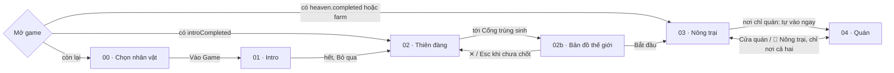

# Game Design Document — Godbean

## Thông tin tài liệu

| | |
|---|---|
| Dự án | **Godbean** — tagline *Godbean: Build your own Coffee Empire!* (vi: *Xây đế chế cà phê của riêng bạn!*). Tên cũ: COG — Cà phê; repo vẫn giữ tên cũ |
| Loại tài liệu | Game Design Document (GDD) tổng hợp |
| Phiên bản | 3.0 |
| Cập nhật | 05/11/2026 |
| Trạng thái tài liệu | **Bản nháp tổng hợp**, chưa có người duyệt (xem [mục 0](#0-bảng-trạng-thái)) |
| Người duyệt | _(chưa có)_ |
| Đối chiếu code | Commit `ebfe1a2` (05/11/2026), chỉ đọc code |
| Tài liệu chuẩn của founder | [GODBEAN_MASTER_HANDOFF_2026-11-04.pdf](../references/GODBEAN_MASTER_HANDOFF_2026-11-04.pdf) v1.0. Ưu tiên cao nhất cho định hướng gameplay, kinh tế, tiến trình. Trang 1–10 (mục 1–13) thắng Phụ lục A của PDF (tr. 10–24, lịch sử). Chỗ game khác tài liệu chuẩn ghi ở [1.5](#15-tầm-nhìn-theo-tài-liệu-chuẩn) và [15.1](#151-câu-hỏi-mở-và-quyết-định) |
| Nguồn ưu tiên khi mâu thuẫn | Code là nguồn sự thật. Luật chi tiết theo màn: [02-heaven/rules.md](../screens/02-heaven/rules.md), [02b-world-map/rules.md](../screens/02b-world-map/rules.md), [03-farm/rules.md](../screens/03-farm/rules.md), [04-cafe/rules.md](../screens/04-cafe/rules.md); vào/ra, dữ liệu, code: README của từng màn ([Phụ lục D](#phụ-lục-d--tài-liệu-liên-quan)) |
| Repo | Làm trên nhánh ở `origin` → PR sang `tahulk79/COG-CoffeeGame` `main` |

**Quy ước cập nhật:** đổi luật hoặc số liệu thì sửa tài liệu của màn trước, rồi cập nhật GDD (tóm tắt, bảng trạng thái) và thêm một dòng ở [Lịch sử phiên bản](#lịch-sử-phiên-bản). GDD chỉ tóm tắt; số liệu chi tiết nằm ở `rules.md` của màn.

## Mục lục

0. [Bảng trạng thái](#0-bảng-trạng-thái)
1. [Tổng quan](#1-tổng-quan)
2. [Trụ cột thiết kế](#2-trụ-cột-thiết-kế)
3. [Cốt truyện và nhân vật](#3-cốt-truyện-và-nhân-vật)
4. [Cấu trúc game](#4-cấu-trúc-game)
5. [Gameplay cốt lõi](#5-gameplay-cốt-lõi)
6. [Hệ thống nông trại](#6-hệ-thống-nông-trại)
7. [Hệ thống quán cà phê](#7-hệ-thống-quán-cà-phê)
8. [Nhân sự và chế độ Auto](#8-nhân-sự-và-chế-độ-auto)
9. [Tiến trình và người chơi mới](#9-tiến-trình-và-người-chơi-mới)
10. [Kinh tế và cân bằng](#10-kinh-tế-và-cân-bằng)
11. [Giao diện và trải nghiệm](#11-giao-diện-và-trải-nghiệm)
12. [Hình ảnh và âm thanh](#12-hình-ảnh-và-âm-thanh)
13. [Kỹ thuật và dữ liệu](#13-kỹ-thuật-và-dữ-liệu)
14. [Lộ trình](#14-lộ-trình)
15. [Câu hỏi mở và rủi ro](#15-câu-hỏi-mở-và-rủi-ro)
- [Phụ lục A — Bảng nội dung](#phụ-lục-a--bảng-nội-dung)
- [Phụ lục B — Lệch còn lại trong code](#phụ-lục-b--lệch-còn-lại-trong-code)
- [Phụ lục C — Thuật ngữ](#phụ-lục-c--thuật-ngữ)
- [Phụ lục D — Tài liệu liên quan](#phụ-lục-d--tài-liệu-liên-quan)
- [Lịch sử phiên bản](#lịch-sử-phiên-bản)

---

## 0. Bảng trạng thái

Mục này trả lời: GDD đang ở trạng thái nào, code đã làm tới đâu, còn việc gì mở.

### 0.1 Tóm tắt

| Câu hỏi | Trả lời |
|---|---|
| GDD ở trạng thái nào? | Bản nháp tổng hợp v3.0, viết lại theo code commit `ebfe1a2`. Chưa có người duyệt |
| Code đã tới đâu? | 49 tính năng ở bảng 0.3: **39 Đã code**, 3 Một phần, 5 Chưa làm, 2 Bỏ (đã thay). Mobile-first F-44…F-48 đã merge (commit `bd0e674`, PR #83) |
| Đã kiểm chứng tới đâu? | Luồng người chơi mới bản cũ đã playtest (03–04/11); kinh tế đo bằng mô phỏng (10.5). Luồng mobile-first mới **chưa chơi thử**; chưa có bằng chứng chạy iPad |
| Lệch tài liệu chuẩn? | Đã chốt hướng **kết hợp**: giữ kinh tế farm + quán, bổ sung Coffee Memory, Decode & Awaken, V60 món đầu, ba trục tiến trình (đều đã code). Còn lệch: lore Databean chưa có lời thoại; F-35 còn 2 câu khóa |
| Việc gấp nhất | D-28 (giá quán p 0,8 áp đảo), D-27 (bón áp đảo), D-25 (sim nơi chỉ trồng/chỉ quán và F-49), D-26 (nơi nhận analytics) |

### 0.2 Chú giải

| Cột | Giá trị | Nghĩa |
|---|---|---|
| Thiết kế | Đề xuất | Có ý tưởng, chưa được duyệt |
| | Đã chốt | Đã duyệt, là luật hiện hành |
| | Đang chỉnh | Đã chốt, số liệu còn đổi theo đo đạc |
| | Bỏ | Không làm, hoặc đã thay bằng tính năng khác |
| Code | Chưa làm | Không có trong code |
| | Một phần | Có một phần phạm vi |
| | Đã code | Có đủ phạm vi đã chốt trong commit đối chiếu |
| Kiểm chứng | Chưa | Chưa có ai chạy/chơi để xác nhận |
| | Test | Có test tự động trong `tests/` (không có nghĩa đã chạy gần đây) |
| | Sim | Đo bằng `scripts/balance-sim.mjs` |
| | Playtest dd/mm | Có người chơi thử ngày đó |

"Đã code" không có nghĩa đã kiểm chứng. Chỉ ghi kiểm chứng khi có bằng chứng.

### 0.3 Tiến độ theo tính năng

| ID | Tính năng | Mục | Thiết kế | Code | Kiểm chứng | Ghi chú |
|---|---|---|---|---|---|---|
| F-01 | Chọn nhân vật, tên ngẫu nhiên, nút Vào Game | 4 | Đã chốt | Đã code | Playtest 04/11 | Không có ô đặt tên |
| F-02 | Intro 3D (xem 22,5 s) | 3, 4 | Đã chốt | Đã code | Playtest 04/11 | Y tế, Thần Chết đã có GLB; chưa lồng tiếng |
| F-03 | Thiên đàng đầy đủ: hỏi 6 câu, dấu, chọn hành trang | 5.3 | Bỏ | — | Test, Playtest 03/11, 04/11 | Thay bằng F-44 (thiên đàng mini) và F-45 (Hội đồng). Save cũ vẫn đọc được |
| F-04 | Mẹo từ câu đúng, hỏi lại câu sai | 5.3, A.1 | Đã chốt | Đã code | Playtest 03/11 | Câu chỉ hỏi lại khi đã gặp chuyên gia |
| F-05 | Ruộng, mua đất liền kề | 6.1 | Đã chốt | Đã code | Playtest 04/11 | |
| F-06 | Cây trồng, chăm sóc | 6.2, A.3 | Đã chốt | Đã code | Test | |
| F-07 | Chế biến phơi, rang | 6.3 | Đã chốt | Đã code | Test | Câu hỏi mở về mẻ ở 15.1 |
| F-08 | Kho, chợ giảm giá theo ngày công | 6.4, 10.3 | Đang chỉnh | Đã code | Sim | |
| F-09 | Nâng cấp tới cấp 20, 3 bậc diện mạo | 6.5 | Đã chốt | Đã code | Sim, Playtest 04/11 | Bậc 2+ còn là bản sao khối tạm |
| F-10 | Đơn hàng farm → quán | 6.6 | Đã chốt | Đã code | Playtest 03/11 (một phần) | |
| F-11 | Trang trí hoa, đèn, biển tên | 6.7 | Đã chốt | Đã code | Chưa | |
| F-12 | Công trình sản xuất phụ, trạm song song | 14.3 | Đề xuất | Chưa làm | — | |
| F-13 | Vòng ca quán, mục tiêu ca, uy tín | 7.1–7.4 | Đang chỉnh | Đã code | Playtest 03/11, 04/11 | |
| F-14 | Công thức, bàn pha theo số đo | 7.5, A.4 | Đã chốt | Đã code | Playtest 04/11 | 14 món |
| F-15 | Nâng cấp quán, tự động hóa | 7.8, A.6 | Đã chốt | Đã code | Playtest 04/11 | |
| F-16 | Thợ farm, chỉ thị | 8.1 | Đã chốt | Đã code | Test | |
| F-17 | Nhân viên quán, bảng việc | 8.2 | Đã chốt | Đã code | Chưa | |
| F-18 | Robot, sự cố, gói thử robot | 8.3 | Đã chốt | Đã code | Chưa | 3 nghi lỗi code ở Phụ lục B (D-11) |
| F-19 | Nhiệm vụ, HUD mở dần, hướng dẫn lần đầu | 9 | Đã chốt | Đã code | Playtest 03/11 | |
| F-20 | Cân bằng kinh tế | 10 | Đang chỉnh | Đã code | Sim | Chưa playtest phiên dài |
| F-21 | Chỉnh độ vui quán | 14.3 | Đề xuất | Một phần | Chưa | Đã code: mục tiêu ca theo sức pha, ly chủ quán ×2, nhịp khách. Chưa: chip mục tiêu, Góc rang +15%, combo chỉ người chơi, nhịp trong ca |
| F-22 | Dòng giống thật, vòng đời nhiều năm | 14.3 | Đề xuất | Chưa làm | — | |
| F-23 | Thợ tự vận hành (hợp đồng ngày/tuần/tháng) | 8 | Bỏ | — | — | Thay bằng F-29. Chỉ thị giữ ở F-16 |
| F-24 | Đa ngôn ngữ Anh/Việt | 13.6 | Đã chốt | Đã code | Chưa | |
| F-25 | Âm thanh, VFX phản hồi | 12.2 | Đã chốt | Đã code | Chưa | Âm tổng hợp; chưa có nhạc nền, âm môi trường |
| F-26 | Thay khối tạm bằng asset 3D | 12.3 | Đã chốt | Một phần | Chưa | |
| F-27 | Nhóm "Để sau" (cold brew, khách quen, latte art…) | 14.4 | Đề xuất | Chưa làm | — | |
| F-28 | Bản đồ thế giới: 8 nơi, luật theo loại nơi | 4, 6, 7 | Đã chốt | Đã code | Playtest 04/11 | |
| F-29 | 3 slot đội, sao theo người làm, lười-mệt, Auto | 8 | Đã chốt | Đã code | Test 04/11, Playtest 04/11 | |
| F-30 | Pha nhanh, rót dễ hơn, ly có hạn tươi | 7.5 | Đã chốt | Đã code | Test 04/11 | |
| F-31 | Món mới (Matcha, Matcha Latte, Dirty), sữa/nước theo nhãn, Auto pha | 7.5, 7.7 | Đã chốt | Đã code | Test 04/11 | |
| F-32 | Chợ thế giới giữa các nơi | 14.3 | Đề xuất | Chưa làm | — | |
| F-33 | Coffee Memory: ly game + ly ngoài đời, so A/B, Insight | 7.9 | Đã chốt | Đã code | Test 04/11 | Khóa riêng `godbean-memory` |
| F-34 | Quick Taste 6 thuộc tính, chấm trước khi xem ly cũ | 7.9 | Đã chốt | Đã code | Test 04/11 | Không ảnh hưởng giá bán |
| F-35 | Decode & Awaken, First Sixth Key | 9.5 | Đã chốt (Fragment ↔ Key v1) | Một phần | Test 04/11 | Thiếu 2 câu: `region` (mẫu hái không ghi vùng), `roast-age` (chưa có luật hạn hạt rang; chạy câu `variety` thay) |
| F-36 | Ba trục Wealth / Mastery / Awakening, hai mục tiêu thắng | 9.1, 9.6 | Đã chốt, số Đang chỉnh | Đã code | Test 04/11, Sim 04/11 | |
| F-37 | Xuất / nhập / xóa dữ liệu | 13.3 | Đã chốt | Đã code | Test 04/11 | |
| F-38 | Analytics theo sự kiện | 13.5 | Đã chốt | Đã code | Test 04/11 | Chưa có nơi nhận (D-26) |
| F-39 | Điểm ly ghi "theo mô hình game" + `SCORE_MODEL_VERSION` | 2, 7.5 | Đã chốt | Đã code | Test 04/11 | |
| F-40 | Pour-over V60 có sẵn, món đầu | 7.5, A.4 | Đã chốt, số Đang chỉnh | Đã code | Test 04/11 | |
| F-41 | Đánh đổi sản lượng ↔ chất lượng (bón, tỉa, giá chợ) | 6.2, 10.2 | Đã chốt, số Đang chỉnh | Đã code | Test 04/11, Sim 04/11 | Bón vẫn nhỉnh nhất (D-27) |
| F-42 | Chủ quán tự đặt giá 0,8–1,3 | 7.6 | Đã chốt, số Đang chỉnh | Đã code | Test 04/11, Sim 04/11 | p 0,8 áp đảo (D-28) |
| F-43 | Hệ số vùng × giống | 6.2 | Đã chốt, số Đang chỉnh | Đã code | Test 04/11, Sim 04/11 | |
| F-44 | Mobile-first: thiên đàng mini ≤ 5 hộp, quà cố định, chọn sẵn Việt Nam | 4, 5.3 | Đã chốt (chưa qua sếp) | Đã code | Chưa | Merge `bd0e674` (PR #83). Chưa đo thời lượng |
| F-45 | Hội đồng so le ở trần gian (Cổng Hội đồng, vật Hội đồng) | 5.3 | Đã chốt (chưa qua sếp) | Đã code | Chưa | Merge `bd0e674`. Có `tests/council.test.js`. Tọa độ chưa chơi thử ở 375×812 |
| F-46 | Tutorial ép `farm-intro` (gieo → hái → phơi → rang), kéo-gieo | 9.3 | Đã chốt (chưa qua sếp) | Đã code | Chưa | Merge `bd0e674` |
| F-47 | Quán ca tập + ly V60 làm mẫu | 7.2 | Đã chốt (chưa qua sếp) | Đã code | Chưa | Merge `bd0e674`. Có `tests/v60.test.js`. Còn mở: nguồn chè cho nơi chỉ quán khi hết lô `starter` |
| F-48 | Công trình thay nút HUD (pha 1): Cửa quán, Bảng đơn, Sạp, Nhà thợ | 6.1, 11.1 | Đã chốt (chưa qua sếp) | Đã code | Chưa | Merge `bd0e674`. Có `tests/farm-buildings.test.js`. Chưa: `!` ở Nhà thợ, pha 2 (mốc theo cấp) |
| F-49 | Trục Cấp duy nhất, XP theo nguồn, tự nhận mẻ nấc 2, sự cố miễn theo cấp | 14.3 | Đề xuất (chờ sếp + sim) | Chưa làm | — | |

### 0.4 Việc còn mở trong thiết kế

| ID | Việc | Mức |
|---|---|---|
| D-28 | F-42: p 0,8 thắng mọi cấu hình vì quán không quá tải và thưởng ca tính theo số ly. Phương án chưa duyệt: (a) sàn p 0,9; (b) tính vật tư mỗi ly theo giá gốc; (c) khách tăng khi giảm giá có trần theo sức pha | Cao |
| D-27 | F-41: bón vẫn là lựa chọn nhỉnh nhất (chênh 6,8%). Phương án chưa duyệt: tăng lượng Đơn Chợ 200 g → ~1.000 g để thưởng chất lượng ≥ 85 có trọng lượng | Trung bình |
| D-25 | Sim chưa có: nơi chỉ trồng / chỉ quán, phục vụ/thu ngân/robot, sự cố, ly nguội, nhiệm vụ vùng. F-49 cần sim trước khi chốt số | Cao |
| D-26 | Chọn nơi nhận analytics (tài liệu chuẩn gợi ý Supabase Free) và người cấp URL công khai | Trung bình |
| D-11 | Xem 3 nghi lỗi code robot/sự cố (B-1…B-3, Phụ lục B) | Trung bình |
| D-10 | Xác nhận 4 hành vi robot/sự cố đang theo code là luật chốt: trần −2 uy tín ly robot cho cả gói; «Nhắc» thợ farm qua bảng hoặc toast; sự cố quán dời khi quán đóng; ly robot bị chê vẫn trừ uy tín trong ca tập | Thấp |
| D-07 | GDD chưa có: phạm vi bản phát hành (MVP), chỉ số thành công (giữ chân, thời gian phiên) | Trung bình |
| D-08 | Chốt người duyệt GDD và ngày duyệt | Thấp |

---

## 1. Tổng quan

### 1.1 Ý tưởng chính

Người chơi bị Thần Chết "kéo nhầm" lên thiên đàng, được báo là chưa chết, rồi chọn nơi trùng sinh trên bản đồ thế giới. Ở trần gian họ trồng, chế biến cà phê, mở quán pha bằng công thức thật, và gặp dần ba chuyên gia của Hội đồng trùng sinh.

### 1.2 Thông số chung

| | |
|---|---|
| Tên game | **Godbean** · *Build your own Coffee Empire!* |
| Thể loại | Mô phỏng nông trại + quản lý quán cà phê, 3D, có cốt truyện mở đầu |
| Nền tảng | Trình duyệt (WebGL, Three.js), ưu tiên mobile, chơi được trên PC |
| Góc nhìn | 3D phối cảnh, camera chéo từ trên cao |
| Điều khiển | Chạm/bấm đối tượng để nhân vật tự đi tới làm; joystick trên mobile; WASD/mũi tên trên PC |
| Ngôn ngữ | Anh (mặc định) và Việt, đổi trong ⚙️ Cài đặt |
| Lưu | localStorage: `godbean-progress` (tiến trình), `godbean-player`, `godbean-memory`, `godbean-analytics` (13.2) |
| Nhịp | Ngày công / vụ cây 6 phút, ca quán 4 phút |

### 1.3 Đối tượng người chơi

- Người chơi casual thích game nông trại, quản lý quán, chơi ngắn trên điện thoại.
- Người thích cà phê, muốn biết pha phin, espresso, V60 thật sự ra sao.

### 1.4 Điểm khác biệt

- **Kiến thức thật:** giống, tỉ lệ, độ xay, nhiệt độ, thời gian chiết là luật chơi.
- **Hai màn phụ thuộc nhau:** hạt từ farm nuôi quán; quán lời hơn trên mỗi gram.
- **Bản sắc Việt:** vườn cao nguyên, phin, cà phê sữa đá, bạc xỉu, cà phê trứng; gỗ, mây tre, sơn mài.
- **Học ngoài đời:** sổ tay Coffee Memory ghi cả ly pha ngoài đời.

### 1.5 Tầm nhìn theo tài liệu chuẩn

Tóm tắt các mục APPROVED của [tài liệu chuẩn](../references/GODBEAN_MASTER_HANDOFF_2026-11-04.pdf) (trang/mục trong ngoặc).

| Chủ đề | Luật | Trong game |
|---|---|---|
| Định vị (tr. 1 §1) | Game xây đế chế cà phê, vừa giải trí vừa giúp hiểu trồng → sơ chế → rang → pha → kinh doanh; game-first. Cơ chế cà phê có cơ sở khoa học, truyện và thưởng là hư cấu. Khám phá được lưu lâu dài | Có farm + quán, Coffee Memory, Decode |
| Thông điệp (tr. 1 §1) | *Build Your Own Coffee Empire* · *Decode the Divine* · *Every Bean Holds a Universe* · *The Sixth Taste* | Chỉ có tagline đầu |
| Nền tảng (tr. 1 §1) | Web responsive PC / mobile / iPad trước, native sau; EN/VI; không cần tài khoản | Có; chưa kiểm iPad |
| Lore (tr. 1–2 §2) | Godbean = Divine Data Seed / Databean, là lore hư cấu | Có đoạn lore giữ chỗ theo Key (9.5); thiên đàng chưa nói tới Databean |
| Sixth Key (tr. 2 §2.1) | Khoảnh khắc giải mã mở tầng khám phá mới; không xếp hạng "giác ngộ" | Có (9.5) |
| Hai tầng chơi (tr. 2 §3) | Learn & Earn (farm + quán) và Build & Expand (đất, quán, đánh đổi sản lượng–chất lượng–giá) | Có; chưa có marketing, chuỗi quán |
| Ba tiến trình (tr. 3 §3.3) | Wealth · Mastery · Awakening độc lập; hai kiểu thắng Economic / Discovery | Có (9.1, 9.6) |
| Decode & Awaken (tr. 3 §4) | Lớp phủ xuyên suốt, không bắt buộc; Awaken mở lựa chọn/công cụ/câu chuyện, không cộng % | Có (9.5) |
| Khoa học cà phê (tr. 4 §5) | Không tự nhận đoán đúng vị thật; không một công thức tối ưu; pour-over là phương pháp đầu | Điểm ly ghi "theo mô hình game"; V60 có sẵn, là ly đầu |
| Coffee Lab & Memory (tr. 4–5 §5.1–5.3) | 6 thuộc tính cảm quan, chấm độc lập trước khi xem ly cũ, Insight, xuất/xóa, dữ liệu riêng tư | Có (7.9, 13.3) |
| Kiếm tiền (tr. 6 §7) | Xem 10.6 | Chưa có thanh toán |
| Đo lường (tr. 6–7 §8.2) | Sự kiện tối thiểu và envelope; không gửi nhật ký/sức khỏe | Có (13.5); chưa có nơi nhận |
| Giải đấu, LiveOps, marketing (tr. 5–7) | Sau MVP | Để sau (14.4) |

Phụ lục A của PDF (GDD cũ "The Coffee Six Sense": web 2D, route `/play`, không kinh tế) chỉ mang tính lịch sử. Game giữ 3D, luồng 00 → 04 và kinh tế hiện có; chỉ lấy từ Phụ lục các yêu cầu không mâu thuẫn (thang cảm quan 1–5, trường Memory, Definition of Done ở 14.5).

## 2. Trụ cột thiết kế

| # | Trụ cột | Nghĩa là | Ví dụ |
|---|---|---|---|
| 1 | **Cuốn ngay** | Mọi thao tác có hình + tiếng ngay khi trạng thái đổi | Tiền, hàng bay về HUD; mục tiêu ly đầu ≤ 2 phút sau khi vào farm |
| 2 | **Có lý do quay lại** | Luôn có việc chờ khi trở lại | Cây lớn khi vắng (bù tối đa 8 giờ), đơn hàng, chuyên gia mới ở Hội đồng, luyện món 3★ |
| 3 | **Hai màn phụ thuộc nhau** | Farm làm ra hạt và là nguồn thu chính; quán lời hơn trên mỗi gram nhưng bị giới hạn bởi nhịp khách | Một ly ~20 g bán ~5 xu (≈ 0,25 xu/g) so với hạt rang ở chợ 0,07 xu/g |
| 4 | **Học thật** | Công thức và số đo là số thật (g, ml, °C); sai thì giải thích lý do thật; điểm ly ghi rõ "theo mô hình game" | Rót tới vạch g/ml/°C; câu hỏi Hội đồng |

**Nguyên tắc chung:**
- Đây là game, không phải website. Ưu tiên thế giới 3D, thao tác trên đối tượng, HUD nhỏ gọn.
- Shop, kho, nâng cấp mở bằng modal giữa màn hình, có nút đóng, khóa di chuyển. Ngoại lệ: Auto bật thì nhân vật vẫn làm việc phía sau modal.
- Công trình thay nút HUD khi có thể (F-48): chạm vật thể 3D để mở chức năng.
- Bản đồ, nhân vật, công trình có tỷ lệ cân đối, đường đi rõ, vật cản hợp lý.
- Khối tạm vẫn thể hiện chức năng, trạng thái và điểm tương tác để thay asset mà không viết lại luật.

## 3. Cốt truyện và nhân vật

### 3.1 Cốt truyện

| Chặng | Diễn biến |
|---|---|
| Intro | Nhân vật đi trên phố, né xe đạp, va biển cảnh báo, ngã. Y tế đưa lên cáng; Thần Chết tách hồn, dẫn lên đường mây tới cổng trời |
| Thiên đàng | Thần Chết và Thần Tiếp Nhận báo người chơi bị kéo nhầm, **chưa chết · chỉ ngất**; Hội đồng trùng sinh sẽ tìm người chơi ở trần gian. Nhận Túi hạt giống, đi qua Cổng trùng sinh |
| Bản đồ | Chọn một trong 8 nơi trùng sinh; loại nơi lộ ra sau khi chốt |
| Trần gian | Làm chủ vườn cà phê và/hoặc quán nhỏ. Ba chuyên gia lần lượt tới Hội đồng theo mốc chơi |

Lore Databean (tài liệu chuẩn) nối qua lớp Decode: 6 câu hỏi của chuyên gia để lại câu hỏi mở, người chơi tự kiểm chứng ở trần gian (9.5). Đoạn lore 1–6 hiện chữ giữ chỗ, ghi rõ "Lore hư cấu".

### 3.2 Nhân vật

| Nhân vật | Vai trò | Asset |
|---|---|---|
| Người chơi | Nam hoặc nữ, tên ngẫu nhiên theo ngôn ngữ và giới tính (mặc định nữ) | GLB có rig (`male.glb`, `girl.glb`) |
| Thần Chết | Dẫn hồn ở intro, mở thoại ở thiên đàng | `heaven/reaper.glb` |
| Thần Tiếp Nhận | Tiết lộ sự thật, trao quà | `heaven/clerk.glb` |
| Nhân viên y tế (2) | Cứu hộ ở intro | `intro/medic-m.glb`, `medic-f.glb` |
| Thần Nông, Thần Pha Chế, Thần Thương Hội | Hội đồng trùng sinh, mỗi người 2 câu | Bóng ở Cổng Hội đồng (khối tạm); thiên đàng không nạp |
| Thợ nông trại | 8 ứng viên người + 3 Robot vườn | Khối tạm |
| Nhân viên quán | 14 ứng viên người có tiểu sử, 4 chỉ số; robot bưng, dọn, pha | `staff.glb`; robot khối tạm |
| Khách quán | Xếp hàng, gọi món, ngồi hoặc mang đi | `guest-m.glb`, `guest-f.glb` |

Chưa có lồng tiếng.

## 4. Cấu trúc game

### 4.1 Sơ đồ màn



- Mở game luôn vào nông trại khi đã có save farm hoặc đã xong thiên đàng (`enterFarm`, `app/game.js`). Nơi chỉ quán: farm tải xong tự vào quán (`farm/game.js`), không có đường về.
- 00 → 01 → 02 → 02b → 03 là đường một chiều. Đóng bản đồ khi chưa chốt thì đứng lại trước cổng thiên đàng.
- Farm ↔ quán đi hai chiều chỉ ở nơi loại "cả hai" (Việt Nam, Brazil). Quán dùng chung model farm; farm vẫn chạy khi người chơi ở quán; quán tạm dừng khi người chơi rời.
- Hội đồng mở tại chỗ (hội thoại đáy màn), không đổi cảnh.

### 4.2 Chuyển màn và dữ liệu đi theo

| Từ → tới | Khi nào | Dữ liệu |
|---|---|---|
| 00 → 01 | Bấm **Vào Game** | Ghi `godbean-player` (`gender`, `name` ngẫu nhiên); giữ model đã chọn |
| 01 → 02 | Hết `DURATION` 23,5 s, Bỏ qua, hoặc tua hết thoại | `completeIntro`: `introCompleted`, `chapter ≥ 2`, `accident` |
| 02 → 02b | Nhân vật tới Cổng trùng sinh | `heaven` (pha, `gift = 'seeds'`) đã lưu |
| 02b → 02 | ✕ / Esc khi chưa chốt; lỗi tải bản đồ | Không lưu gì (`cancelPortal`) |
| 02b → 03 | Bấm **Trùng sinh ở đây** rồi **Bắt đầu** | `startingRegion` ghi ngay khi chốt; `heaven.completed`, `mode = 'mini'`; truyền `gift`, câu đúng (mẹo), câu đã trả lời (đã gặp) cho `createFarm` |
| 03 → 04 | Chạm Cửa quán (đi tới thảm rồi vào) hoặc ☕ trong ≡ | Dùng chung model `farm` (`farm.act('cafe', …)`) |
| 04 → 03 | Nút 🌱 Nông trại hoặc Esc hai lần trong 2,5 s | Quán tạm dừng; nhân vật đứng trước Cửa quán |

Chi tiết từng màn: [00](../screens/00-selection/README.md), [01](../screens/01-intro/README.md), [02](../screens/02-heaven/README.md), [02b](../screens/02b-world-map/README.md), [03](../screens/03-farm/README.md), [04](../screens/04-cafe/README.md).

### 4.3 Bảng màn

| Màn | Thời lượng | Vai trò | Tài liệu |
|---|---|---|---|
| 00 Chọn nhân vật | < 30 s | Chọn nam/nữ | [README](../screens/00-selection/README.md) |
| 01 Intro | 22,5 s, bỏ qua được | Mở truyện | [README](../screens/01-intro/README.md) |
| 02 Thiên đàng | Mục tiêu ≤ 25 s (chưa đo) | Tiết lộ, nhận quà, qua cổng | [README](../screens/02-heaven/README.md) · [rules](../screens/02-heaven/rules.md) |
| 02b Bản đồ thế giới | < 30 s, tối thiểu 3 chạm | Chọn nơi trùng sinh | [README](../screens/02b-world-map/README.md) · [rules](../screens/02b-world-map/rules.md) |
| 03 Nông trại | Vòng chơi chính | Trồng, chế biến, bán, thuê, xây | [README](../screens/03-farm/README.md) · [rules](../screens/03-farm/rules.md) |
| 04 Quán | Ca 4 phút | Nhận order, pha tay, bưng ly | [README](../screens/04-cafe/README.md) · [rules](../screens/04-cafe/rules.md) |

### 4.4 Tám nơi trùng sinh

| Loại | Nơi | Luật chính |
|---|---|---|
| Cả hai (`both`) | Việt Nam, Brazil | Farm + quán, Cửa quán và Bảng đơn, đơn quán tự sinh |
| Chỉ trồng (`farm`) | Colombia, Kenya, Indonesia | Chỉ bán hạt ở chợ; Auto bán hạt dư; mục tiêu thắng cần công trình ≥ 15 |
| Chỉ quán (`cafe`) | Ý, Nhật, Mỹ | Tự vào quán; nhập hạt 45 xu/500 g; hạt cứu trợ 300 g mỗi ngày công khi kẹt |

- Loại nơi ẩn tới khi chốt; lần đầu Việt Nam được chọn sẵn sau 0,8 s (`PRESELECT_HOLD`). Chốt là khóa vĩnh viễn cho save.
- Mỗi nơi có 2 nhiệm vụ riêng và hệ số vùng × giống. Chi tiết: [02b rules](../screens/02b-world-map/rules.md).

### 4.5 Điều khiển

| | PC | Mobile |
|---|---|---|
| Di chuyển | Bấm mặt đất, WASD / mũi tên | Chạm mặt đất, joystick góc trái |
| Tương tác | Bấm đối tượng; E / Enter / Space ở thiên đàng | Chạm đối tượng |
| Camera | Kéo > 8 px để dịch/xoay, con lăn hoặc +/− zoom | Kéo một ngón, nút +/− (farm) |
| Hội thoại | Enter hoặc bấm để tiếp | Chạm để tiếp |
| Đóng hộp | Esc đóng hộp trên cùng | Nút × |

## 5. Gameplay cốt lõi

### 5.1 Vòng lặp chính

```text
Trồng → chăm (tưới / làm cỏ / bón / tỉa) → hái quả
     → sân phơi (quả → nhân sạch) → lò rang (nhân → hạt rang)
     → bán ở Chợ  hoặc  chuyển về quán pha bán
     → xu → mua ruộng, nâng cấp, thuê thợ, xây trang trí → mở rộng
```

Lớp phủ: Hội đồng trao mẹo (5.3); Coffee Memory ghi cảm nhận (7.9); Decode & Awaken biến dữ liệu chơi thành Fragment và Key (9.5).

### 5.2 Nhịp thời gian

| Nhịp | Người chơi làm gì |
|---|---|
| Vài giây | Chạm cây, hái, nhận mẻ, rót tới vạch |
| 30 s – 2 phút | Chạy mẻ phơi/rang, pha và bưng một ly |
| Ca quán 4 phút | Đạt mốc Đồng/Bạc/Vàng, nhận thưởng ca |
| Ngày công 6 phút | Lứa cây mới, giá chợ hồi, trả lương thợ, suất hỏi lại mới |
| Nhiều phiên | Mua ruộng, nâng cấp, mở món, luyện 3★, đủ đội 3 người, mở Key |

### 5.3 Thiên đàng mini và Hội đồng trùng sinh

**Thiên đàng mini** (một lần, [02 rules](../screens/02-heaven/rules.md) mục 1–3):
- Tối đa 5 hộp thoại: Thần Chết 2, Thần Tiếp Nhận 2 (dấu «CHƯA CHẾT · CHỈ NGẤT»), hộp 5 trao **❧ Túi hạt giống** (+6 hạt vối, +6 phân) bằng nút Nhận.
- Nhận xong nhân vật tự đi vào Cổng trùng sinh; chạm để tua. **Bỏ qua** một lần bấm nhảy thẳng tới đây.
- Không hỏi câu nào, không chọn quà, không nhắc chữ "cà phê".

**Hội đồng trùng sinh** (ở nông trại và quán, [02 rules](../screens/02-heaven/rules.md) mục 7–9):

| Chuyên gia | Có mặt khi (nơi có farm) | Câu |
|---|---|---|
| ❧ Thần Nông | Xong `farm-intro` và đã hái | `ripe`, `water` |
| ♨ Thần Pha Chế | Đã bán ly đầu (nơi chỉ trồng: bán chợ lần đầu) | `recipe`, `adjust` |
| ₫ Thần Thương Hội | Hết ca quán thường đầu tiên (nơi chỉ trồng: ngày công kế sau Pha Chế) | `costs`, `customer` |

- Nơi chỉ quán: Thần Nông và Thần Pha Chế tới khi bán ly đầu.
- Mỗi lượt gặp một chuyên gia, hỏi các câu chưa gặp của người đó (tối đa 2). Đúng → nhận **mẹo** có tác dụng thật (Phụ lục A.1). Sai → giải thích, câu vào cơ chế hỏi lại.
- Điểm vào: **Cổng Hội đồng** ở farm (trồi lên khi chuyên gia đầu tới); **vật Hội đồng** trong quán (chỉ mở khi cửa đóng); nút ở báo cáo ca thường; Sổ tay.
- **Hỏi lại:** chỉ câu đã gặp mà chưa thuộc; tối đa 1 câu mỗi ngày công; hỏi đúng lúc (sau khi hái, ra giếng, ly < 70 điểm, báo cáo ca) hoặc ôn ở Sổ tay thiên đàng. «Để sau» tính là đã dùng suất.
- Mẹo trao một lần, không bao giờ trả hai lần. Hội đồng không trao quà hay Fragment.

## 6. Hệ thống nông trại

Luật đầy đủ: [03-farm/rules.md](../screens/03-farm/rules.md).

### 6.1 Bản đồ và công trình

- 4 ruộng × 12 ô (lưới 4×3) = 48 ô. Ruộng 1 có sẵn; ruộng 2–4 giá **120 / 180 / 300 xu**, chỉ mua ruộng liền kề.
- Chạm ô hoặc biển ruộng khóa: nhân vật đi tới biển. Đủ xu và liền kề mới hiện xác nhận; thiếu xu thì báo số xu thiếu. Chỉ trừ xu khi xác nhận.
- Vùng farm `FARM_BOUNDS`: x −20 → 11, z −19 → 4, có rào ngoài. Mỗi ruộng có rào riêng và 4 cổng.
- Trạm: sân phơi, lò rang, giếng, ao. Công trình (F-48, hiện theo mốc ở 9.3): **Cửa quán**, **Bảng đơn** (chỉ nơi cả hai), **Sạp ven đường**, **Nhà thợ**, **Cổng Hội đồng**. Chạm Sạp/Bảng đơn/Nhà thợ mở modal tại chỗ; Cửa quán đi tới thảm rồi vào.
- Huy hiệu trên vật: `!` Sạp khi hết giống mà còn ô trống; `✓`/số đơn ở Bảng đơn; `⬆` khi đủ cấp và xu nâng; «✨ Mới» tới lần dùng đầu.

### 6.2 Cây trồng và chăm sóc

Cây lâu năm: hái không xóa cây, cây sang lứa mới. Bảng giống: Phụ lục A.3.

| Việc | Khi nào | Luật |
|---|---|---|
| Gieo | Ô trống | Chọn giống ở dải icon dưới; kéo túi hạt qua nhiều ô. Trừ hạt khi gieo xong |
| Tưới | Nước < 35 | Tốn 1 lượt bình, đặt nước 70 (~412 s sau mới khát). Nước ≤ 15 thì cây ngừng lớn |
| Làm cỏ | Cỏ ≥ 30 | ~857 s từ lúc sạch. Cỏ ≥ 75 thì ngừng lớn |
| Bón phân | Tiến độ 30% → < 65%, nước ≥ 30, 1 lần/lứa | Sản lượng ×1,15, chất lượng −6. Không làm cây lớn nhanh hơn |
| Tỉa cành | Cây trưởng thành, tiến độ ≤ 17%, 1 lần/lứa | Sản lượng ×0,9, chất lượng +10 |
| Hái | Quả chín | Cần kho đủ chỗ cả lứa. Chạm cây chín luôn là hái |

- Sản lượng = gốc × (0,7 + 0,3 × sức khỏe/100) × chăm sóc × hệ số vùng.
- Chất lượng = 55 + sức khỏe × 0,25 + chăm sóc + vùng (kẹp 0–100).
- Sức khỏe (sàn 20) ảnh hưởng tốc độ lớn và sản lượng. Mưa ngày 4–5 mỗi chu kỳ 7 ngày lịch (1 phút/ngày) cộng nước.
- Quả tươi để quá 1 ngày lịch mất dần chất lượng (sàn 20). Vắng mặt bù tối đa 8 giờ, cây không chết.
- Chạm cây = Tự chọn: nhân vật làm việc cây cần nhất. Dải công cụ ⛏️ (kéo nhiều ô) mở theo mốc `tools`.
- **Hệ số vùng** (F-43, `REGION_CROP`): mỗi nơi có farm nhân sản lượng, cộng chất lượng, nhân thời gian lớn theo giống; nhãn ✓ hợp / ✗ kém vùng ở thẻ giống. Bảng: [02b rules](../screens/02b-world-map/rules.md) mục 5.

### 6.3 Chế biến

| Trạm | Vào → ra (mỗi phần) | Thời gian / mẻ cấp 1 | Sức chứa / mẻ cấp 1 |
|---|---|---|---|
| Sân phơi | 600 g quả → 100 g nhân sạch | 30 s | 18 kg |
| Lò rang | 100 g nhân sạch → 84 g hạt rang | 18 s | 1 kg |

- Mỗi trạm chạy 1 mẻ một lúc; yêu cầu lớn chia thành mẻ nối tiếp; hàng chờ tối đa 48 mẻ (tính cả mẻ xong chưa nhận).
- Nguyên liệu trừ khi xếp. Thành phẩm nằm ở giỏ trên trạm, **phải chạm để nhận**. Kho đầy thì giữ ở trạm, không mất.
- Đảo (chỉ sân phơi): 1 lần/mẻ từ nửa thời gian, +2 chất lượng. Hủy được mẻ chưa chạy, trả nguyên liệu. Không có máy xay ở farm.

### 6.4 Kho, mua, bán

- Kho tính theo gram của các **lô** (chất lượng, giống, nguồn, thời điểm); 60 kg × hệ số sức chứa. Ba vị trí: kho farm, đang chuyển, kho quán.
- **Sạp** có 3 tab Giống / Vật tư / Chợ. Mua 1–99, có xác nhận. Bán theo gram, mặc định bán hết, có xác nhận.
- Giá chợ, bão hòa và Đơn Chợ: [10.2–10.3](#102-giá-sản-phẩm).

### 6.5 Nâng cấp công trình

- 10 hạng mục: Đất, Hàng rào, Ao, Giếng, Dụng cụ, Sân phơi, Lò rang, Kho, Giao hàng, Quán.
- Cấp tối đa 20 (Quán 10). Lên cấp N cần cấp nông trại ≥ N. Cấp nông trại tối đa 999.
- Tốc độ `1 + 0,07 × (cấp − 1)`; sức chứa `1 + 0,18 × (cấp − 1)`. Mẻ đã xếp giữ thông số lúc xếp.
- Diện mạo theo bậc: Cơ bản (1), Cải tiến (10), Chuyên nghiệp (20), mỗi bậc một slot asset.
- Giá: [10.4](#104-công-thức-giá-nâng-cấp).

### 6.6 Đơn hàng farm → quán (chỉ nơi cả hai)

| Tab Bảng đơn | Điều kiện | Hành động |
|---|---|---|
| Cần làm | Đơn mở, kho chưa đủ hạt rang | Chọn thợ phụ trách |
| Chờ chuyển | Đơn mở, kho đủ | «Chuyển về quán · 2 xu», từng đơn hoặc Chuyển hết |
| Đang chuyển | Hàng đã xuất kho | Xem % và giây còn lại |

- Tự sinh khi farm có ít nhất 1 thợ: mỗi ngày lịch bù đủ 2 đơn (252 g, 168 g), hạn 8 phút. Quán gọi thêm đơn 252 g, tối đa 4 đơn quán mở.
- Chuyến mất 10 s ÷ tốc độ Giao hàng. Chuyển nội bộ không sinh tiền; quán kiếm tiền khi bán ly.

### 6.7 Xây dựng trang trí

- Bồn hoa 25 xu, đèn vườn 40 xu, biển tên 30 xu (≤ 24 ký tự). Tối đa 100 món.
- Bóng xanh/đỏ → xoay (R) → bấm đất chốt → xác nhận mới trừ xu. Nhân vật tới thi công 5–6 s; phá dỡ 3,5 s, không hoàn xu.
- Không đặt trên ruộng, đường, trong 3,5 m quanh trạm/công trình. Chỉ trang trí, không cộng năng suất.

## 7. Hệ thống quán cà phê

Luật đầy đủ: [04-cafe/rules.md](../screens/04-cafe/rules.md).

### 7.1 Vòng một ca (4 phút)

1. **Mở cửa** (🚪 hoặc cửa 3D): khách vào, dùng kiosk trống hoặc xếp hàng tới quầy thu ngân.
2. **Nhận order:** đứng sau quầy thu ngân là tự nhận order khách đầu hàng. Khách tìm ghế; hết ghế thì chờ mang đi.
3. **Pha** ở bàn pha (7.5). **Bưng:** cầm ly, bấm đúng bàn (mang đi: quầy thu ngân hoặc quầy nhận đồ).
4. **Thanh toán:** giá theo chất lượng, tip theo sao, độ nhanh, combo (7.6).
5. **Hết ca:** báo cáo, thưởng theo mốc (7.4). Khách đang chờ về êm, không trừ uy tín.

Rời quán về farm thì quán tạm dừng hoàn toàn; vào lại chơi tiếp đúng chỗ.

### 7.2 Ca tập và ly đầu (F-47)

- Lần đầu vào quán: **ca tập** tự mở nếu kho có ≥ 15 g chè rang. Một khách gọi **Pour-over V60** đứng sẵn ở quầy thu ngân. Không giờ hết, không mốc.
- Thẻ quán 3 bước: nhận order → pha V60 → bưng ly. Bán ly đầu là xong ca tập; báo cáo «Ly đầu tiên đã bán!» và nút «🚪 Mở ca mới».
- Ly V60 tự pha đầu là **ly làm mẫu** (`v60-guided`): đáp án đúng tự sáng viền kèm lý do, bước chọn tối đa 0,8.
- Van an toàn: quán đóng mà thiếu chè thì bấm 🚪 bỏ ca tập, mở ca thường.
- Trong ca tập Auto chỉ bưng và dọn, không nhận order, không pha.
- Chế độ học (chưa bán ly nào): tối đa 2 khách chờ, bỏ về không trừ uy tín; kiên nhẫn ×3 tới ly thứ 3.

### 7.3 Khách và uy tín

- Kiên nhẫn: xếp hàng 55 s, ngồi 80 s (× độ êm bàn), mang đi 50 s. Khách chờ đúng món bạn đang pha hao ×0,25.
- Hàng ≥ 6 + số quầy thu ngân: khách mới quay về, uy tín −1. Hết kiên nhẫn: bỏ về, uy tín −2, mất combo.
- **Khoảng cách giữa hai khách** (`arrivalGap`):
  `max(3, 20(1 − C), 20/(1 + 1,5H), min(24, 9 + max(0, 13 − 6,5H) − (uy tín − 50)·0,06 − số bàn·0,6 − số kiosk))` × `p̄^1,5` × ngẫu nhiên 0,75–1,25.
  H = tay pha hiệu dụng (phần menu barista pha được, tối đa bằng số trạm, cộng robot espresso); C = phần menu có tay pha ngoài bạn; p̄ = hệ số giá trung bình. Tự pha một mình, uy tín 50, 3 bàn → ~20 s.
- **Uy tín** 10–100 (đầu 50) là thước sức khỏe quán: ly `(sao − 1) × 0,6`; thưởng ca +1/+2/+3. Quyết định hạng sao quán (10–29 ★ … ≥ 90 ★★★★★) và món mở.

### 7.4 Mục tiêu ca

| Mốc | Số ly | Thưởng |
|---|---|---|
| Đồng | `4 + hạng sao + round(3 × H)` | 3 xu/ly, uy tín +1 |
| Bạc | ⌈1,4 × Đồng⌉ | 4 xu/ly, uy tín +2 |
| Vàng | ⌈1,8 × Đồng⌉ | 5 xu/ly, uy tín +3 |

- Thưởng ca tối đa 300 xu. Cần TB sao **ly bạn tự pha** ≥ 2 (không tự pha ly nào thì chỉ xét số ly). HUD cảnh báo khi đủ ly mà TB < 2★.
- Trượt: uy tín −1 chỉ khi dưới nửa mốc Đồng. **Món của ca** được gọi gấp 3, bán +30%.

### 7.5 Pha chế và thành thạo

- Bàn pha là modal giữa màn hình. Bước chọn (hạt, độ xay, kỹ thuật) và bước **giữ để rót** tới vạch g/ml/°C. Rót quá không rút lại. Sai thì hiện lý do thật.
- Điểm ly = trung bình bước × 100. Sao: ≥ 90 ★★★, ≥ 70 ★★, ≥ 40 ★. Kết quả ghi «Điểm theo mô hình game» kèm ⓘ; mỗi ly ghi `SCORE_MODEL_VERSION` (F-39).

| Cách ra ly | Luật |
|---|---|
| Pha tay | Từng bước; nâng điểm tốt nhất (`best`) của món |
| ⚡ Pha nhanh | Chờ 6 s; điểm = `best` của món kẹp 40–90 |
| 🤖 Auto pha | 2 xu; máy làm từng bước cho xem, ra 80 điểm ★★ |

- Ly chủ quán ra (cả ba cách) bán ×2 giá. Chỉ pha tay nâng `best`.
- `best ≥ 90` mở **pha theo trí nhớ** (ẩn vạch, +0,2 × giá món tip). Barista người chỉ pha món có `best ≥ 90 − Trí nhớ × 0,4`.
- **Ly để lâu:** món đá 90 s, món nóng 60 s; quá hạn −1★, giá ×0,7; quá gấp đôi thì ly bị bỏ.
- Công thức: Phụ lục A.4.

### 7.6 Giá, tip, giá do chủ quán

- Chất lượng ly = `điểm × 0,75 + chất lượng lô × 0,25 + thiết bị + hợp hạt + sữa + nước`.
- Giá ly = `giá món × p × (0,6 + 0,4 × chất lượng/100)` × 0,7 nếu nguội × 1,3 món của ca × 1,1 Góc rang × 2 ly chủ quán.
- Tip theo sao, kiên nhẫn còn, combo (≥ 2★ liên tiếp, tối đa 5), trí nhớ, bàn, Giao tiếp phục vụ.
- **Chủ quán đặt giá** (F-42): hệ số p mỗi món 0,8–1,3, bước 0,05, chỉ đổi khi quán đóng. Khách thưa/dày theo `p̄^1,5`; món p > 1 giảm tip.

### 7.7 Nguyên liệu

| Nguồn hạt rang | Luật |
|---|---|
| Lô `starter` save mới | 600 g vối + 300 g chè (chất lượng 70) |
| Từ farm | Đơn quán hoặc chuyển tự do, 2 xu cước |
| Nhập hạt ngoài | 500 g vối: 75 xu; nơi chỉ quán 45 xu (`supplierPrice`) |
| Hạt cứu trợ | Nơi chỉ quán, xu < giá nhập, hạt < 10 g → 300 g vối miễn phí, mỗi ngày công một lần |

- Vật tư theo gói thật (Phụ lục A.5). Một loại sữa và một loại nước cho mọi món: Dalat Milk/Meiji, nước máy/Lavie (cộng/trừ chất lượng).
- Thiếu nguyên liệu khi pha thì hiện thứ thiếu kèm nút mở Kho.

### 7.8 Nâng cấp quán

| Nhóm | Hạng mục |
|---|---|
| Bàn ghế | Bàn trong nhà 3 → 10 theo cấp Quán; mỗi bàn nâng riêng: 4 ghế, ghế đệm, sofa (tăng kiên nhẫn, tip) |
| Thiết bị | Phin, máy xay (cộng chất lượng); máy espresso, vòi sữa, máy đánh trứng, chổi tre (mở món); V60 có sẵn |
| Tự động | Trạm pha thêm (tối đa 3), quầy thu ngân 2, kiosk (2), quầy nhận đồ, robot pha espresso |
| Mở rộng | Sân vườn (+2 bàn), Góc rang (×1,1 giá) |
| Menu | Hệ số giá từng món |

Giá chi tiết: Phụ lục A.6.

### 7.9 Coffee Memory (F-33, F-34)

Sổ tay cà phê giúp nhớ ly nào ngon hơn, hiểu vì sao, và pha ly sau tốt hơn, cả trong game lẫn ngoài đời. Memory không chấm điểm: điểm mô hình và cảm nhận người chơi là hai dữ liệu tách rời.

- **Mở:** bục sổ tay trên quầy, nút «📓 Ghi sổ» ở kết quả ly. Nơi chỉ trồng: Hướng dẫn ▸ Sổ tay cà phê (chỉ ly ngoài đời).
- **Hai loại ly:** ly game (tự tạo nháp khi bạn pha tay xong; tối đa 30 nháp) và ly ngoài đời (người chơi nhập). Tối đa 500 mục.
- **Luồng:** Pha → nếm độc lập → so với ly cũ → suy ngẫm → lưu Insight (Quan sát · Giả thuyết · Lần sau đổi) → nhắc «Lần sau đổi» khi mở bàn pha món đó.
- **Quick Taste:** 6 thuộc tính 1–5 (hương thơm, chua, ngọt, đắng, đậm đà, hậu vị) + mức thích. Không cộng thành "độ ngon"; ly cũ ẩn tới khi chốt cảm nhận.
- **Chế độ:** Nhanh / Nhật ký / Scientist (cần Key of Curiosity: đủ 8 nhóm dữ liệu, «Thí nghiệm» khóa biến, «Bộ dụng cụ của tôi»).
- **So sánh A/B:** đổi ≥ 2 biến thì cảnh báo; điểm chỉ so khi cùng phiên bản mô hình; lệch ≤ 5% coi như giống.
- **XP:** ly game +3, ly ngoài đời +5, Insight đủ 3 ô +5; trần 30/ngày công. Cảm nhận không đổi giá, sao, uy tín.
- **Riêng tư:** ghi chú, ký ức, trạng thái cá nhân là tùy chọn, không gửi analytics, không dùng cho thưởng hay quảng cáo.

## 8. Nhân sự và chế độ Auto

### 8.1 Đội 3 slot

| | Farm | Quán |
|---|---|---|
| Slot | 3 (`FARM_SLOTS`), trộn người/robot tùy ý | 3 (`MAX_CREW`), giới hạn vai: thu ngân 2, barista 3, phục vụ 3, tạp vụ 1, quản lý 1 |
| Robot | Robot vườn làm đúng 1 việc (tưới, làm cỏ, chế biến hoặc giao); không trồng, bón, tỉa, hái | Robot bưng, dọn, pha (chỉ Phin đen nóng); không đào tạo |
| Người | 1 mảng việc; cấp 4 → 2 mảng; cấp 7 → cả 3 | 1 vai; từ cấp 3 rảnh thì phụ bưng/dọn |
| Sao ly | — | Robot và máy ★, nhân viên tối đa ★★, chỉ bạn ★★★ |
| Lương | Người `30 + 10 × (cấp − 1)` xu/ngày công; robot 15 xu, gói 1/5/10 ngày = 15/68/113 xu | Theo vai, mỗi ca 4 phút (thu ngân 6 … quản lý 15); robot 3–4 xu/ca |
| Cấp | 1–10, đào tạo 40 × cấp xu | 1–5, đào tạo 40 × cấp xu |

- Thuê là vào làm ngay. Lương tự gia hạn nếu bật và đủ xu; hết xu thì thợ dừng an toàn. Giờ đã trả ở quán chỉ trôi khi quán mở và bạn ở quán.
- Không ai làm trùng việc: bạn, thợ, robot dùng chung bảng giữ chỗ; thợ nhường việc bạn đang đi tới.
- **Chỉ thị farm** (tab trong Nhân viên): Tự chăm vườn, Trồng lấp ô trống, Dùng phân bón, Tự chế biến.
- Việc thợ làm không tính vào nhiệm vụ của người chơi. Chi tiết chia việc: [03 rules](../screens/03-farm/rules.md) mục 11; vai quán: [04 rules](../screens/04-cafe/rules.md) mục 11.

### 8.2 Lười, mệt (chỉ người)

- Năng lượng 0–100 sống theo phiên. Tính cách cố định theo id: siêng / thường / lười (1 : 2 : 1); mỗi người ghét một mảng việc.
- Đầu mỗi việc: cơ hội nghỉ = `gốc + 0,4 × (1 − E/100)² + 0,15 nếu việc ghét`, trần 0,6. Nghỉ mệt (E < 35) 10 s rồi +30; ghét việc 3 s; lười 8 s.
- Mệt làm chậm tối đa ×1,4; barista mệt −12 điểm ly.

### 8.3 Sự cố (chỉ người)

| Sự cố | Gốc | Tác dụng | Xử lý |
|---|---|---|---|
| Mải chơi 📱 | 0,12 | Đứng yên tối đa 40 s | «Nhắc» |
| Nghỉ ốm 🤒 | 0,04 | Nghỉ 1 ngày công / 1 ca, không mất lương | «Thuê robot thay» khi còn slot |
| Chửi khách 😤 (thu ngân, phục vụ) | 0,05 | Báo trước 3 s; không chặn thì khách bỏ về, uy tín −2 | Chạm người trong 3 s |

- Xác suất giảm theo cấp người (sàn ×0,4); quản lý ca giảm một nửa mải chơi và chửi khách.
- Không có sự cố: 2 ngày công/ca đầu sau khi thuê; uy tín quán < 30; farm khi bạn ở quán; quán khi gói thử robot đang chạy.
- **Gói thử robot** (một lần, khi mở Nhân viên): 1 ca robot pha sai thông số thật + robot bưng, kèm 200 g hạt và vật tư; báo cáo so ly bạn pha với ly robot (sao, khách chê, lãi). Ly robot không làm mất combo.

### 8.4 Chế độ Auto

- **3 lượt miễn phí × 10 phút** (`AUTOPLAY`), chung farm và quán. Giờ chỉ trôi khi Auto chạy. Chỉ ⏸ hoặc hết giờ mới dừng.
- Nhân vật tự chơi bằng đúng luồng chạm của người chơi, bàn tay 👆 chỉ chỗ bấm, dòng chữ giải thích. Luật và nhiệm vụ tính như tự làm.
- **Farm:** ưu tiên hái → nhận mẻ → tưới/lấy nước → đảo → chạy mẻ → làm cỏ → trồng → bón → tỉa (trừ khoảng cách). Hết việc ruộng: chuyển đơn quán đủ hàng, giao Đơn Chợ, gửi hạt dư về quán (nơi chỉ trồng: bán chợ), mua giống khi hết.
- **Quán:** mở cửa → bưng ly → nhận order nếu không có thu ngân → pha bằng ⚡ Pha nhanh → dọn bàn → đứng quầy thu ngân. Mua vật tư thiếu, gọi hạt từ farm.
- Khi Auto bật: camera vẫn kéo/zoom; chạm bản đồ, joystick, phím di chuyển bị bỏ qua; chạm thợ, công trình vẫn mở tại chỗ. Mở modal không dừng Auto; Auto không đóng cửa sổ người chơi mở.
- Auto không nâng cấp, không thuê, không tự đổi cảnh farm ↔ quán, không trả lời câu Hội đồng. Ẩn trong tutorial `farm-intro`.

## 9. Tiến trình và người chơi mới

### 9.1 Ba trục tiến trình (F-36)

| Trục | Tích lũy | Mở |
|---|---|---|
| **Wealth** | Xu + tài sản (ruộng, nâng cấp, thiết bị quán, trang trí) | Ruộng, nâng cấp, thuê người |
| **Mastery** | XP và cấp; điểm luyện món | Giống mới, trần cấp công trình, món, barista tự pha |
| **Awakening** | Fragment, Message, Sixth Key | Công cụ, chế độ, câu chuyện (9.5) |

Ba trục độc lập: **xu không mua được XP, Fragment hay Key**.

### 9.2 Cấp và XP

- Save mới 200 xu.
- Cấp 1–10 theo `LEVEL_XP` (0, 30, 90, 190, 350, 600, 950, 1400, 2000, 2800); sau cấp 10: `2800 + 850 × (cấp − 10) + 50 × (cấp − 10)²`, tới 999.

| Nguồn XP | XP |
|---|---|
| Hái 1 cây | 6 |
| Nhận mẻ | 4 mỗi mẻ |
| Đơn Chợ | 14 |
| Bán ở chợ | ⌊xu / 2⌋, trần 40 mỗi ngày công (`MARKET_XP_CAP`) |
| Ly bạn hoặc nhân viên bán | 1 + số sao (ly robot không có) |
| Mốc món ★★ / ★★★ lần đầu | 15 / 30 (`MASTERY_XP`) |
| Coffee Memory | 3 / 5 / +5 Insight, trần 30 mỗi ngày công |
| Giải mã câu hỏi mở | 20 (`DECODE_XP`) |
| Nhiệm vụ | Theo nhiệm vụ (9.3) |

Cấp mở giống (chè cấp 2, mít cấp 3) và trần cấp nâng cấp công trình.

### 9.3 Nhiệm vụ và mở khóa dần

**Chuỗi nhiệm vụ** (`QUESTS`, thưởng một lần, chỉ tính thao tác của người chơi):

| # | Nhiệm vụ | Thưởng |
|---|---|---|
| 1 | Hái lứa đầu | 10 xu, 4 XP |
| 2 | Bán ly đầu ở quán | 15 xu, 6 XP |
| 3 | Phơi mẻ đầu | 10 xu, 4 XP |
| 4 | Rang mẻ đầu | 10 xu, 4 XP |
| 5 | Bán ở Chợ | 15 xu, 6 XP |
| 6 | Gửi hạt rang về quán | 10 xu, 5 XP |
| 7 | Mua ruộng 2 | 10 xu, 5 XP |
| 8–9 | Tưới, Làm cỏ | 5 xu, 3 XP mỗi việc |

- Nơi chỉ trồng bỏ #2, #6; nơi chỉ quán chỉ giữ #2. Mỗi nơi thêm 2 nhiệm vụ riêng ([02b rules](../screens/02b-world-map/rules.md) mục 4).
- **Thẻ mục tiêu** (HUD trái): chạm thì nhân vật tự đi tới đúng chỗ. Lần đầu thẻ nhấp nháy, có mũi chỉ 3D. Hết chuỗi: gợi ý việc tiếp theo (gặp Hội đồng → hái → tưới …).

**Mở khóa dần** (`HUD_UNLOCKS`; save cũ đã qua mốc thấy ngay):

| Mục | Mở khi |
|---|---|
| Cửa quán (chỉ nơi cả hai) | Đã nhận nhiệm vụ Hái, hoặc đã bán ly |
| Sạp | Tới nhiệm vụ Bán, hoặc đã bán, hoặc hết giống mà còn ô trống |
| Bảng đơn (chỉ nơi cả hai) | Tới nhiệm vụ Gửi hạt, hoặc đã có đơn |
| Nâng cấp | Cấp ≥ 2 |
| Nhà thợ / Nhân viên | Đã mua ruộng 2, hoặc cấp ≥ 3 (cùng lúc tặng gói thử robot) |
| Xây dựng | Đã nhận Làm cỏ, hoặc cấp ≥ 4 |
| Dải công cụ ⛏️ | Đã mua ruộng 2, hoặc ≥ 2 ruộng, hoặc cấp ≥ 3 |

Món quán mở theo uy tín và thiết bị (Phụ lục A.4). Mục mới mở khi đang chơi có chấm "Mới" và toast; công trình trồi lên kèm mũi tên 6 s.

### 9.4 Năm phút đầu

**Mục tiêu thời gian** (chưa đo lại sau mobile-first): thiên đàng ≤ 25 s; lần hái đầu ≤ 20 s sau khi vào farm; ly đầu bán được ≤ 2 phút sau khi vào farm; tổng từ intro tới ly đầu ≤ 5 phút.

| Lúc | Hướng dẫn |
|---|---|
| Thiên đàng | Gợi ý tiếp hội thoại theo thiết bị («Chạm để tiếp» / «Enter hoặc bấm để tiếp») |
| Vào farm (save mới) | **Tutorial ép `farm-intro`** (F-46): gieo (3 cây con, có kéo-gieo) → hái cây quà chín → phơi và nhận → rang và nhận. Bàn tay chỉ, viền sáng, một dòng chữ |
| Trong tutorial | Khóa Vào quán, Sạp, ô xu, thẻ mục tiêu, công trình; ẩn Auto; hoãn hỏi lại câu Hội đồng. Bước không làm được thì bỏ ép, không kẹt |
| Gợi ý điều khiển farm | Khung nhỏ theo thiết bị; tắt sau khi đi + làm một việc, 15 s, hoặc × |
| Vào quán lần đầu | Ca tập và thẻ 3 bước (7.2) |
| Mở bàn pha lần đầu | Một dòng hướng dẫn rót tới vạch; ly V60 làm mẫu |

- Save mới: ruộng 1 có 8 cây quà (4 chín, 4 đang lớn), 6 hạt vối, 6 phân, bình 6 lượt.
- Nơi chỉ quán và save cũ không bị ép `farm-intro`. Cờ hướng dẫn lưu ở `farm.tutorial.seen`.
- Chi tiết: [03 rules](../screens/03-farm/rules.md) mục 9–10, [04 rules](../screens/04-cafe/rules.md) mục 2.

### 9.5 Decode & Awaken (F-35)

Lớp phủ trên farm + quán, **không bắt buộc**: bỏ qua vẫn chơi trọn kinh tế. Không trao Fragment hay Key chỉ vì bấm hay đọc; phải có dữ liệu do chính người chơi tạo.

```text
Câu hỏi mở → thử nghiệm (game tự nhận dữ liệu) → giải mã (chọn quan sát đúng theo số thật)
  → Fragment → 3 Fragment cùng loại = Divine Message → vận dụng → Sixth Key
```

| Fragment | Hoạt động | Key mở | Key cho gì |
|---|---|---|---|
| Origin | giống, đất, vùng | Nature | Số hệ số vùng ở thẻ giống và thẻ kết quả bản đồ (lần trùng sinh sau) |
| Transformation | phơi, rang | Transformation | 10 mẻ gần nhất ở sân phơi, lò rang |
| Extraction | xay, nước, pha | Curiosity | Chế độ Scientist, «Thí nghiệm» khóa biến |
| Connection | khách, nhân viên | Empathy | Gu khách trên phiếu gọi món |
| Exchange | mua bán | Balance | Lãi ca và doanh thu theo món trong báo cáo ca |
| Reflection | Memory | Connection | Coffee DNA trong sổ tay |

- **Câu hỏi:** 19 câu (`awakening/rules.js`): 6 câu từ chuyên gia (mở sẵn từ đầu, không phụ thuộc đã gặp Hội đồng), 13 câu phát sinh khi chơi; 2 câu khóa (`region`, `roast-age`).
- **First Sixth Key = Key of Curiosity:** mở khi giải câu `recipe` hoặc V60 đạt ≥ 70 điểm. Pha ly V60 A, B → giả thuyết đổi đúng một biến → ly C chỉ đổi biến đó → giải mã → 3 Fragment Extraction.
- Key không cộng sản lượng, giá, tốc độ hay uy tín. Mỗi Key mở thêm một đoạn lore giữ chỗ (ghi "Lore hư cấu").
- Giao diện: farm — Hướng dẫn ▸ Câu hỏi mở / Fragment-Key; quán — Sổ tay cà phê ▸ Câu hỏi / Key. Câu sẵn sàng có nút «🔎 Giải mã».
- Bảng 6 câu từ chuyên gia: [02 rules](../screens/02-heaven/rules.md) mục 10.

### 9.6 Hai mục tiêu thắng

Đạt mục tiêu **không kết thúc game**: hiện chúc mừng, trao danh hiệu, chơi tiếp. Đạt cả hai có danh hiệu thứ ba.

| | Economic — "Chủ đế chế cà phê" | Discovery — "Người giải mã" |
|---|---|---|
| Điều kiện chung | Tài sản ≥ 300.000 xu (`VICTORY_ASSETS`) | Mở đủ 6 Sixth Key |
| Cả hai | + đủ 4 ruộng + uy tín quán ≥ 85 | |
| Chỉ trồng | + đủ 4 ruộng + mọi công trình farm cấp ≥ 15 | |
| Chỉ quán | + quán cấp 10 + uy tín ≥ 90 + đủ máy tự động | |

Nguồn: `farm/progression.js` `economicStatus`.

## 10. Kinh tế và cân bằng

### 10.1 Nguồn thu và khoản chi

| Nguồn xu | Khoản chi |
|---|---|
| Bán ở Chợ (nguồn chính) | Hạt giống 10/20/30 xu, phân bón 1 xu/túi |
| Đơn Chợ (2 đơn/ngày công) | Mua ruộng 120/180/300 |
| Bán ly ở quán (giá + tip) | Nâng cấp công trình và quán |
| Thưởng ca (≤ 300 xu) | Lương thợ, nhân viên, robot |
| Thưởng nhiệm vụ | Vật tư quán, hạt nhập ngoài (75 hoặc 45 xu/500 g), Auto pha 2 xu/ly |
| Mẹo `costs` (+30 xu một lần) | Chuyển hàng 2 xu/chuyến, sửa rào 5 xu, trang trí |

### 10.2 Giá sản phẩm

| Sản phẩm | Giá gốc / gram |
|---|---|
| Quả chín | 0,004 xu |
| Nhân sạch | 0,04 xu |
| Hạt rang | 0,07 xu |
| Bột (save cũ) | 0,072 xu |

Giá một lần bán = gram × giá/gram × hệ số giống (×1 / ×1,3 / ×1,5) × `(0,3 + 0,8 × chất lượng/100)` (F-41).

### 10.3 Chợ bão hòa và Đơn Chợ

- Mỗi ngày công 6 phút, giá biên giảm tuyến tính từ 100% về sàn 30% khi đã bán 840 xu giá gốc (`MARKET_DAILY = 1200`). Ngày công mới hồi giá. Bán một lần hay chia nhỏ nhận như nhau.
- **Đơn Chợ:** 200 g hạt rang, trả 1,2 × giá gốc; lô trung bình chất lượng ≥ 85 trả ×4/3 (≈ 1,6 × giá gốc); tối đa 2 đơn mỗi ngày công (`ORDERS_PER_DAY`).
- Mục đích: 2 ruộng bán gần đủ giá, 4 ruộng bão hòa, để hạt dư mang sang quán lời hơn mỗi gram. Chợ vẫn là nguồn thu chính vì quán bị giới hạn bởi nhịp khách.

### 10.4 Công thức giá nâng cấp

- Cấp < 10: `⌈base × 1,42^(cấp − 1)⌉`.
- Cấp ≥ 10: `⌈base × 1,42⁹ × (1 + 0,15 × (cấp − 10))²⌉`.
- Giá gốc: Đất 90, Hàng rào 80, Ao 100, Giếng 60, Dụng cụ 75, Sân phơi 100, Lò rang 160, Kho 90, Giao hàng 100, Quán 140.

### 10.5 Kết quả mô phỏng (04/11/2026)

`scripts/balance-sim.mjs` chạy chính `model.js` với người chơi mẫu. Sim chưa có phục vụ/thu ngân/robot, sự cố, ly nguội, nơi chỉ trồng/chỉ quán (D-25).

**Có barista** (sau khi đổi mục tiêu ca, sao TB chỉ ly bạn pha, 2 Đơn Chợ/ngày; cách pha mix, 60 phút):

| Barista | Tiền ly | Thưởng ca | Lương | Ca Bạc/Vàng | Uy tín cuối | Thu/giờ |
|---|---|---|---|---|---|---|
| 0 | 616 | 321 | 0 | 5/1 | 100 | 4.893 |
| 1 | 591 | 536 | 60 | 2/4 | 100 | 5.072 |
| 2 | 954 | 934 | 120 | 1/5 | 87 | 5.839 |
| 3 | 582 | 759 | 180 | 2/4 | 52 | 5.293 |

- Thuê người không làm trượt ca; 2 barista lời nhất. Chợ ≈ 3.920 xu/giờ (67–80% tổng thu).
- Chỉ Pha nhanh thì ly ★, trượt cổng 2★ nên mất thưởng ca; tự pha mỗi món một lần rồi Pha nhanh là cách lời nhất.
- Uy tín chạm 100 trong ~1 giờ ở 0–1 barista: giữ hệ số +0,6/ly, chỉ xem lại nếu người chơi một mình đạt 90 trong < 11 ca và playtest báo hết mục tiêu.

**Sau F-36, F-41, F-42, F-43:**

| Đo | Kết quả | Kết luận |
|---|---|---|
| Cấp theo thời gian (vn) | 30′: 8 · 60′: 11 · 120′: 15 · 240′: 20 · 600′: 30 | Trần XP chợ 40 vẫn đạt ≥ 14 ở 120′, không chỉnh ngưỡng |
| Chăm cây, 120′, chỉ farm | Bón 14.533 · bón+tỉa 14.366 · không 13.801 · tỉa 13.611 xu | Chênh 6,8%; bón vẫn nhỉnh nhất (D-27) |
| Vùng, 60′, chỉ farm | vn 5.995 · id 5.962 · br 5.756 · co/ke 5.165 (−14%) | Không vùng nào kém vn quá 25% |
| Giá quán, 60′ | p 0,8 thắng ở 0 và 2 barista | Cần chỉnh (D-28) |
| Economic Victory | Tài sản tăng ~6.800 xu/giờ | 300.000 xu ≈ 44 giờ chơi |

### 10.6 Nguyên tắc kiếm tiền (tài liệu chuẩn tr. 6 §7)

- F2P; có thể mở IAP, Coffee Pass, Coffee Lab Pro, rewarded ads tự nguyện, brand partnership. **Chưa có thanh toán trong prototype.**
- Không pay-to-win, không bán Sixth Key, không dùng dữ liệu sức khỏe/cảm xúc cho quảng cáo. Coffee Memory cơ bản và xuất dữ liệu miễn phí. Không khóa kiến thức cơ bản sau paywall.
- Đề xuất trong PDF: Coffee Coins (xu hiện tại), Coffee Gems (cosmetic), Founder's Pack (chưa chốt giá).
- Khi có backend: giao dịch do server quyết, có ledger, idempotency, audit log. Hiện save ở localStorage, `ledger` giữ 60 dòng cuối, số dư sửa được ở máy người chơi — chấp nhận ở alpha.

## 11. Giao diện và trải nghiệm

### 11.1 HUD

**Farm** (`farm/ui.js`, `ui/hud-drawer.js`):

| Vùng | Thành phần |
|---|---|
| Trái | Avatar, tên, cấp, XP (chạm: camera về nhân vật) → thẻ mục tiêu |
| Phải | Ô xu (chạm: lia tới Sạp) |
| Dưới | 🎒 Kho, ≡ Quản lý, nút Auto; dải chọn giống / công cụ ⛏️ |
| ≡ Quản lý | Cửa hàng, Vào quán, Nâng cấp, Nhân viên, Đơn hàng, Xây dựng, Hướng dẫn, Cài đặt, Cần xử lý, Hoạt động |
| Giữa trên | Toast, tự tắt sau 3 s |

Lối tắt từ xa (≡, thẻ mục tiêu, ô xu) lia camera tới công trình (650 ms) rồi mở modal.

**Quán:** dải trạng thái (⏱ ca, 🚪 cửa/hàng chờ, 🪑 ghế, ⭐ uy tín/combo, 🖐 ly trên tay), dải phiếu order (tối đa 8), nút 🚪 · 🧺 Kho · 🌱 Nông trại, ngăn kéo Nâng cấp · Nhân viên · Đơn hàng · Sổ công thức · Cài đặt.

**Thiên đàng:** chỉ thẻ nhiệm vụ gọn góc trái và nút Bỏ qua.

### 11.2 Quy tắc UI

- Modal ở giữa màn hình, khóa di chuyển (trừ khi Auto bật), kích thước ổn định giữa tab, nội dung dài cuộn bên trong.
- Mua/bán, mua ruộng, phá dỡ, xóa dữ liệu luôn có xác nhận; chỉ trừ tiền khi xác nhận. Esc trong hộp xác nhận chỉ đóng hộp đó.
- Chọn giống bằng dải icon nhỏ phía dưới, không làm tối map; ô được chọn sáng viền vàng.
- Thông tin không chỉ dựa vào màu: luôn có chữ hoặc icon kèm theo.
- Dùng được bằng chạm, không phụ thuộc hover.

### 11.3 Bộ UI dùng chung

- Phong cách: khung gỗ, giấy kem, biển tiêu đề, nút đóng tròn; font **Baloo 2**.
- Token màu và cỡ chữ trên `:root` (`src/ui/styles/game.css`), class dùng chung ở `ui-kit.css`. Nền HUD đặc, không blur; chữ trên HUD/modal tương phản ≥ 4,5:1.
- Cỡ chữ theo token (`--fs-display`, `--fs-title`, `--fs-body`, `--fs-label`, `--fs-caption`, `--fs-number`), co giãn theo màn bằng `clamp`.
- Nút có tiếng UI tự gắn (`ui.click`, `ui.close`; ghi đè bằng `data-sfx`).

## 12. Hình ảnh và âm thanh

### 12.1 Định hướng hình ảnh

Hướng **"Phố Nắng Cà Phê"**: stylized ấm, chất liệu Việt.

| Trụ cột | Nghĩa là |
|---|---|
| Nắng cao nguyên ấm | Ánh sáng là nhân vật chính; nắng vàng `#ffe2b0`, bóng ánh xanh |
| Chất liệu thủ công | Gỗ, mây tre, gốm, vải bố, giấy dó, sơn mài; bề mặt nhám (roughness 0,7–0,95) |
| Đọc được trong 1 giây | UI ≤ 20% màn hình; mỗi cảnh chỉ 1 màu nhấn cho thứ tương tác được |

- Bảng màu chính: đất bazan `#8a4b2e`, lá cà phê `#3f6b34`, quả chín `#c8402f` (màu nhấn farm), gỗ `#a57940`, sơn mài `#b5523a`; thiên đàng nền `#f6efe0` + ngọc `#5fa596` + vàng kim `#d9a944`.
- Ánh sáng: hemi + sun theo cảnh, không post-processing.
- Tỷ lệ: công trình ≤ 2,2 × chiều cao người; bàn ghế đúng tỷ lệ người.

### 12.2 Âm thanh và hiệu ứng

- Thao tác nào cũng có hình và tiếng; tiền/hàng bay về HUD.
- Âm thanh (`src/shared/audio/`): tổng hợp bằng Web Audio, 5 bus (master, music, ambience, sfx, ui), âm 3D theo vị trí nhân vật, mở khóa ở lần chạm đầu, tạm dừng khi ẩn tab. Danh mục id ở `sounds.js` (`ui.*`, `coin.*`, `farm.*`, `cafe.*`, `bench.*`). Nhạc nền và âm môi trường đã có id nhưng **chưa có file**.
- Quầy pha: tiếng rót/hơi/đánh bọt đổi theo số đo, có tiếng báo vào vạch. Pha theo trí nhớ thì tắt gợi ý bằng tiếng.
- VFX (`src/shared/vfx/`): hạt, số bay, rung, viền sáng. 3 mức chất lượng Thấp/Vừa/Cao (pixel ratio, bóng, số hạt, rung). `prefers-reduced-motion` tắt rung, giảm hạt.
- Cài đặt âm lượng và chất lượng hình lưu qua các lần mở game.

### 12.3 Asset 3D

- Quy trình: tạo mẫu bằng Meshy → hậu kỳ trong Blender (scale, pivot, giảm poly, tên node) → xuất `public/models/<màn>/<tên>.glb` → nén bằng `scripts/optimize-models.mjs` (meshopt) → gắn bằng `replaceAsset(slot, model)`. File gốc ở `assets-src/`, không vào bản build.
- Style prompt: stylized low-poly, ấm, màu đất và xanh dịu, cạnh bo tròn, không chữ trên model.
- Mỗi đối tượng có slot riêng và khối tạm dự phòng; thay asset không đổi luật hay lối đi.
- Còn khối tạm: Cổng Hội đồng, 4 công trình F-48, robot quán, bậc 2+ của trạm, bảng biển cảnh báo intro. Danh sách slot theo màn: mục Asset của README từng màn.

## 13. Kỹ thuật và dữ liệu

### 13.1 Tổng quan kỹ thuật

| Hạng mục | Mô tả |
|---|---|
| Engine | Three.js (`three` 0.185), JS module thuần, Vite 7 |
| Cấu trúc | Theo màn ở `src/features/<màn>/` (13.7) |
| Model dữ liệu | Farm giữ model cho cả game (`createFarm`, `farm/model.js`). Mọi màn đổi tiền, kho qua `farm.act(id, action, choice)`; số liệu ở `farm/rules.js`, `farm/content.js`, `cafe/recipes.js` |
| Lưu farm | Sau mỗi `act` thành công và mỗi ≥ 5 s |
| Tìm đường | A* lưới 0,35, chia lô theo ngân sách khung hình; dùng chung cho người chơi, thợ, khách |
| Hiệu năng | Đồ họa mặc định theo thiết bị (máy yếu thấp, cảm ứng vừa, còn lại cao); ở thiên đàng và farm tự hạ một mức khi dưới 25 fps kéo dài; mất ngữ cảnh WebGL thì hạ xuống thấp. Không post-processing |

### 13.2 Khóa localStorage

| Khóa | Nội dung | Ghi |
|---|---|---|
| `godbean-player` | `{ gender, name }` (đọc cắt 20 ký tự) | `savePlayer` khi bấm Vào Game |
| `godbean-progress` | Save chính, `version: 1` | `completeIntro`, `saveHeaven`, `saveRegion`, `saveFarm`, `saveSettings` |
| `godbean-memory` | Sổ tay: `{ version, entries[], setup { mode, kit } }` | `state/memory.js` |
| `godbean-analytics` | Hàng chờ sự kiện (≤ 500) và id ẩn danh | `shared/analytics/` |
| `godbean-progress-backup` | Bản save trước khi Chơi lại từ đầu hoặc Nhập | `resetProgress`, `applyImport` |
| `godbean-progress-corrupt` | Bản thô của save hỏng, chép một lần | `readProgress` |
| Hậu tố `@max` | Mọi khóa save khi chạy bản dev với `?profile=max` (xu khởi đầu rất lớn, không ghi analytics) | `state/storage-keys.js` |

Khóa cũ `cog-coffee-*` bị xóa khi tải; không chuyển save từ tên cũ.

**Trường cấp 1 của `godbean-progress`:**

| Trường | Ý nghĩa |
|---|---|
| `version` | Luôn `1`; khác thì coi như save rỗng (và chép sang `-corrupt`) |
| `introCompleted`, `chapter`, `accident` | Tiến độ mở đầu (chapter 2 ở thiên đàng, 3 khi vào farm) |
| `heaven`, `startingGift` | Tiến trình thiên đàng ([02 rules](../screens/02-heaven/rules.md) mục 6) |
| `startingRegion` | Nơi trùng sinh, ghi khi chốt |
| `farm` | Model farm + quán, `version: 3` ([03 README](../screens/03-farm/README.md), [04 README](../screens/04-cafe/README.md)) |
| `settings` | Cài đặt người chơi |
| `victories`, `awakening` | Bản sao từ `farm` do `saveFarm` chép lên |

**`settings`:** `{ version: 1, master 0,8, music 0,6, ambience 0,7, sfx 0,8, ui 0,6, muted false, quality, lang 'en', analytics true }`. `readSettings` luôn trả đủ trường, giá trị sai về mặc định. Đổi ngôn ngữ thì lưu rồi tải lại trang.

### 13.3 Xuất, nhập, xóa dữ liệu (F-37)

- Cài đặt ▸ Dữ liệu: **Xuất** file `godbean-save-YYYYMMDD.json` dạng `{ format: 'godbean-export', version: 1, exportedAt, progress, player, memory }`.
- **Nhập:** kiểm định dạng, hỏi xác nhận; chép save hiện tại sang `-backup`, giữ cài đặt hiện tại, rồi tải lại.
- **Xóa sổ tay** riêng; **Xóa tiến trình** hỏi kèm có xóa sổ tay không. Reset giữ `settings`.
- Dòng cố định: dữ liệu chỉ nằm trong trình duyệt này; hãy Xuất để giữ bản sao.

### 13.4 Chuyển save cũ, an toàn dữ liệu

- Không tăng `version` khi thêm trường. `createFarm` chuẩn hóa mỗi lần tải: trường thiếu → mặc định; không ghi đè dữ liệu đã có; không trả thưởng hai lần (`claimed`, `lessons.granted`, `giftApplied`).
- Dữ liệu bỏ dần được dọn khi tải (máy xay, cá, nhiệm vụ ngày…); cấp công trình kẹp về 20 (Quán 10); đội quá 3 slot giữ 3 người đầu.
- **Mở hai tab:** từ khi vào nông trại, tab khác ghi `godbean-progress` thì tab này chuyển chỉ đọc, mọi hàm ghi bỏ qua, báo «Game đang mở ở tab khác — tải lại để chơi tiếp ở đây». Màn 00–02 chưa có cơ chế này.
- Trình duyệt chặn lưu: vẫn chơi được trong lượt, báo một lần.
- Trần xu 5 × 10¹³. Đồng hồ máy lùi > 60 s thì mọi mốc giờ dời theo.

### 13.5 Analytics (F-38)

- Ẩn danh: `anonymous_player_id` ngẫu nhiên; không gửi chữ tự do, tên, ghi chú, dữ liệu cá nhân của Memory. Props chỉ là số, cờ, mã ngắn (`sanitizeProps`).
- Envelope: `event_id`, `event`, id ẩn danh, `session_id`, `timestamp`, `app_version`, `locale`, `platform`, `region`, `props`…
- Hàng chờ ≤ 500, gửi theo lô mỗi 30 s và khi ẩn trang. Không có `VITE_ANALYTICS_URL` thì chỉ xếp hàng (xem bằng `?debug=analytics` ở bản dev). Công tắc trong Cài đặt; tắt thì xóa hàng chờ.

| Nhóm | Sự kiện đang phát |
|---|---|
| Phễu | `landing_viewed`, `play_clicked`, `game_started`, `tutorial_completed` (ly tự pha đầu), `return_visit` |
| Pha, Memory | `brew_started`, `brew_completed` (`mode`, `score`, `stars`, `model_version`), `taste_submitted`, `memory_saved`, `memory_compared`, `discovery_saved` |
| Màn và kinh tế | `heaven_completed` (`skipped`, `mode`, `region_type`…), `region_selected` (`preselected`), `field_bought`, `shift_ended` (ca thường), `workday_ended`, `challenge_completed`, `victory_reached`, `auto_started`, `council_answered` |

Đã khai báo nhưng chưa có tính năng phát: `result_shared`, `referral_opened`, `feedback_submitted`, `purchase_verified`. Sự kiện theo màn: mục Analytics của README từng màn.

### 13.6 Đa ngôn ngữ (F-24)

- Anh (mặc định) và Việt; ngôn ngữ cố định trong một lần tải trang (`settings.lang`).
- `src/i18n/index.js`: `t(key, params)`, `formatNumber`, `applyI18n` cho HTML tĩnh (`data-i18n`). Thiếu khóa → tiếng Anh → tiếng Việt → chính khóa.
- Chuỗi ở `src/i18n/locales/<tên>.js` dạng `{ en, vi }`, 12 file: `html`, `common`, `selection`, `intro`, `heaven`, `world-map` (`world.`), `farm`, `farm-rules` (`farmRules.`), `crew`, `cafe`, `cafe-recipes` (`cafeRecipes.`), `awakening`.
- Quy ước: không viết chữ hiển thị thẳng trong code; logic không so chữ hiển thị; tên người và địa danh Việt giữ nguyên ở cả hai ngôn ngữ.

### 13.7 Cấu trúc thư mục

```text
src/
  main.js                 dịch HTML tĩnh, gọi startGame
  app/game.js             khởi động, chọn màn, chuyển màn, màn lỗi, analytics màn
  characters/             tải nhân vật có rig, NPC, chuyển động, bounds
  features/
    selection/            00 · sân khấu chọn nhân vật
    intro/                01 · cảnh, timeline, va chạm, cứu hộ
    heaven/               02 · nội dung, pha, cảnh, UI
    world-map/            02b · 8 nơi, địa hình, cảnh 3D
    farm/                 03 · model dùng chung, luật, nội dung, đội, Auto, tutorial, công trình (19 file)
    cafe/                 04 · khách, bàn pha, công thức, UI, sổ tay Memory (10 file)
    awakening/            Decode & Awaken: luật, Key, giao diện
  shared/
    world/scene.js        cảnh 3D dùng chung: camera, chạm, tìm đường, slot asset
    game/                 navigation (A*), collision, morale (lười/mệt)
    three/                tải model, giải phóng cảnh
    audio/, vfx/          âm thanh, hiệu ứng
    analytics/            hàng chờ sự kiện, nối sự kiện game
  state/                  progress (save), memory, storage-keys, names
  i18n/                   index + 12 file locales
  ui/                     settings, dialogue, joystick, movement, hud-drawer, autoplay-hud,
                          incidents, lesson-prompt, loading, currency, icons
  ui/styles/              11 file css (game, ui-kit, hud, menus, dialogue, farm, cafe,
                          heaven, world-map, memory, awakening)
tools/
  intro-preview/          xem từng mốc intro
  farm-preview/           chạy farm với save tạm
  world-coffee-atlas/     World Coffee Atlas Live v0.1 (Next.js, xuất tĩnh ra public/data, phục vụ tại /data)
scripts/
  balance-sim.mjs         mô phỏng kinh tế bằng model thật
  optimize-models.mjs     nén GLB (meshopt)
  design-inbox.mjs        tóm tắt thay đổi thiết kế từ repo chính
tests/                    22 file node:test (`npm test`)
public/models/            GLB theo màn
```

**Lệnh:** `npm run dev`, `npm run build`, `npm test`. **Tham số URL:** `?fps` (fps, draw call, mức đồ họa), `?profile=max` (dev), `?debug=grid` và `?debug=incident` (quán), `?debug=analytics` (dev).

## 14. Lộ trình

### 14.1 Đã có trong code

| Màn | Tính năng |
|---|---|
| 00–01 | Chọn nhân vật, tên ngẫu nhiên; intro 3D có phụ đề |
| 02 | Thiên đàng mini, quà cố định, tự đi vào cổng |
| 02b | Bản đồ 8 nơi, chọn sẵn Việt Nam, luật theo loại nơi, hệ số vùng |
| 03 | 4 ruộng, 3 giống, chăm sóc có đánh đổi, chế biến, chợ bão hòa, nâng cấp tới 20, đội 3 slot, công trình thay nút, Cổng Hội đồng, tutorial ép, trang trí |
| 04 | 14 món, bàn pha theo số đo, Pha nhanh/Auto pha, ca tập, ca 4 phút, giá do chủ quán, đội 3 slot, tự động hóa, Coffee Memory |
| Chung | Hội đồng so le, Decode & Awaken, ba trục tiến trình, mục tiêu thắng, Auto, analytics, xuất/nhập save, Anh/Việt, âm thanh và VFX |

### 14.2 Đã hoàn thành theo thứ tự tài liệu chuẩn

Chốt **kết hợp**: giữ kinh tế farm + quán (vượt phạm vi Phase 4 của PDF), bổ sung Phase 1–3. Đã code: F-39, F-37 → F-40 V60 (Phase 1) → F-33, F-34 Memory (Phase 2) → F-35 First Sixth Key (Phase 3) → F-41, F-43, F-42, F-36 → F-38 analytics (thiếu nơi nhận) → mobile-first F-44…F-48.

### 14.3 Đề xuất chờ duyệt (chưa code)

| Đề xuất | Mô tả | Trạng thái |
|---|---|---|
| F-49 Trục Cấp duy nhất | Mọi thứ mở bằng cấp người chơi; XP theo nguồn (`via`), XP thợ/robot chờ quyết | Chờ sếp + sim |
| F-49 Tự nhận mẻ | Nấc 2 của chỉ thị Tự chế biến, mở ở mốc tự động hóa, mặc định tắt | Chờ F-49 + sim |
| F-49 Sự cố theo cấp | Không có sự cố người khi cấp < mốc (sau chỗ thợ thứ 2), bật dần, sự cố đầu là Mải chơi | Chờ F-49 + sim |
| F-48 pha 2 | Công trình mở theo mốc cấp thay mốc nhiệm vụ | Chờ sim |
| F-12 Công trình phụ | Trạm phụ (sân phơi, lò rang, kho), công trình chức năng (bồn nước, ủ phân, trạm giao, chòi nghỉ) | Đề xuất |
| F-22 Giống và chế biến thật | Dòng giống tên thật, tuổi cây (già cỗi, cưa đốn, tái canh, đất nghỉ), máy sấy, phân loại, 3 mức rang, nghỉ hạt, 3 mức xay | Đề xuất |
| F-32 Chợ thế giới | Sàn mua/bán hạt giữa các nơi, NPC là bên kia; cần tính lại giá theo giá nhập 45 xu nơi chỉ quán | Đề xuất |
| F-21 phần còn lại | Chip «🎯 tiếp theo» và popup đổi uy tín; Góc rang +15% giá và tip (uy tín 60); combo chỉ ly người chơi; giờ cao điểm, khách quen, khách sành | Đề xuất |
| Sink cuối game | Bảo trì theo cấp / cấp 21+ / trang trí cao cấp (khuyến nghị trang trí cao cấp) | Đề xuất |
| Nơi chỉ trồng/chỉ quán | Hợp đồng xuất khẩu/đấu giá; chọn xuất xứ hạt nhập; túi hạt đầu ở Colombia/Kenya là hạt chè | Đề xuất |
| Nguồn chè cấp 1 | Nguồn chè cho V60 khi hết lô `starter` ở nơi chỉ quán | Chờ F-49 |

### 14.4 Để sau

- Game: cold brew theo mẻ, latte art, ly hỏng khi sai nhiều bước, sữa/trứng từ farm, cảnh farm/quán riêng theo nơi, kho đồ trang trí, di chuyển đồ đã đặt, nút "Thu tất cả", pinch zoom, lưu tùy chọn ẩn/hiện HUD.
- Nội dung: nhạc nền và âm môi trường bằng file thật, lồng tiếng, lời thoại lore Databean, thay khối tạm bằng asset.
- Theo tài liệu chuẩn, sau MVP: giải đấu và Virtual Judges (tr. 5 §6), kiếm tiền, LiveOps và Founder Control Center (tr. 6–7), marketing automation (tr. 7 §8.4), Sixth Realm sâu, native app.

### 14.5 Definition of Done (tài liệu chuẩn)

Theo PDF tr. 24 §29 và tr. 9 §11.1, một tính năng chỉ **Done** khi: (1) có source code được lưu phiên bản; (2) chạy lại và test được; (3) dùng được bằng chạm trên iPad và màn hình mobile phổ biến, không phụ thuộc hover; (4) có nội dung EN/VI; (5) không làm hỏng dữ liệu Memory/save đã lưu; (6) không lộ thông tin riêng tư hay khóa bí mật; (7) có mô tả giới hạn của điểm mô phỏng; (8) có build thử nghiệm và người thật đã kiểm tra. Cột Kiểm chứng ở 0.3 chưa dùng tiêu chí này.

## 15. Câu hỏi mở và rủi ro

### 15.1 Câu hỏi mở và quyết định

**Còn mở:**

1. Có gộp lệnh chế biến mới vào mẻ chờ cùng loại không.
2. Nâng cấp có mở nhiều mẻ song song không, từ cấp nào.
3. Giữ hàng chờ 48 mẻ hay giảm; có tính mẻ xong chưa nhận không.
4. F-49: XP từ việc của thợ/robot và tự nhận mẻ là 0 thì coi là sửa lỗi hay đổi kinh tế.
5. Giá quán (D-28) và đánh đổi bón/tỉa (D-27).
6. Cân bằng kinh tế cần playtest thật phiên dài, không dựa vào vốn thử lớn.

**Đã chốt (đối chiếu tài liệu chuẩn, 04/11/2026):**

| Mã | Câu hỏi | Quyết định |
|---|---|---|
| Q-01 | Thứ tự lộ trình | Kết hợp: giữ kinh tế, bổ sung Phase 1–3 |
| Q-02 | Vị trí pour-over | V60 có sẵn, là món hướng dẫn đầu |
| Q-03 | Mẹo thiên đàng và Awaken | Giữ mẹo, thêm câu hỏi mở → Fragment |
| Q-04 | Ba trục tiến trình | Tách Wealth / Mastery / Awakening |
| Q-05 | Đánh đổi sản lượng ↔ chất lượng | Theo PDF, số do cân đối kinh tế |
| Q-06 | Mục tiêu thắng | Hai mục tiêu độc lập, không kết thúc game |
| Q-07 | Giá do chủ quán | Tự đặt trong 0,8–1,3 |
| Q-08 | Vùng ảnh hưởng số liệu | Ảnh hưởng sản lượng, chất lượng, thời gian lớn |
| Q-09 | Repo | Làm trên `origin`, PR vào `cog` `main` |
| Q-10 | Coffee Memory | Lưu cả ly trong game và ly ngoài đời |
| Q-11 | Analytics | Theo sự kiện, từ MVP; nơi nhận còn chọn (D-26) |
| D-21 | Chữ "thật" hay "mô phỏng" | Giữ công thức/số đo thật, điểm ly ghi là mô hình game |

### 15.2 Rủi ro

| Rủi ro | Ảnh hưởng | Hướng xử lý |
|---|---|---|
| Luồng mobile-first (F-44…F-48) chưa chơi thử | Người mới có thể kẹt hoặc thấy rối | Playtest màn 375×812, đo thời gian tới ly đầu |
| Người mới khó hiểu | Bỏ game sớm | Tutorial ép, HUD mở dần, thẻ mục tiêu dẫn đường, ca tập |
| Sink cuối game hữu hạn: nâng hết farm ≈ 653 nghìn xu (~110–130 giờ), quán ≈ 7,7 nghìn; nơi chỉ quán cạn sink sau vài giờ | Cuối game tiền không còn chỗ tiêu | Đề xuất sink (14.3) |
| Cân bằng có lựa chọn áp đảo (p 0,8, bón) | Mất quyết định thú vị | D-27, D-28 |
| Save chỉ ở localStorage | Mất dữ liệu khi xóa trình duyệt, đổi máy | Xuất/Nhập, dòng nhắc ở Cài đặt |
| Khối tạm thay asset chậm | Hình ảnh kém hấp dẫn | Ưu tiên thay khối tạm dễ thấy (Cổng Hội đồng, công trình, robot) |

---

## Phụ lục A — Bảng nội dung

### A.1 Mẹo từ Hội đồng

| Chuyên gia | Câu | Mẹo | Tác dụng |
|---|---|---|---|
| Thần Nông | `ripe` | Mắt chọn quả | Lô quả nhân vật chính hái +5 chất lượng |
| Thần Nông | `water` | Đọc độ ẩm | Bình tưới +2 lượt |
| Thần Pha Chế | `recipe` | Cân đo chuẩn | Phin đen nóng và Cà phê sữa đá bắt đầu ★ (điểm 40) |
| Thần Pha Chế | `adjust` | Sửa từng bước | Kết quả ly đánh dấu «Sửa bước này trước» |
| Thần Thương Hội | `costs` | Sổ thu chi | +30 xu một lần |
| Thần Thương Hội | `customer` | Giữ chân khách | Uy tín quán +3 một lần |

### A.2 Quà khởi đầu

| Quà | Tác dụng | Ghi chú |
|---|---|---|
| ❧ Túi hạt giống (`seeds`) | +6 hạt vối, +6 phân | Save mới luôn nhận; nơi chỉ quán đổi thành +150 xu |
| ☕ Gói mở rộng quán (`tools`) | Quán cấp 2: 4 bàn | Chỉ save cũ; nơi chỉ trồng đổi thành +150 xu |
| ₫ Túi vốn nhỏ (`capital`) | +150 xu | Chỉ save cũ |

### A.3 Giống cà phê

| Giống | Giá hạt | Mở ở cấp | Cây con | Mỗi lứa | Sản lượng gốc / lứa | Hệ số giá |
|---|---|---|---|---|---|---|
| Vối (Robusta) | 10 xu | 1 | 90 s | 360 s | 3.000 g quả | ×1 |
| Chè (Arabica) | 20 xu | 2 | 120 s | 360 s | 2.600 g | ×1,3 |
| Mít (Liberica) | 30 xu | 3 | 150 s | 396 s | 3.400 g | ×1,5 |

Lứa đầu chín sau cây con + một lứa. Sản lượng nhân chăm sóc (6.2), sức khỏe và hệ số vùng.

### A.4 Công thức quán

| Món | Giá | Hạt | Mở khi |
|---|---|---|---|
| Phin đen nóng | 2,5 | 20 g vối | Có sẵn |
| Cà phê sữa đá | 3 | 20 g vối | Có sẵn |
| Pour-over V60 | 5 | 15 g chè | Có sẵn |
| Bạc xỉu | 3 | 10 g vối | Uy tín 55 |
| Phin cà phê mít | 3,5 | 20 g mít | Uy tín 55 |
| Espresso | 3 | 18 g chè | Máy espresso |
| Americano | 3,2 | 18 g chè | Máy espresso |
| Dirty | 4,5 | 18 g chè | Máy espresso, uy tín 50 |
| Cappuccino | 4 | 18 g chè | + Vòi sữa |
| Latte | 4 | 18 g chè | + Vòi sữa |
| Cà phê trứng | 5 | 15 g vối | Máy đánh trứng, uy tín 60 |
| Cà phê muối | 4,5 | 18 g vối | Máy đánh trứng, uy tín 65 |
| Matcha | 3,5 | — | Chổi tre |
| Matcha Latte đá | 4,5 | — | Chổi tre, uy tín 40 |

Số đo từng bước (độ xay, liều, nhiệt, ml): [04 rules](../screens/04-cafe/rules.md) mục 8.

### A.5 Vật tư quán

| Vật tư | Gói | Giá | Kho đầu |
|---|---|---|---|
| Ly & ống hút | 50 ly | 5 | 30 |
| Sữa đặc | ~300 ml | 6 | 300 ml |
| Sữa Dalat Milk / Meiji | 1 lít | 5 / 7 | 1 lít / 0 |
| Nước Lavie | 1,5 lít | 2 | 0 (nước máy miễn phí) |
| Bột matcha | 30 g | 9 | 0 |
| Đá viên | 2 kg | 2 | 2 kg |
| Trứng gà | 10 quả | 4 | 0 |
| Kem whipping | 250 ml | 6 | 0 |
| Muối biển | 100 g | 1 | 0 |
| Giấy lọc V60 | 40 tờ | 4 | 40 |

### A.6 Thiết bị và tự động hóa quán

| Hạng mục | Giá từng cấp (xu) | Tác dụng |
|---|---|---|
| Bộ phin | có sẵn → 40 → 90 | +4 chất lượng/cấp món phin |
| Máy xay | có sẵn → 80 → 160 | +3 chất lượng/cấp mọi món |
| Bộ V60 + ấm cổ ngỗng | có sẵn → 60 → 120 | +4 chất lượng/cấp món V60 |
| Máy espresso | 120 → 200 → 320 | Mở Espresso, Americano, Dirty |
| Ca & vòi đánh sữa | 60 → 120 | Mở Cappuccino, Latte |
| Máy đánh trứng/kem | 70 | Mở Cà phê trứng, Cà phê muối |
| Chổi tre + bát | 50 | Mở Matcha, Matcha Latte |
| Trạm pha thêm | 150 → 260 | 2–3 trạm cho barista |
| Quầy thu ngân 2 | 180 | Hai khách đầu hàng được nhận cùng lúc |
| Robot thu ngân (kiosk) | 200 → 300 | 1–2 kiosk; mỗi kiosk −1 s khoảng cách khách |
| Quầy nhận đồ + màn hình | 160 | Ly mang đi tự gọi khách tới lấy |
| Robot pha espresso | 350 | Tự pha Espresso/Americano chưa ai lo: 10 s, 70 điểm, ★ |
| Sân vườn | 400 | +2 bàn ngoài vườn |
| Góc rang | 300 | Mọi ly ×1,1 giá |

Bàn trong nhà theo cấp Quán: `min(10, 3 + round((cấp − 1) × 7/9))`.

## Phụ lục B — Lệch còn lại trong code

Tài liệu màn đã viết theo code. Các chỗ dưới là code tự lệch nhau hoặc nghi lỗi, chưa sửa:

| # | Mô tả |
|---|---|
| B-1 | Giá hiển thị khi robot hết gói dùng `contractPrice(w)` (lương × gói theo `contractPlan`), còn tiền thật trừ là `packPrice`. Save robot có gói khác "ngày" thì hai số lệch |
| B-2 | Trả công khi sự cố đã quay nhưng chưa tới hạn thì `signContract` quay sự cố mới đè sự cố cũ |
| B-3 | Quán: nút «Thuê robot thay» (`canCover`, `cafe/ui.js`) kiểm "Nhân viên đã mở", cờ `replace` trong `cafe/service.js` thì không |
| B-4 | Cây trồng: mốc tỉa 17% so theo `SEASON_MS` ở `farm/game.js`, `crew.js` nhưng theo `regrowMs` ở `model.js` (lệch với mít); `CARE.feedFrom/feedUntil` khai báo nhưng không dùng |
| B-5 | `CONTRACT_PLANS` và action `contractPlan` (ngày/tuần/tháng) còn trong code nhưng `contractPlan()` luôn trả gói ngày |
| B-6 | `expert.greeting`, `expert.seal` trong `heaven/content.js` không còn dùng |

## Phụ lục C — Thuật ngữ

| Thuật ngữ | Nghĩa |
|---|---|
| Ngày công / vụ | 6 phút thời gian thật (`WORK_DAY_MS = SEASON_MS`) |
| Ngày lịch | 1 phút (`DAY_MS`): thời tiết, đơn quán |
| Ca quán | 4 phút một lần mở cửa (`CAFE_SHIFT_MS`) |
| Ca tập | Ca đầu tiên của quán, xong ở ly đầu |
| Lô | Một phần hàng trong kho có chất lượng, nguồn, thời gian riêng |
| Nhân sạch | Hạt đã phơi và tách vỏ, chưa rang |
| Mẻ | Một lượt chế biến ở sân phơi hoặc lò rang |
| Hội đồng trùng sinh | Ba chuyên gia gặp người chơi theo mốc ở farm/quán |
| Mẹo | Tác dụng thật nhận từ câu trả lời đúng ở Hội đồng |
| Uy tín | Chỉ số quán 10–100: hạng sao, lượng khách, món mở |
| Tay pha | Barista pha được món trên menu, hoặc robot pha espresso |
| Pha nhanh / Auto pha | Ra ly không chơi từng bước (6 s theo điểm tốt nhất / máy làm, 2 xu) |
| Auto | Chế độ nhân vật tự chơi, 3 lượt × 10 phút |
| Chỉ thị | Thiết lập việc thợ farm tự làm |
| Công trình | Vật thể 3D thay nút HUD (Cửa quán, Bảng đơn, Sạp, Nhà thợ, Cổng Hội đồng) |
| Fragment / Message / Sixth Key | Phần thưởng Awakening: 3 Fragment cùng loại = Message; vận dụng xong mở Key |
| Khối tạm | Hình khối dựng bằng code, chờ thay asset 3D |

## Phụ lục D — Tài liệu liên quan

| Nhóm | File |
|---|---|
| Tài liệu chuẩn | [GODBEAN_MASTER_HANDOFF_2026-11-04.pdf](../references/GODBEAN_MASTER_HANDOFF_2026-11-04.pdf) |
| 00 Chọn nhân vật | [README](../screens/00-selection/README.md) (gồm khởi động chung, màn lỗi, mở hai tab) |
| 01 Intro | [README](../screens/01-intro/README.md) |
| 02 Thiên đàng | [README](../screens/02-heaven/README.md), [rules](../screens/02-heaven/rules.md) (Hội đồng, mẹo, hỏi lại, câu hỏi mở) |
| 02b Bản đồ thế giới | [README](../screens/02b-world-map/README.md), [rules](../screens/02b-world-map/rules.md) |
| 03 Nông trại | [README](../screens/03-farm/README.md), [rules](../screens/03-farm/rules.md) |
| 04 Quán | [README](../screens/04-cafe/README.md), [rules](../screens/04-cafe/rules.md) (gồm Coffee Memory) |

## Lịch sử phiên bản

| Phiên bản | Ngày | Thay đổi |
|---|---|---|
| 3.0 | 05/11/2026 | Chuẩn hoá theo code, gộp tài liệu dùng chung vào GDD, bỏ tài liệu phụ. Đối chiếu commit `ebfe1a2`; F-44…F-48 Đã code; thêm 7.9, 8.4, 9.5, 9.6, 13.2–13.7 |
| 2.2 | 05/11/2026 | F-33 Đã code (bộ dụng cụ, sổ tay ở farm); F-35 thêm khóa biến, hệ số vùng trên bản đồ, lore theo Key |
| 2.1 | 04/11/2026 | Chốt D-21, Q-04, Q-06, Q-07, Q-08, Q-10, Q-11; thêm F-42, F-43 |
| 2.0 | 04/11/2026 | Chốt 6 điểm mâu thuẫn với tài liệu chuẩn (lộ trình kết hợp, V60 món đầu, đánh đổi sản lượng–chất lượng, câu hỏi mở) |
| 1.9 | 04/11/2026 | Đối chiếu tài liệu chuẩn: thêm 1.5, 10.6, 14.5, F-33…F-39 |
| 1.8 | 04/11/2026 | Thêm F-31 (món mới, sữa/nước, Auto pha) |
| 1.7 | 04/11/2026 | Đổi tên game thành Godbean, khóa save `godbean-*` |
| 1.6 | 04/11/2026 | Thêm F-30 (Pha nhanh, ly có hạn tươi) |
| 1.5 | 04/11/2026 | Thêm F-29 (3 slot, sao theo người làm, Auto) |
| 1.4 | 04/11/2026 | Thêm F-28 Bản đồ thế giới |
| 1.3 | 04/11/2026 | F-24 Đã code; ngôn ngữ mặc định tiếng Anh |
| 1.2 | 04/11/2026 | Sửa số robot/sự cố và cây trồng theo code |
| 1.1 | 04/11/2026 | Thêm mục 0 Bảng trạng thái |
| 1.0 | 04/11/2026 | Bản GDD tổng hợp đầu tiên |
