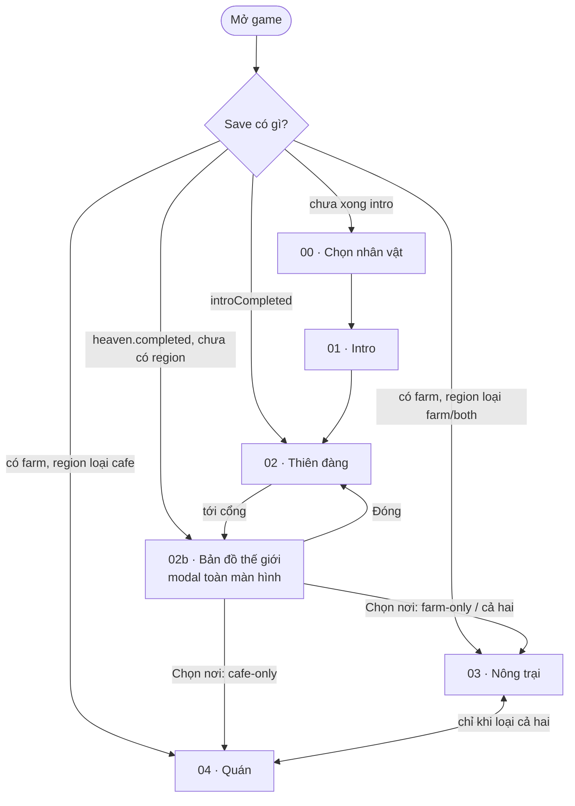

# Bản đồ thế giới: chọn nơi trùng sinh

| | |
|---|---|
| Người đề xuất | Quang |
| Ngày | 04/11/2026 |
| Trạng thái | Đã chốt |
| Ưu tiên | Vừa |
| Màn liên quan | 02 Thiên đàng / 03 Nông trại / 04 Quán / Chung |
| Mục GDD | 4.1 |
| Mã tính năng | F-28 |
| Cập nhật | 04/11 — Quang chốt làm v1 theo gợi ý câu hỏi mở; luật hiện hành ở docs/screens/02b-world-map |

## Ý tưởng

Ở cuối màn 02, khi nhân vật bước tới cổng trùng sinh, game **không** vào thẳng nông trại. Một modal toàn màn hình mở ra bản đồ thế giới 3D (three.js): các vùng đất nổi trên biển mây, kéo/vuốt để di chuyển. Chạm một vùng thì vùng đó nhô lên, sáng viền, hiện thẻ nhỏ với nút **«Chọn nơi này»**. Chọn xong mới trùng sinh về nơi đó.

Mỗi nơi theo thực tế ngành cà phê:

- **Vùng trồng, ít uống tại chỗ** (Kenya, Colombia, Sumatra): chỉ có nông trại. Hạt bán ra chợ/xuất khẩu, không có quán.
- **Vùng uống, không trồng** (Ý, Nhật, Mỹ): chỉ có quán. Hạt nhập từ nhà rang/nhà nhập khẩu.
- **Vừa trồng vừa uống** (Việt Nam, Brazil): đủ cả farm và quán như game hiện tại.

Nhiệm vụ mỗi nơi khác nhau, bám đặc điểm thật của nơi đó (Kenya đấu giá Nairobi, Ý quầy espresso đứng, Nhật pha tay…).

### 1. Luồng màn mới

Sơ đồ dự kiến (so với [game-flow.md](../../game-flow.md)): thêm bước **Bản đồ** giữa cổng thiên đàng và farm/quán; quán có thể là màn đầu tiên ở trần gian.

| Tình huống | Đi đâu |
|---|---|
| Người chơi mới, tới cổng | Mở bản đồ. Đóng bản đồ = đứng lại trước cổng, chưa qua; bước vào cổng lần nữa thì mở lại |
| Save cũ đã có `farm` (trước tính năng) | Coi như đã chọn **Việt Nam** (cả hai). Vào thẳng farm như hiện nay, không hỏi gì, không mất tiến độ |
| Save đã qua cổng nhưng chưa có farm (tắt trang đúng lúc) | Mở bản đồ khi tải lại |
| Đổi địa điểm về sau | **Đề xuất v1: không đổi**, mỗi save một nơi (đơn giản, không phải gộp hai model). Về sau: nút "Thế giới" (đã có chỗ, từng bỏ vì "chưa có tính năng" — rules.md mục 8) mở bản đồ ở chế độ **mở chi nhánh**: cấp/tiền đủ thì mở nơi thứ hai với tiến độ riêng. Xem câu hỏi mở 2 |

### 2. Danh sách địa điểm đề xuất

Giống trong game hiện có 3 loại: vối (robusta), chè (arabica), mít (liberica). Đề xuất không thêm giống ở v1, chỉ giới hạn giống theo vùng.

| # | Địa điểm | Loại | Giống | Lý do thực tế | Đặc trưng chơi |
|---|---|---|---|---|---|
| 1 | **Việt Nam** — Tây Nguyên / Đà Lạt | Cả hai | Vối, chè (Cầu Đất), mít | Nước xuất khẩu robusta lớn nhất; văn hóa quán phin rất mạnh | Game hiện tại; **nơi mặc định, mở sẵn**, gợi ý cho người mới |
| 2 | **Brazil** — Minas Gerais | Cả hai | Chè, vối (conilon) | Sản lượng lớn nhất thế giới, cũng là nước tiêu thụ lớn; phơi khô tự nhiên trên sân rộng | Ruộng lớn, phơi nhiều; quán bán *cafezinho* nhỏ, rẻ, bán nhiều ly |
| 3 | **Colombia** — vùng Trục cà phê | Farm-only | Chè | Phần lớn sản lượng xuất khẩu qua liên đoàn nông dân; đồi dốc, hái tay từng quả chín | Hái tay chọn quả chín được giá cao; chế biến ướt (ghi là phơi trong v1) |
| 4 | **Kenya** — chân núi Kenya | Farm-only | Chè | Gần như toàn bộ xuất khẩu qua sàn đấu giá Nairobi; người Kenya uống trà nhiều hơn | Bán theo phiên đấu giá, chất lượng quyết định giá |
| 5 | **Indonesia** — Sumatra | Farm-only | Chè, vối, mít | Chế biến ướt-bóc vỏ kiểu riêng; trồng xen dưới tán rừng | Mùa mưa dài: tưới ít, phơi khó, cần mái phơi |
| 6 | **Ý** — Napoli / Milano | Cafe-only | Nhập (chè + vối pha trộn) | Không trồng được cà phê; quầy espresso uống đứng, giá thấp, khách đông | Ca ngắn, khách nhanh, menu espresso/cappuccino; phạt pha chậm |
| 7 | **Nhật Bản** — Tokyo | Cafe-only | Nhập (chè) | Văn hóa *kissaten* và pha tay rất kỹ | Ít khách, giá cao, chấm điểm pha khắt khe (V60, siphon nếu có) |
| 8 | **Mỹ** — Seattle | Cafe-only | Nhập | Nơi khởi phát chuỗi cà phê specialty; mang đi nhiều, cold brew | Khách mang đi chiếm đa số; thêm đá/cold brew (F-27) |

Gợi ý về sau (không làm v1): Ethiopia (nơi khởi nguồn cà phê, nửa sản lượng uống trong nước bằng lễ cà phê → "cả hai" với quán là lễ cà phê), Hawaii Kona (trang trại + quán trên cùng đảo), Úc (flat white), Hàn Quốc.

> Lưu ý về ví dụ "châu Phi chỉ trồng": đúng với **Kenya**, nhưng **Ethiopia** tiêu thụ trong nước rất lớn, nên không để Ethiopia là farm-only.

**Mở khóa:** đề xuất v1 chỉ mở **Việt Nam, Kenya, Ý** (một nơi mỗi loại) để thử luật bật/tắt với ít nội dung nhất; các nơi khác hiện trên bản đồ với ổ khóa "Sắp có".

### 3. Luật bật/tắt theo loại địa điểm

| Phần | Cả hai | Farm-only | Cafe-only |
|---|---|---|---|
| Màn khởi đầu | Farm | Farm | Quán |
| Nút ☕ Vào quán / 🌱 Nông trại | Có | **Ẩn** | **Ẩn** (không có farm để về) |
| Ruộng, cây, giếng, sân phơi, lò rang | Có | Có | Không tạo |
| Chợ (bán hạt) | Có | Có — **nguồn tiền chính** | Không |
| Bảng Đơn hàng (F-10) | Đơn farm → quán | Đổi thành **Hợp đồng xuất khẩu**: cùng cơ chế đơn (lượng, hạn, thưởng), người nhận là nhà xuất khẩu/sàn đấu giá thay vì quán | Ẩn phía farm; quán chỉ có **Nhập hạt** |
| Nguồn hạt của quán | Farm giao + Nhập hạt ngoài | — | **Nhập hạt ngoài** là nguồn duy nhất, chọn xuất xứ (giá khác nhau theo nơi, ví dụ Kenya đắt hơn Việt Nam); bỏ nút "Đặt farm 252 g" |
| Lô `starter` 600 g | Có | Không | Có (hạt nhập) |
| Thợ farm / nhân viên quán | Cả hai | Chỉ thợ farm | Chỉ nhân viên quán |
| Nâng cấp, Xây dựng | Cả hai | Chỉ farm | Chỉ quán |
| Mẹo thiên đàng (F-04) | Như cũ | Mẹo quán (`recipe`, `adjust`, `customer`) không có tác dụng | Mẹo farm (`ripe`, `water`) không có tác dụng — xem câu hỏi mở 5 |
| Hành trang (`seeds`/`tools`/`capital`) | Như cũ | Như cũ | `seeds` đổi thành phiếu nhập hạt, `tools` thành dụng cụ pha |

Nguyên tắc: không viết luật riêng cho từng nơi trong code chạy, mà mỗi địa điểm là **một bản ghi dữ liệu** (`type`, giống được trồng, hệ số giá, danh sách nhiệm vụ, nguồn hạt nhập). Farm/quán chỉ đọc cờ `type` để ẩn/hiện, giống cách HUD mở dần đang dùng hàm `when` trong `farm/content.js`.

Trụ cột 3 "Hai màn phụ thuộc nhau" chỉ còn đúng ở nơi "cả hai". Ở farm-only, phụ thuộc thay bằng **chợ giảm giá theo ngày ↔ hợp đồng xuất khẩu**; ở cafe-only là **giá hạt nhập ↔ giá bán ly**.

### 4. Nhiệm vụ theo địa điểm

Gắn vào hệ nhiệm vụ hiện có (`QUESTS` trong `farm/content.js`: chuỗi cố định, mỗi mục `{ stat, count, coins, xp }`, thưởng một lần, rules.md mục 7). Đề xuất: mỗi địa điểm có **chuỗi nhiệm vụ riêng** cùng định dạng. Việt Nam giữ đúng chuỗi hiện tại để save cũ không đổi.

| Nơi | Ví dụ chuỗi (thứ tự) | Chỉ số dùng |
|---|---|---|
| Việt Nam | Hái → Bán ly đầu → Phơi → Rang → Bán → Gửi hạt về quán → Mua ruộng 2 → Tưới → Làm cỏ (**giữ nguyên**) | có sẵn |
| Brazil | Hái → Phơi trên sân → Rang → Bán ly *cafezinho* đầu → Phơi 3 mẻ cùng lúc → Bán 30 ly trong một ca | có sẵn + `served` theo ca |
| Colombia | Hái quả chín (không hái quả xanh) → Phơi → Giao hợp đồng xuất khẩu đầu → Mua ruộng trên đồi | có sẵn + **mới** `exported` |
| Kenya | Hái → Phơi → Gửi lô tới phiên đấu giá → Đạt giá đấu ≥ X → Mua ruộng 2 | **mới** `exported`, `auctionBest` |
| Sumatra | Hái → Phơi dưới mái (mùa mưa) → Rang → Bán chợ → Trồng xen giống mít | có sẵn |
| Ý | Mở cửa → Pha espresso đầu → Phục vụ 10 khách uống đứng trong 1 ca → Không khách nào bỏ về một ca | `served`, **mới** `walkouts` theo ca |
| Nhật | Nhập hạt chè → Pha tay đạt ≥ 90 điểm → Bán ly giá cao → Đạt uy tín X | `served`, `mastery`, `reputation` |
| Mỹ | Nhập hạt → Bán 10 ly mang đi → Ủ cold brew (khi có F-27) → Thuê nhân viên 2 | `served`, `takeaway` (mới) |

Nhiệm vụ cuối mỗi chuỗi có thể là "**Mở chi nhánh ở nơi khác**" nếu chốt cho đổi/mở thêm địa điểm (câu hỏi mở 2).

### 5. UI/UX bản đồ 3D

Theo `AGENTS.md`: game, không phải website; thế giới 3D, thao tác trên đối tượng, HUD nhỏ.

- **Mở:** nhân vật chạm cổng → cổng lóe sáng, camera đẩy vào cổng, chuyển cảnh mây sang bản đồ (không cắt cứng). Di chuyển nhân vật bị khóa trong lúc bản đồ mở.
- **Khung:** modal toàn màn hình (yêu cầu riêng của tính năng này, khác modal giữa màn của shop/kho), nút ✕ đóng góc trên phải, dùng kiểu nút gỗ kem như ⚙️. Đóng → về đứng trước cổng.
- **Bản đồ:** đề xuất **bản đồ phẳng kiểu sa bàn** (các mảng đất low-poly nổi trên biển mây/nước), không dùng quả địa cầu: kéo một ngón dễ hơn xoay cầu trên điện thoại, vùng nhỏ như Kenya vẫn đủ to để chạm. Mỗi vùng có một vật mốc nhỏ (cây cà phê, máy espresso, tách…) và icon loại 🌱 / ☕ / 🌱☕ nổi trên đầu.
- **Kéo/vuốt:** một ngón kéo để trượt camera, có quán tính, kẹp trong biên bản đồ. Hai ngón chụm/con lăn chuột để phóng to/thu nhỏ trong khoảng hẹp. Bàn phím: mũi tên/WASD trượt.
- **Chạm vùng:** vùng nhô lên ~0,3 đơn vị, viền sáng, nhún nhẹ; camera lướt tới giữa vùng; vùng khác hạ xuống. Có tiếng "bụp" và hạt sáng nhẹ (`sfx`, `vfx` có sẵn). Vùng khóa: rung nhẹ + ổ khóa, thẻ ghi "Sắp có".
- **Thẻ chọn:** dải thẻ nhỏ ở đáy (không làm tối map, giống dải chọn giống ở farm): tên nơi, icon loại, giống trồng, một dòng đặc trưng ("Đấu giá ở Nairobi"), nút lớn **«Chọn nơi này»** cao ≥ 48 px. Bấm → hộp xác nhận ngắn "Trùng sinh ở Kenya? Ở đây chỉ có nông trại." (vì v1 không đổi lại được).
- **Gợi ý lần đầu:** bàn tay 👆 vuốt minh họa, vùng Việt Nam nhấp nháy "Gợi ý cho người mới".
- **Mobile-first:** dọc là bố cục chính; thẻ đáy không che quá 30% chiều cao; ngang trên PC thì thẻ nằm góc dưới phải.
- **Hiệu năng:** cảnh bản đồ dùng chung renderer, tạo khi mở, `disposeScene` khi chọn xong; theo `getQuality` giảm mây/bóng ở máy yếu.

### 6. Dữ liệu, save, code, asset

**Trường mới** (phải sửa [contracts.md](../../shared/contracts.md) mục 1–2 khi chốt):

| Trường | Kiểu | Ai ghi | Ghi chú |
|---|---|---|---|
| `startingRegion` (cấp 1 của `godbean-progress`) | id địa điểm, ví dụ `'vn'` | bản đồ, qua `saveHeaven` (ghi cùng `gift`) | Giống cách `startingGift` đi vào `createFarm` |
| `farm.region` | id địa điểm | `createFarm` chép từ `startingRegion` khi tạo save | Nguồn sự thật sau khi đã có farm. **Thiếu → `'vn'`** (chuyển save cũ) |
| `farm.stats.exported`, `auctionBest`, `takeaway`… | số | `model.js` | Chỉ thêm những chỉ số nhiệm vụ đã chốt |

Không đổi `version` của save (thêm trường có mặc định).

**Code sẽ đụng** (khi chốt):

| File | Việc |
|---|---|
| mới `src/features/world-map/` (`scene.js`, `ui.js`, `content.js`) | Cảnh bản đồ, thẻ chọn, danh sách địa điểm (nguồn duy nhất) |
| `src/features/heaven/game.js` | Callback qua cổng: mở bản đồ thay vì gọi thẳng `enterFarm` |
| `src/app/game.js` | Thêm `enterWorldMap`; chọn màn khởi động theo `region` (nhánh cafe-only vào quán trực tiếp) |
| `src/state/progress.js` | `saveHeaven` nhận thêm `region` |
| `src/features/farm/model.js`, `content.js` | `region`, chuỗi nhiệm vụ theo nơi, giống theo nơi, hợp đồng xuất khẩu dùng lại `orders.js`; HUD mở dần thêm điều kiện theo loại |
| `src/features/farm/game.js`, `ui.js` | Ẩn nút quán/farm, không dựng ruộng ở cafe-only |
| `src/features/cafe/game.js`, `ui.js` | **Việc lớn nhất:** hiện quán được tạo bên trong `createFarmGame`. Cafe-only cần chạy quán khi không có cảnh farm (vẫn giữ model farm làm chủ dữ liệu, chỉ không dựng scene farm) |
| `src/i18n/locales/` | Tên, mô tả địa điểm, thoại xác nhận (Anh/Việt) |

**Tài liệu sẽ sửa:** `docs/game-flow.md`, `docs/screens/02-heaven/README.md` (ra tới bản đồ), thư mục màn mới `docs/screens/02b-world-map/` (khớp `src/features/world-map/`), `03-farm/rules.md` (mục 4, 7, 8), `04-cafe/gameplay.md` (nguồn hạt), `shared/contracts.md`, GDD (mục 4, 9, dòng `F-xx`).

**Asset 3D:** sa bàn biển mây + 8 mảng đất low-poly; 8 vật mốc nhỏ theo nơi (tránh công trình/thương hiệu thật có bản quyền — dùng vật chung như cây cà phê, máy espresso, xe đạp chở bao); icon loại 🌱/☕ dạng sprite; viền sáng/hạt sáng. Giai đoạn đầu dùng **khối tạm** vẫn thể hiện vùng, loại, trạng thái khóa, rồi thay asset sau (F-26). Môi trường farm/quán theo nơi (ví dụ đồi dốc Colombia, quầy đứng Ý) để giai đoạn sau; v1 dùng lại cảnh có sẵn, chỉ đổi màu trời/đất và biển tên.

## Vì sao

- **Cuốn ngay:** thêm một khoảnh khắc "chọn số phận" có hình đẹp ở cuối thiên đàng, người chơi tự quyết nơi mình sống lại.
- **Có lý do quay lại:** mỗi nơi chơi khác nhau; nếu mở chi nhánh thì là mục tiêu dài hạn.
- **Học thật:** biết vì sao Kenya trồng mà ít uống, vì sao Ý không trồng mà uống nhiều, Brazil phơi khô, Sumatra ướt-bóc vỏ.
- **Rủi ro:** làm yếu trụ cột 3 (hai màn phụ thuộc) ở nơi chỉ có một bên; phải thay bằng phụ thuộc chợ/xuất khẩu hoặc giá nhập như mục 3.

## Ảnh hưởng

_Đội phát triển điền khi Đang xem. Phác ước lượng để review:_

- Luật / tài liệu phải sửa: như mục 6.
- Dữ liệu save: `startingRegion`, `farm.region`, vài chỉ số nhiệm vụ; save cũ → Việt Nam.
- Asset: sa bàn + 8 vùng + vật mốc; khối tạm trước.
- Ước lượng công (thô, v1 = VN + Kenya + Ý): bản đồ 3D + chọn nơi ~2–3 ngày; luật bật/tắt farm-only ~1–2 ngày; quán chạy độc lập (cafe-only) ~2–3 ngày; nhiệm vụ theo nơi + i18n ~1–2 ngày; tài liệu, test chuyển save ~1 ngày.

## Câu hỏi mở

1. **Phạm vi v1:** chỉ 3 nơi (Việt Nam, Kenya, Ý) hay đủ 8 ngay?
2. **Đổi địa điểm:** một save một nơi mãi mãi, cho đổi (mất tiến độ hay giữ?), hay mở chi nhánh với tiến độ riêng từng nơi?
3. **Có làm cafe-only ngay không?** Đây là phần tốn công nhất (tách quán khỏi farm). Có thể v1 chỉ làm "cả hai" + farm-only, cafe-only để sau.
4. **Người mới có được chọn nơi khó ngay không**, hay mở dần (Việt Nam trước, nơi khác khi đạt cấp X ở save hiện tại)?
5. **Mẹo thiên đàng không dùng được ở nơi chỉ một bên:** chấp nhận mất tác dụng, đổi thành mẹo tương đương (ví dụ `ripe` → chọn hạt nhập tốt hơn), hay đổi câu hỏi theo nơi đã chọn (nhưng nơi được chọn *sau* khi hỏi)?
6. **Bản đồ phẳng sa bàn hay quả địa cầu?** Đề xuất sa bàn (dễ chạm trên điện thoại).
7. **Thứ tự hành trang và bản đồ:** chọn hành trang trước rồi tới bản đồ (như đề xuất), hay chọn nơi trước rồi hành trang theo nơi?
8. **Giống cà phê mới theo nơi** (Geisha Colombia, SL28 Kenya…) có thêm không, hay chờ F-22 (dòng giống thật)?

## Quyết định

_Ngày, người quyết, chốt hay bỏ, lý do._

- 04/11/2026, Quang: chốt làm v1 theo gợi ý của đề xuất — 3 nơi mở (Việt Nam, Kenya, Ý), một save một nơi, làm cả nơi chỉ quán, mẹo thiếu tác dụng thì chấp nhận, sa bàn phẳng, chọn hành trang trước bản đồ, chưa thêm giống. Hợp đồng xuất khẩu và chọn xuất xứ hạt nhập để sau; v1 thay bằng nhiệm vụ cuối riêng mỗi nơi.
