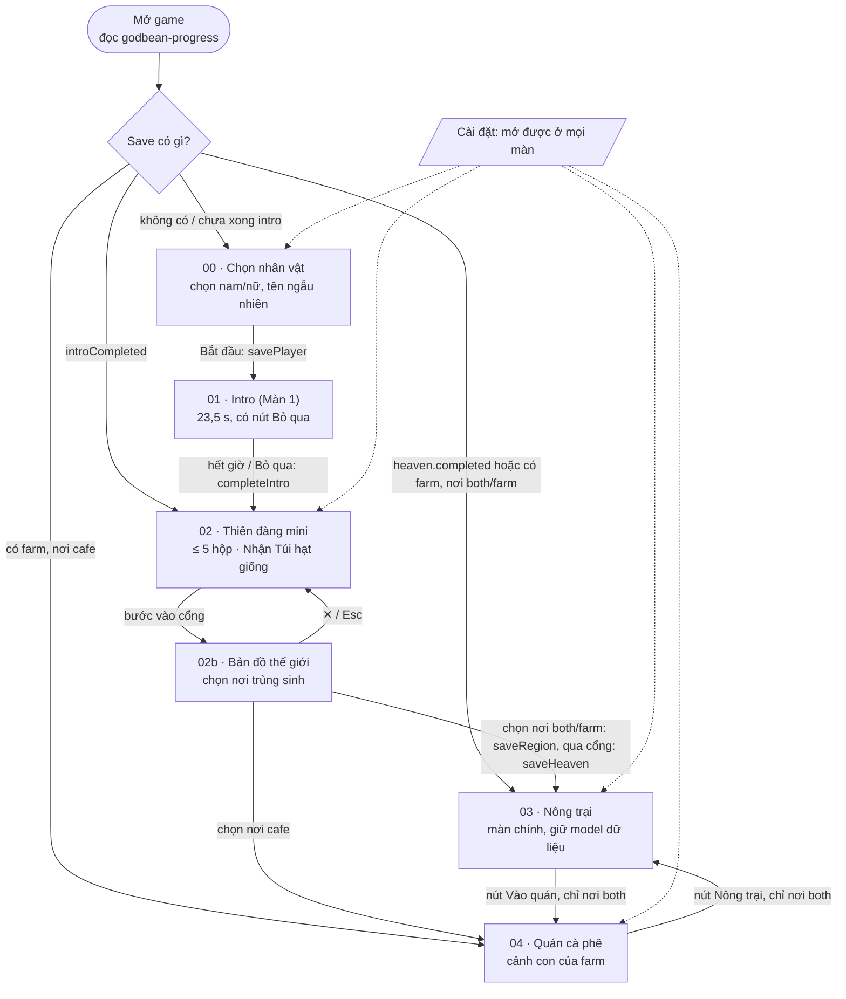

# Sơ đồ liên kết giữa các màn

Một trang cho cả game: màn nào dẫn tới màn nào, điều kiện chuyển, dữ liệu truyền đi. Chi tiết từng màn nằm trong `screens/<màn>/README.md`. Nguồn sự thật cho dữ liệu là [shared/contracts.md](shared/contracts.md); nguồn cho điều kiện chuyển là `src/app/game.js`.

## Sơ đồ

Đường một chiều: 00 → 01 → 02 (mini) → 02b → 03/04 (05/11/2026, F-44). Hội đồng chuyên gia (05/11/2026, F-45: Cổng Hội đồng ở 03, chuông Hội đồng ở 04, hội thoại đáy màn tại chỗ) gặp ở trần gian từ 03/04 và trả về chỗ cũ, không quay lại 02. Bản đồ đóng được để về trước cổng; đã chọn nơi thì không đổi lại. Sau khi qua cổng không còn đường quay lại; tải lại trang vào thẳng farm (nơi chỉ quán: vào thẳng quán). Chỉ nơi "cả hai" (Việt Nam) có 03 ↔ 04 hai chiều; xem [screens/02b-world-map](screens/02b-world-map/README.md).

## Điều kiện chuyển màn

| Từ | Tới | Điều kiện | Chỗ xử lý |
|---|---|---|---|
| Mở game | 00 / 02 / 03 | Đọc save: `heaven.completed` hoặc có `farm` → 03; `introCompleted` → 02; còn lại → 00 | `src/app/game.js` (khởi động) |
| 00 Chọn nhân vật | 01 Intro | Bấm bắt đầu; ghi `godbean-player` | `enterIntro` |
| 01 Intro | 02 Thiên đàng | Hết `DURATION` (23,5 s) hoặc Bỏ qua; ghi `introCompleted` | `finish` → `enterHeaven` |
| 02 Thiên đàng | 02b Bản đồ | Nghe ≤ 5 hộp, bấm Nhận Túi hạt giống (hoặc Bỏ qua ↗ 1 lần bấm), hoạt cảnh tự đi vào cổng (chạm để tua) — 05/11/2026, F-44 | `onPortal` của `createHeavenGame` → `openWorldMap` |
| 02b Bản đồ | 02 Thiên đàng | ✕ hoặc Esc; đứng lại trước cổng | `leaveWorldMap()` → `cancelPortal` |
| 02b Bản đồ | 03 / 04 | Chọn nơi, xác nhận (ghi `startingRegion`, lộ loại nơi + nhiệm vụ riêng, không lui được), bấm Bắt đầu; chạy hoạt cảnh qua cổng, ghi `heaven`, `startingGift`. Nơi `cafe` tải farm rồi tự vào quán | `leaveWorldMap(id)` → `depart` → `onReborn` → `enterFarm` |
| 03 Nông trại | 04 Quán | Nút "Vào quán" (nhiệm vụ "Bán ly cà phê đầu tiên" chỉ tới đây); chỉ nơi `both`. Nơi `cafe`: tự vào khi tải | `enterCafe` trong `features/farm/game.js` |
| 04 Quán | 03 Nông trại | Nút "Nông trại"; không có ở nơi `cafe` | `exitCafe` |

## Dữ liệu đi theo từng chặng

| Chặng | Dữ liệu truyền | Dùng ở đâu |
|---|---|---|
| 00 → 01 | `gender`, `name` | Mô hình nhân vật và tên trên HUD ở mọi màn sau |
| 02 → 03 | `gift`: save mới luôn `seeds` (05/11/2026, F-44); `tools` / `capital` chỉ ở save cũ | Quà áp một lần khi tạo farm; nơi chỉ quán đổi seeds thành +150 xu |
| 02b → 03 | `startingRegion` → `farm.region` | Loại nơi bật/tắt quán, đơn hàng, chuỗi nhiệm vụ |
| 02 → 03 | `heaven.answers` → `correctQuestionIds` → `farm.lessons`; `answeredQuestionIds` → `farm.lessons.met` (F-45) | Câu đúng (save cũ) thành mẹo có số thật ở farm/quán; câu sai được hỏi lại đúng lúc. Mini không hỏi câu nào; câu chưa trả lời chờ Hội đồng (F-45) |
| 03 ↔ 04 | Cùng một model `farm` | Quán đọc/ghi kho, tiền, lô hàng, chuyến giao qua `farm.act(...)`, không có save riêng |

## Điểm cần nhớ

- **Quán không phải một màn độc lập.** `createCafeGame` được gọi từ bên trong `createFarmGame`; farm giữ scene quán để vào lại nhanh và vẫn `tick` model khi người chơi đang ở quán (thợ vẫn chạy, đơn vẫn đếm hạn).
- **Một save duy nhất** `godbean-progress` (`version: 1`). Mọi hàm ghi đọc lại bản cũ rồi gộp, nên trường của màn này không bị màn khác ghi đè.
- **Cài đặt** (`settings`) nằm chung save, không thuộc màn nào; xem [shared/ui-audio-vfx.md](shared/ui-audio-vfx.md).
- Luồng 5 phút đầu và các kịch bản liên màn (thiên đàng → farm → quán → bán ly đầu) nằm trong [shared/onboarding-flow.md](shared/onboarding-flow.md) mục 8.
