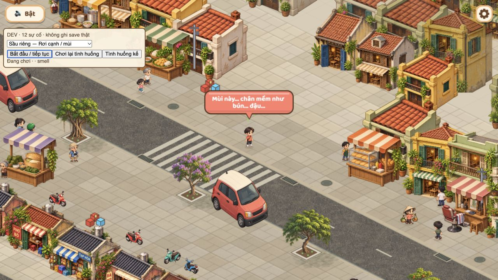

# Luồng 5 — 12 sự cố và các nhánh nội dung

Ngày 2026-10-29. T-104: Review triển khai; **chưa phải đã duyệt chơi hết nội dung**. Người dùng đã duyệt luồng3 và4. Không chạy suite/test/typecheck/build; người dùng tự chơi nghiệm thu.

## Cách xem từng tình huống

Chạy `npm run dev`, mở `http://localhost:5173/?incidentReview=cat` (đổi cổng theo Vite). Nếu đang dùng server của phiên làm việc này: `http://127.0.0.1:5191/?incidentReview=cat`.

1. Bảng **DEV · 12 sự cố** có17 lựa chọn. Chọn tình huống, bấm **Bắt đầu / tiếp tục**. Chờ trước khi bấm để nhìn rõ cảnh báo. Di chuyển bằng điều khiển bình thường để thử né hoặc tiến vào vật nguy hiểm.
2. **Chơi lại tình huống** tải lại ca đang chọn; **Tình huống kế** mở lựa chọn tiếp. Chọn lại thay vì chờ hazard ngẫu nhiên.
3. Ca mở ở ngõ giao phố (22,5;7,5); ca xe đặt trên đường cạnh ngõ, phải đi xuống làn xe để thử va chạm. Né xe nhưng đứng trong khoảng3,5ô ngang làn để xem thùng gà bật mở. Các bẫy tĩnh được đặt phía trước, cần đi tới để thử trúng.
4. Ca chính cho phép nhánh tự nhiên xảy ra: đi gần rồi xa khỏi vỏ chuối/ổ voi để sinh bẫy tiếp; né lượt dép đầu rồi quan sát lượt về. Ca “Bẫy thứ hai”/“Lượt dép quay lại” chỉ dựng sẵn **điều kiện bắt đầu nhánh**, không chứng minh điều kiện kích hoạt tự nhiên đã đúng.
5. Sầu riêng “Rơi cạnh / mùi” đặt cách hero1ô. Đứng yên để thấy chậm chân; dây phơi chỉ đảo điều khiển2giây, không làm ngất. Bồ câu “Có bánh mì” dựng trạng thái đuổi theo, không tự đánh dấu đã ghé quầy thật.
6. Các loại gây ngất dùng cùng đường cảnh báo → hoạt động → trúng → nằm → cứu hộ → S04. Không dùng nút bỏ qua để giả làm bằng chứng cứu hộ.

Chế độ này chỉ hoạt động ở bản DEV, dùng `MemoryStorage` sẵn có: không đọc/ghi save chơi thật, không tăng bộ đếm thật. Reload bắt đầu lại một phiên bộ nhớ; chuyển chương vẫn mang state trong phiên. Không dùng `fresh`. Tắt nguy hiểm ngẫu nhiên và va chạm xe/barie sinh hoạt trong ca duyệt để chúng không cướp cảnh; giữ NPC, đường đi, collider và cứu hộ. Vì vậy **vẫn phải chơi bản thường** để duyệt xung đột nhiều sự cố.

## Ma trận nội dung

Thời gian báo trước bên dưới là lúc mới vào lượt; bản thường rút dần tới65%, nhưng các lá bài chính không dưới600ms. Ca DEV nâng tối thiểu lên1200ms để dễ quan sát, không dùng thời gian dev để kết luận độ khó bản thường. Hitbox là khoảng cách trong tọa độ map, không phải số pixel.

| Loại | Điều kiện / vị trí bản thường | Báo trước → hoạt động | Va chạm / né | Nhánh và kết quả |
|---|---|---|---|---|
| Mèo | Từ đầu chaos; chỗ đi được cách hero hơn4ô | 1100ms → đuổi tối đa6s | Bán kính0,4; tốc độ2,6ô/s, không qua tường | Quấn chân → ngất; chạy xa hoặc đủ thời gian thì bỏ đi |
| Chó | Từ đầu; như mèo | Chó nhỏ1700ms → chó lớn3,6s | Bán kính0,45;3,8ô/s, quay có giới hạn | Đổi hình/tiếng ở active; trúng → ngất |
| Ổ voi/nắp cống | Phía trước3,5ô, điểm có khoảng trống | 1500ms →4s | Bán kính0,85; warn chưa gây hit | Lại gần<1,8 rồi đi xa>2,4ô → nắp cống trước mặt1,8ô, báo600ms; trúng loại nào cũng ngất |
| Sầu riêng | Điểm rơi quanh hero, dẫn trước0,8ô khi chạy | 1400ms →250ms | Trúng<0,5ô | Rơi lệch<1,4ô → mùi, chậm còn55% trong2s; trúng → ngất |
| Xe chở hàng | Làn8–10, hai hướng; map hiện không cấu hình đường dọc | Cả làn1600ms → tối đa8s | Ba xe cách1,3ô, kiểm cả đoạn di chuyển, bán kính0,5 | Qua hero hơn3,2ô và ngang làn<3,5ô → thùng mở/gà xuất hiện nếu còn chỗ; quẹt → ngất |
| Bồ câu | Đi ngang/dọc qua hàng/cột hero từ mép map | 1500ms →6s |9ô/s, va chạm đoạn bay bán kính0,55 | Ghé bánh mì trước đó → bẻ hướng đuổi bánh; trúng → ngất |
| Vỏ chuối | Điểm đi được phía trước3–5ô |800ms →14s | Bán kính0,3; warn vô hại | Lại gần/né như ổ voi → vỏ thứ hai trước1,4ô, báo600ms; trúng → ngất |
| Chậu nước | Chỉ được chia khi hero ở phía nhà, y<8,4 |1200ms →250ms | Điểm rơi quanh y≤7,6, bán kính0,6 | Rơi trúng → ngất; rơi lệch → biến mất, không còn hit |
| Dây phơi | Cùng điều kiện phía nhà |1200ms →250ms | Bán kính0,6 | Chụp đầu → đảo hướng joystick/phím2s, **không ngất**; lệnh chạm đi tới vẫn theo điểm đích |
| Đá cầu | Bay ngang/dọc từ cách hero6ô |800ms → bay, tối đa2,5s |10ô/s, đoạn bay bán kính0,45 | Né thì bay đi; trúng → ngất |
| Dép tổ ong | Ném từ điểm cách hero5ô |900ms → tối đa8s |7ô/s, đoạn bay bán kính0,4 | Bay quá vị trí hero2,5ô rồi quay về đúng đường; lượt đi hoặc về đều gây ngất |
| Gà | **Chỉ từ nhánh xe chở hàng**, không có lá bài độc lập |500ms →4,5s |3,2ô/s, bán kính0,45; không qua tường | Đuổi → ngất hoặc bỏ đi; ca DEV gà cho xem riêng giai đoạn này |

Barie là cảnh riêng của phố, không tính vào12 loại. Tất cả11 lá bài chính hiện mở từ0giây chaos, nhưng lượt chơi thường chờ8giây đầu và có thể ngất trước khi thấy hết. Không thêm kết thúc sống đủ thời gian; các loại gây ngất đi vào cứu hộ/trùng sinh như hiện tại.

## Sửa trong đợt này

- Bộ bài không tích thêm bản sao của loại đang bị chặn bởi vị trí/thời gian nghỉ. Ưu tiên loại ít được sinh trong lịch sử; `incident:seen:<kind>` tăng khi sinh thành công, **không phải chứng nhận người chơi đã nhìn thấy/né/trúng**. Không thay schema save và không xóa lịch sử cũ.
- Kiểm giới hạn5hazard cho từng lần chia trong nhịp đôi và khi sinh nhánh phụ. Khi đã đủ5hazard, nhánh chờ chỗ trống trong những tick còn hợp lệ; chỉ đánh dấu thùng đã mở/bẫy phụ đã sinh khi tạo thành công. Nếu cơ hội đã hết thì không cố chen thêm nguy hiểm.
- Vỏ chuối báo từ800ms (trước300); bẫy phụ chuối/cống600ms (trước150/450). Các lá bài không bị ramp xuống dưới600ms. Gà giữ500ms theo nhánh xe.
- Điểm rơi kiểm khoảng trống thân người; nếu điểm ngẫu nhiên nằm trong vật cản thì tìm điểm gần có thể đi tới. Giữ điểm ngẫu nhiên hợp lệ, không ép mọi điểm rơi về tâm ô.
- Xe, dép, cầu, chim kiểm đoạn di chuyển thay vì chỉ một điểm mỗi tick, giảm bỏ lọt khi frame chậm. Bồ câu bẻ hướng dùng cùng phép đo đoạn, không suy hitbox theo trục cũ.
- Sửa mô tả mèo phù hợp hành vi quấn chân; câu chuối/cống dùng được cả bẫy đầu và bẫy phụ; xe dùng lời chở hàng thay tủ lạnh để khớp hình lồng gà. Không thay thoại quầy, art, UI bàn giao, cứu hộ đã duyệt.
- Rà đường kết thúc: step dừng ngay khi có hit; gone chỉ fade và không chạy hit; knock đổi sang faint, dừng chia; `finishDown` có cờ reported để không gọi chuyển chương lần hai. Không bổ sung đường kết thúc khác.

## Bằng chứng và checklist người dùng duyệt

Đã mở bộ chọn dev trong game, xem mèo ở warn; chọn/bắt đầu sầu riêng chính và thấy chuyển S04. Xem nhánh rơi cạnh có trạng thái smell; xem dây phơi có shorts nhưng run tiếp tục. Đã xem xe đi qua sinh gà tự nhiên trong ca xe (motorbike:active + chickens:warn), không gọi ca gà riêng để thay thế nhánh này. Đã xem bảng chọn ở viewport390×844, không tràn khung; chưa kiểm cảm ứng thật. Console không báo error ở lần đọc. Bằng chứng này không đánh dấu cả17ca đã qua.

[Xe thả gà](../screenshots/flow5-cargo-chickens.png) · [Dây phơi](../screenshots/flow5-laundry.png) · [Kết quả S04 sau ca sầu riêng](../screenshots/flow5-durian-s04.png) · [Bộ chọn trên khung mobile](../screenshots/flow5-review-mobile.png).

- [ ] 12 loại: cảnh báo dễ hiểu, có thể né, hit đúng chỗ hình vẽ.
- [ ] Chuối/cống: nhánh phát sinh tự nhiên + ca nhánh dựng sẵn.
- [ ] Xe → mở thùng → gà thật sự xuất hiện; không chỉ xem ca gà riêng.
- [ ] Bồ câu: chưa ghé bánh mì và đã ghé quầy thật, đối chiếu ca DEV có bánh.
- [ ] Sầu riêng: rơi trúng / rơi cạnh / ngoài vùng mùi.
- [ ] Dép: né lượt đi và kiểm lượt về; chó: đổi chó nhỏ/lớn.
- [ ] Dây phơi hết2s trở về điều khiển bình thường, không tự gọi cứu hộ.
- [ ] Các loại gây ngất chỉ gọi một cảnh cứu hộ/chuyển S04.
- [ ] Chơi URL thường: nhiều lượt, sát quầy/tường/ngõ/hai đầu phố, không sự cố còn hit sau fade; không vượt giới hạn khi sinh nhánh phụ.
- [ ] Lịch sử được giữ sau reload bản thường; mode DEV không thay tiến độ thật.
- [ ] PC và điện thoại thật dọc/ngang: độ đọc cảnh báo, độ khó, điều khiển và hiệu năng.

Không có kết quả tự động hoặc lời khẳng định tất cả nhánh đã chơi qua. Chỉ đóng T-104 sau khi người dùng duyệt các ca còn lại.
