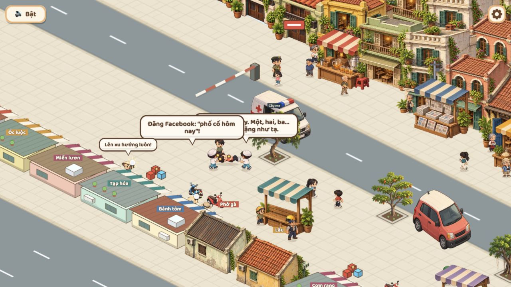

# Luồng 4 — nhân vật và cứu hộ

Cập nhật 2026-10-29: người dùng đã duyệt luồng4 và luồng3, T-103/T-102 Done theo duyệt. Các bằng chứng và giới hạn kiểm tra bên dưới là ghi nhận ở lượt triển khai; kiểm thiết bị thật/toàn chương vẫn thuộc các mốc sau.

## Đã thay đổi

- Hai bác sĩ phải hiện diện và tới gần điểm đứng được giao (sai số0,16ô) mới nâng/lên xe. Không dùng khoảng cách1,2ô tới hero để cho qua khi bác sĩ còn đang tới vị trí.
- Bác sĩ thứ hai chờ trong xe nếu cửa chưa có chỗ xuống, thử lại ở các tick sau. Tìm chỗ dọc thân xe theo cả hướng đỗ ngang/dọc, tránh thân xe và người ra trước; không hiện hai người cùng một chỗ khi hết mốc0,6giây.
- Vị trí đỡ đầu/chân đổi sang hai đầu rõ hơn: offset đầu(-0,3;+0,8), chân(+0,55;0), có tìm điểm thay thế khi vướng vật. Điểm đỡ phải có đường từ bác sĩ/cửa xe tới quanh thân xe; ô trống bên kia tường không đủ điều kiện.
- Trong lúc khiêng, hero chờ nếu một bác sĩ còn cách điểm đỡ hơn0,5ô. Hero đi2,2ô/s, bác sĩ có thể đi2,6ô/s để theo kịp sau góc rẽ. Giữ cơ chế đường vòng vật cản có sẵn; không gắn bác sĩ trực tiếp vào tọa độ hero để kéo xuyên tường.
- Bước tách hai bác sĩ khi quá sát nhau cũng kiểm tra thân xe, đồng thời bỏ cache đường cũ sau khi bị đẩy lệch vị trí.
- Độ nâng hình hero giảm18→8px để gần độ cao bàn tay ở atlas đang dùng. Áp dụng pose trước khi cập nhật hình, đồng bộ cùng khung với carryLift. Giữ pose chibi đi/vấp/ngã/nằm/nâng/khiêng và xe nhiều hướng đã có; không tạo atlas mới.

## Bằng chứng lượt này

Đọc atlas hero phản ứng và bác sĩ khiêng, rà mã route/pose/door/portal và các caller. Mở bản local cổng5190, điều khiển bằng click/phím như người chơi, không gọi debug để ép ngất hoặc chuyển chương. Đã nhìn thấy hai bác sĩ tiếp cận và khiêng ở vỉa hè gần xe máy dựng; lượt sau chỉnh đội hình cũng tới S04. Console không error tại các lần đọc. Không chạy suite unit/e2e/typecheck/build hoặc mô phỏng toàn bản đồ.

[Hai bác sĩ tiếp cận](../screenshots/flow4-approach.png) · [Trước chỉnh điểm đỡ](../screenshots/flow4-carry-before.png) · [Sau khi chuyển S04](../screenshots/flow4-complete.png)

Ảnh trước/sau là hai lượt khác nhau; không dùng để so vị trí NPC ngẫu nhiên. Chỉ đối chiếu điểm đỡ/độ nâng hero. Ảnh cảnh khiêng có thoại/nhãn khác trong khung; bố trí lại thoại thuộc luồng6, không đánh dấu đã hoàn thiện UI từ lượt này.

## Checklist người dùng tự duyệt

| Tình huống | Cần thấy | Bằng chứng lượt này |
|---|---|---|
| Đi, đổi hướng, vấp/ngã/nằm | Đổi pose rõ, không xoay sprite đứng thành tư thế nằm khi có atlas | Đọc atlas/code; đã thấy nằm trong lượt phố. Chưa duyệt mọi phản ứng12 loại |
| Cứu hộ vỉa hè cạnh xe dựng | Hai bác sĩ xuống/tiếp cận, đỡ hai đầu rồi về xe | Có ảnh tiếp cận/khiêng và kết thúc S04 trên PC |
| Barie tây, tai nạn xe máy và barie rơi | Ngã trên mặt đất, đủ bác sĩ và lên xe được | Chưa xác nhận riêng từng nhánh ở lượt này |
| Barie đông và xe tới từ phải | Xe đi đúng đường, đỗ gần và hiện trong camera | Chưa chơi xác nhận sau sửa |
| Sân cuối ngõ, sát hai góc tường | Điểm đỡ tới được, không nâng hụt hoặc đứng chờ mãi | Chưa chơi xác nhận sau sửa |
| Sát quầy/cây/ghế/xe | Bác sĩ và người được khiêng đi vòng; không xuyên thân xe | Đã xem một vị trí gần xe dựng; chưa đủ các góc |
| Qua khúc rẽ khi đang khiêng | Hero chờ nếu bác sĩ bị tụt; không tách người khỏi tay | Đã đổi điều kiện, chưa xem hết tuyến có khúc rẽ |
| Cửa lên xe và portal | Chỉ ẩn người khi cả hai tới vị trí; cửa đóng rồi xe rời đi/chuyển S04 | Đã tới S04; chưa chụp cận từng frame cửa/portal |
| Nhánh rụng bánh | Không kẹt sau hiệu ứng, vẫn chuyển S04 đúng một lần | Giữ mã nhánh cũ, chưa xác nhận riêng lượt này |
| Mobile dọc/ngang và menu giữa cứu hộ | Thấy được nhân vật/xe, menu dừng cảnh; không chạy lệch nhịp khi quay lại | Chưa kiểm trên điện thoại thật hoặc lại toàn luồng mobile trong lượt này |

Không đánh dấu tất cả ô đã qua từ các số mô phỏng trước đây. Các vị trí ngõ/góc và cả hai hướng xe cần người dùng chơi duyệt trước khi đóng T-103. Khi có lỗi, ghi vị trí/ảnh và giai đoạn bị dừng (xuống xe, tiếp cận, nâng, khiêng hay cửa xe).
