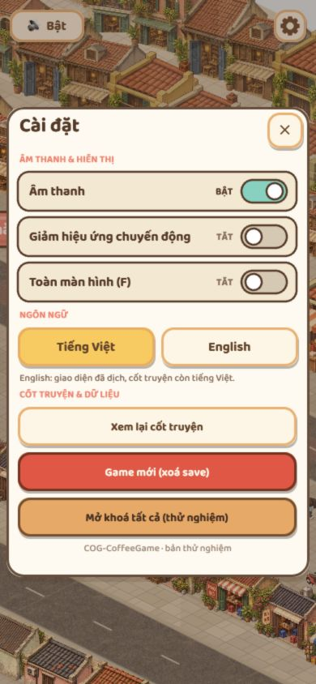

# Luồng6 — UI, camera và điều khiển

Ngày2026-10-29. T-105 Review triển khai, chưa được duyệt. Người dùng đã duyệt luồng5.

## Thay đổi

- Hủy joystick, cử chỉ, phím và đường chạm đi tới của màn đi bộ khi mở/đóng menu, resize, blur/ẩn tab hoặc pointercancel. Đóng menu cần thao tác mới để đi tiếp; không dùng lại input cũ.
- Chặn click thế giới/phím1–2 chọn câu trả lời khi đang mở menu hoặc khóa cốt truyện. Menu dừng simulation của màn phố/vườn; bộ đếm chuyển chương vẫn chạy bình thường khi không có modal.
- Modal giữ lớp chặn bấm và trạng thái mở cho tới hết hiệu ứng đóng, tránh chạm xuyên lúc bảng đang mờ đi.
- Joystick tránh safe area vật lý; safe area HUD đổi sang đơn vị đã chia scale, tránh lệch trên máy có tai thỏ/home bar.
- Thoại NPC/hero/cảnh báo giữ cỡ chữ theo màn hình khi camera nhìn xa. Không thay góc camera hoặc thêm zoom/kéo map.
- Timeout XHR tải asset15giây. Nếu file tải lỗi, hiện bảng cùng UI game, cho đóng để dùng hình tạm hoặc thử tải lại; URL thử lại bỏ fresh để không lặp xóa save. Không thay lựa chọn mute/blink/objective đã bỏ.
- Bảng duyệt sự cố vẫn chỉ trong DEV.

## Cần tự duyệt

- PC/phím và điện thoại dọc/ngang: kéo joystick rồi mở/đóng cài đặt, xoay máy, rời/quay lại tab; không tự bước tiếp hoặc chạy tới điểm cũ.
- Thoại quầy dài, hai lựa chọn: đọc được, bấm đúng, không che joystick; phím1–2 không chọn khi đang ở cài đặt.
- Đóng menu bằng X/chạm ngoài/ESC: không bước vào thế giới phía dưới.
- Thoại NPC, hero và cảnh báo ở mép màn: không bị cắt, không quá nhiều bóng thoại che nhau sau tăng cỡ chữ.
- Cứu hộ/chuyển S04 và xoay máy giữa cảnh: không mắc chuyển cảnh.
- Mạng chậm/file lỗi: hết thời gian chờ, thông báo hiện đủ, đóng dùng hình tạm và thử tải lại hoạt động.

## Bằng chứng và giới hạn

Đã đọc đường gọi và chạy git diff --check. Không chạy test/suite/typecheck/build theo yêu cầu người dùng tự test. Lượt đầu phiên CUA không khả dụng; lượt tiếp theo đã kết nối lại và mở game local5191. Đã xem390×844 và844×390, mở cài đặt, giữ Right khi menu đang mở, xoay dọc→ngang trong menu. Menu không tràn khung, bảng DEV đã ẩn khi menu mở. Console không có error tại lần đọc. Không coi việc sửa code là bằng chứng đã qua checklist; cần rà trực quan và điện thoại thật trước đóng T-105.

## Bổ sung trong lượt tiếp tục

- Chặn cả Enter/Space chuyển thoại khi mở modal (ngoài phím1–2 đã chặn).
- Bảng duyệt DEV ẩn khi mở modal, tránh che nút X/tiêu đề.
- Nhãn hazard nằm ngoài camera được ẩn, nhãn trong camera được giới hạn trong mép màn hình; tránh mẩu chữ cắt ở hai bên.

[Menu ngang sau xoay](../screenshots/flow6-settings-landscape.png).

Ảnh chứng minh bố cục menu, không chứng minh joystick/cảm ứng thật. Chưa đi hết thoại quầy/lựa chọn dài, chưa dựng lỗi mạng để kiểm nút thử lại, chưa kiểm rời tab giữa khiêng/chuyển chương hoặc tai thỏ thật. T-105 vẫn Review, chờ các mục này và người dùng duyệt; không tự đóng mốc.
