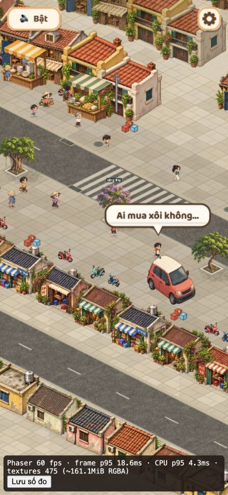

# Luồng8 — hiệu năng và gói bàn giao

2026-10-29. T-107 Review, chưa đóng. Người dùng đã duyệt luồng7, cho phép build/typecheck nhưng không chạy test; phạm vi xác nhận là web và Android. Chưa có model Android/OS/browser hoặc số đo từ thiết bị thật; iOS chưa được xác nhận hỗ trợ.

## Công cụ đo và tài nguyên

`?fps=1` nay đếm POST_RENDER của Phaser, không đếm browser requestAnimationFrame. Báo FPS theo cửa sổ1giây, p95/khoảng khung lớn nhất, số gap>50ms, thời gian CPU từ PRE_STEP đến POST_RENDER; đây không phải GPU time. Đếm texture và ước tính width×height×4, không phải VRAM thực, không bao gồm mipmap/driver/render target. JS heap chỉ có khi browser cung cấp. Khi ẩn tab reset cửa sổ đo, không gộp thời gian tab ẩn vào FPS chơi.

Nút **Lưu số đo** tải JSON: viewport/DPR/user-agent, entry module/production/renderer, thời điểm khung world đầu tiên, resource timing và tối đa600 mẫu1giây. Không tự gửi dữ liệu đi đâu. Lưu JSON trước khi reload vì buffer là trong phiên.

- [Kiểm kê38 WebP](chapter1-assets.json):6.612.854byte (~6,31MiB), nguồn RGBA82,16MiB trước các texture bake/UI/runtime. Đây là registry, không phải log request thực.
- Font Baloo2 còn tải từ Google Fonts; có fallback/giới hạn đợi2,5giây. Chưa xác nhận offline giữ đúng font. Không kết luận tải lạnh từ dung lượng ảnh.
- Bỏ vẽ sạn/crack nền đường native khi texture nhựa đã có; giữ nền màu và fallback khi texture thiếu. Lớp đó bị ảnh che kín nhưng trước đây vẫn dựng lặp theo chunk. Không giảm chất lượng art hoặc cắt NPC. Chưa profile riêng nên không quy mọi khựng khởi tạo cho lớp này hoặc tuyên bố mức tăng tốc từ nó.

## Bằng chứng desktop local

Browser IAB Chromium156, UA macOS, viewport1280×720/DPR2; không biết model CPU/GPU thật. localhost, không hạn chế mạng, chạy trong môi trường công cụ. Không thay bằng kết quả Android.

[Baseline dev](flow8-desktop-dev.json): gần60fps ở các mẫu ổn định, CPU p95 khoảng4,2–4,4ms; có gap khởi tạo1.828,7ms và gap chuyển S04 278,1ms. Khung world đầu khoảng3.221,8ms từ navigation. Không phải kiểm cache lạnh có kiểm soát.

[Baseline release trước sửa lỗi ảnh người dùng](flow8-desktop-release.json):169mẫu, resource transfer khoảng6,82MiB; khung world đầu4.108,2ms. Lúc đầu còn tab dev chạy song song nên kết quả thấp không dùng so sánh tốc độ dev/release. Sau đóng dev, lượt phố thứ hai ở khoảng90,6–113,8giây có23mẫu, median60fps/min52,2fps. Có khựng khởi tạo2.516,8ms và chuyển cảnh tới504,3ms trong toàn báo cáo, **chưa đạt điều kiện không khựng kéo dài một cách vô điều kiện**.

Texture ở S04 sau hai vòng khoảng204MiB RGBA; tăng lần đầu khi tải thêm nền/chương, không tự coi là leak. Chưa chạy soak dài để kết luận heap/texture không tăng liên tục. Các baseline trên thuộc bundle cũ trước sửa xe/NPC/bubble; không dùng chúng để chứng nhận bundle cuối.

## Sửa theo ảnh trong khi làm luồng8

- Xe đỗ chuyển vào vỉa hè y14, xe2 sang x29 để không che điểm bắt đầu hoặc chặn làn đi bộ chính. Collider dùng vị trí map mới cùng ảnh.
- Vào S03 đặt hero ở tâm đoạn phố (24,12), gồm chơi mới/replay/reload màn phố; không xóa lịch sử/sự cố. Không thay vị trí các chương sau.
- NPC kiểm đoạn đi qua vật cản, không chỉ ô đích; đường A* xét gốc cây/xe máy dựng. Tăng khoảng cách người, so le người đi hai làn; crowd chọn chỗ tránh người/điểm đã đặt. Đội cứu hộ cũng nhường người trên đường tới goal, giữ ngoại lệ tiếp xúc bệnh nhân khi khiêng.
- Chỉ hiện một NPC nói, ưu tiên hội thoại quầy/cứu hộ, không kéo lời của NPC ngoài camera vào giữa màn hình. Khi hero nói thì ẩn lời NPC khác. Tránh thẻ đè hero cả khi đứng; các thẻ tránh nhau, đường chỉ nối về đầu người nói nếu thẻ phải dịch.
- Đây là sửa gameplay/render sau các luồng đã duyệt; cần người dùng duyệt lại các vị trí gửi ảnh và cứu hộ, không kế thừa nguyên bằng chứng cũ.

## Gói release

`artifacts/cog-vertical-slice-web-2026-10-29.zip` gồm nội dung dist và manifest SHA256 từng file; file `.sha256` cạnh zip xác định đúng gói. Source PNG61MiB, screenshot, save và node_modules không nằm trong gói. Có entry JS khoảng1,91MB (gzip lý thuyết529KB); máy chủ phải bật gzip/Brotli để có lợi ích đó. ZIP không thay hosting, chưa deploy/push/commit.

Không mở index bằng file://. Giải nén vào static host tại root origin; đường asset là /assets. Bản local preview: `http://127.0.0.1:5192/`; thêm `?fps=1` khi lấy số đo, bỏ tham số khi chơi bình thường. Production không có bảng duyệt sự cố hoặc nút thử nghiệm.

## Android và nghiệm thu còn thiếu

1. Ghi model/Android/Chrome hoặc browser đang dùng, chế độ pin/nhiệt, loại mạng. Chỉ mở một tab game, đóng tab dev.
2. Kiểm bản release qua hosting hiện có hoặc LAN cùng Wi-Fi. Nếu tự chạy LAN: `npm run preview -- --host 0.0.0.0 --port 5193`, vào `http://<IP-máy-tính>:5193/?fps=1` trên Android. Không dùng127.0.0.1 trên điện thoại để trỏ máy tính. Dừng server khi xong.
3. Một lượt tải xóa cache qua công cụ trình duyệt và một lượt cache ấm; ghi thời gian/điều kiện riêng. Không coi transferSize0 là tải0byte qua mạng, vì có cache/giới hạn timing.
4. Đi phố1phút, nhóm sự cố, cứu hộ/vòng xoáy/S04; lưu JSON. Xoay dọc/ngang và rời/quay lại tab.
5. Xem lại cốt truyện3lượt trong cùng tab (không reload giữa lượt) để xem texture/heap có tăng không giới hạn. Lưu report rồi mới reload.
6. Mục tiêu đề xuất Android≥30fps, desktop gần60fps, không đứng hình kéo dài. Giữ các gap khởi tạo/chuyển cảnh trong báo cáo thay vì loại chúng để đẹp số. Chốt ngưỡng tải lạnh sau mạng tham chiếu, chưa đặt một con số thiếu căn cứ.

Typecheck và production build đã qua sau quyền người dùng. Không chạy unit/e2e. Luồng8 chưa thể Done khi thiếu số đo Android và kiểm lại các lỗi người dùng vừa báo; chưa chuyển sang đóng toàn bộ Vertical Slice.

## Kết quả cuối sau sửa ảnh người dùng

[Report bundle cuối](flow8-final-release-mobile-viewport.json) ghi entry `index-BG2D6wzT.js`, production=true, khung390×844/DPR1 trên desktop (không phải Android thật). Khung world đầu3.183,9ms;52mẫu phố và75mẫu S04 đều có median60fps. Vẫn có gap khởi tạo1.809,4ms và gap S04 tới263ms. Texture cuối phố162,5MiB RGBA, S04 202,2MiB; chưa kết luận leak từ một lượt. Không error console ở lần đọc cuối.

Đã nhìn thấy điểm vào giữa map/xe đỗ mới và cảnh cứu hộ tiếp tục sang S04 sau sửa nhường đường/né gốc cây. Không tái hiện toàn bộ vị trí người dùng có thể đi, không suy từ viewport dọc thành đạt Android.

[Cứu hộ sang S04 sau sửa](../screenshots/flow8-fixed-rescue-s04.png).

Gói ZIP/manifest đã tạo lại sau sửa; mã SHA256 trong file cạnh ZIP xác định gói cuối. Build/typecheck cuối qua; không chạy test, không deploy hoặc push. T-107 vẫn Review vì chưa có số đo Android và còn khoảng khựng khởi tạo cần người dùng đánh giá/tiếp tục xử lý trước nghiệm thu cuối.
